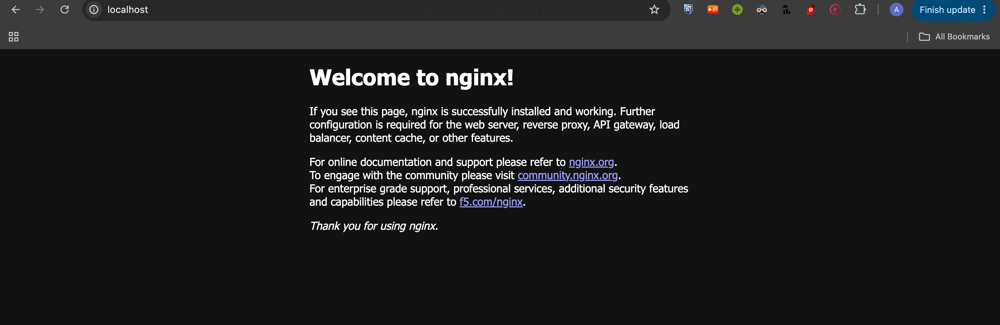
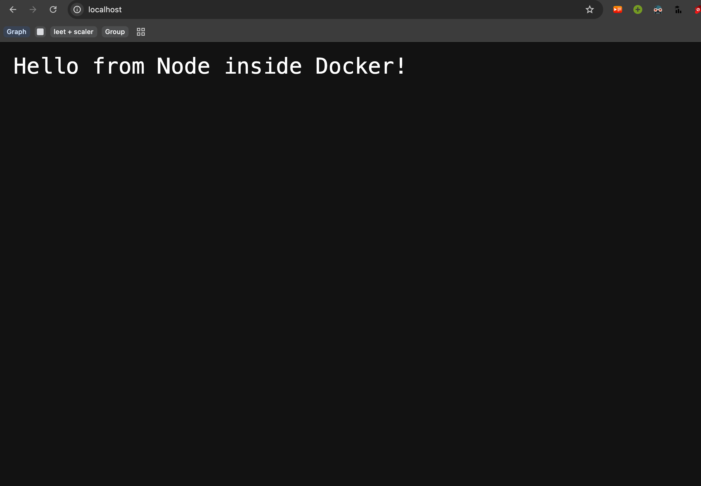
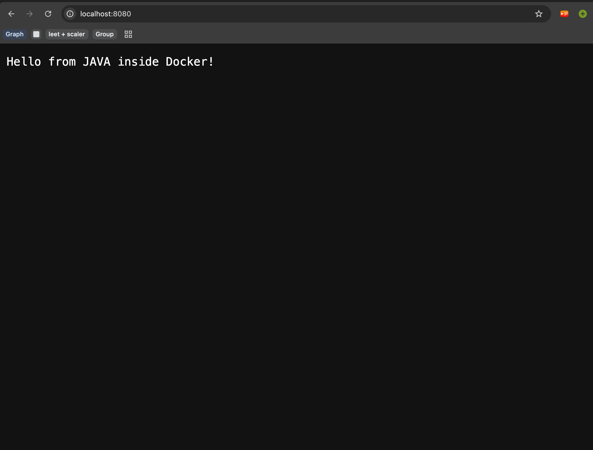
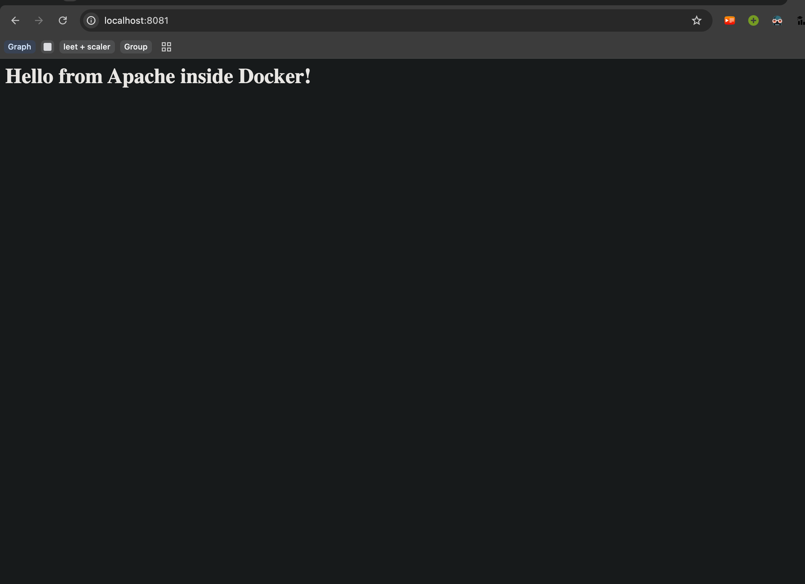

# DevOps & Cloud [SWE] — Class 6 Notes

**Lecture Title:** Docker Fundamentals
**Date/Time:** 21 August 2026, 09:30 AM
**Duration:** 120 minutes
**Instructor:** Nensi Ravaliya
**Big idea:** A Dockerfile is a recipe. An image is the packaged dish. A container is the dish actually being served.
**Sources:** this class's transcript + `Class-06/docker.md`, `Class-06/homework/` (written by you) + the instructor's repo [Nency-Ravaliya/devops-heros](https://github.com/Nency-Ravaliya/devops-heros) → `session6-7-docker/`

---

## 0. The 60-Second Version

1. **"It works on my machine" is the problem Docker was invented to kill.** Your Node 18 works; your friend's Node 20 doesn't. Same code, different laptop, broken build.
2. **A container is a *rented flat*. A VM is *your own house*.** The flat shares the building's water, power and security — that's why it's tiny and starts in seconds.
3. **Docker's architecture is client → daemon → registry.** You type a command (client), the **daemon** does the work, and if the image isn't local it pulls from a **registry** (Docker Hub).
4. **Image = blueprint (read-only). Container = running instance of that blueprint.**
5. **Dockerfile = the same commands you'd type on a server**, just written with Docker instructions.
6. **Every line in a Dockerfile creates a layer**, and layers get **cached** — which is why rebuilds are fast, and why the order of your lines matters.
7. **The lifecycle:** `build` → `run` → `stop` → `exited` → `rm`.
8. **Change your code and the running container won't update.** Images are read-only. You must **rebuild**.

---

## 1. Housekeeping

### What she'd uploaded

> 📚 *"I uploaded the networking resources and shell scripting — you can check that GitHub repo. For Git/GitHub also I created. I create session six."*

### Docker install check

> 🎤 *"Docker install hai, kiske paas Docker nahi hai abhi?"* — anyone who doesn't have Docker yet? Then: *"After installing Docker, check the version: `docker --version`. I have this version. You?"*

```bash
docker --version
```

### 😄 The `sudo` problem she asked about

> ⚠️ **If you're on Linux and every Docker command fails until you add `sudo`** — with a *"cannot connect to the Docker daemon"* error — that's normal on a fresh install.
>
> **The fix:** add your user to the **`docker` group**. (She mentioned it alongside the `.bashrc` environment file.)
>
> 💡 *"If you are a Windows user, maybe you are not facing this one."* It's a Linux-only rite of passage.

---

## 2. What We're Covering (The Docker Roadmap)

> 🗺️ **Her plan for Docker:**
>
> ```
> Docker architecture       ← must come first
>       ↓
> Docker IMAGE     ⭐ know this completely
> Docker CONTAINER ⭐ know this completely
>       ↓
> Docker VOLUME    (a bit advanced)
> Docker NETWORK
>       ↓
> Docker COMPOSE   — running multiple containers in one network
> ```

> 💡 **Why architecture first:** *"In Kubernetes and Docker, two things you need to learn first — why we need to use Docker (everything that we know), but **what exactly is the architecture**."* You'll do the same for Kubernetes later.

---

## 3. Why Docker Exists — Four Problems

She built this list with the class, then expanded it with her "Chai & Bites startup" example later (§7).

### Problem 1 — "It works on my machine" 🤷

> 🧠 **Picture this, and you've probably lived it.** You write code on your laptop. It runs perfectly. You push to GitHub. Your friend clones it, runs it, and:
>
> - *libraries are not installed*
> - *modules are not there*
> - *MongoDB / PostgreSQL connection isn't working*
>
> **Why?** *"You have Node.js **18** in your laptop and it's working fine. Your friend clones the repo and it's not working — because they have Node.js **20**, the latest version."*

> ⚠️ **Her interview warning about this exact answer:**
>
> *"If someone asks why you need to use Docker, **don't say 'it works on my machine'**. This is the thing interviewers know. This is the thing you also know. **Instead** tell them: dependency hell, complex deployment, inconsistent dev environments."*

### Problem 2 — Dependency hell 🔥

You need a *pile* of dependencies installed on the VM to run one app.

> 🎯 **The question that makes it click:** *"I'm running a Python or Node.js 17 application on one server. Can I ALSO run a Node.js 20 application with another website on the **same** server?"*
>
> ✅ **With Docker: yes.** *"One container I will use Node.js 17, other container I will use Node.js 20."* Two conflicting versions, one machine, zero conflict.

### Problem 3 — Complex deployment 🏗️

> 🧠 One full-stack app might be **5–6 frontend containers** and **7–8 backend containers**. How do you manage deploying all of that by hand? You don't.

### Problem 4 — Inconsistent environments 🌍

> 🔥 **This is the one she said you'll only truly understand once you're working:**
>
> *"Same application — maybe it's working in dev environment, it will **not** work in test, QA, UAT, SIT and prod. This is one issue you will face once you become a DevOps engineer. **If anyone worked on a live project, they know.** One application can work in the dev environment on some servers, and the same application, same code, same thing is not working on another server. **It happened.**"*

**Her concrete example:**

| Environment | Resources | Operating system |
|---|---|---|
| **Dev** | 13 GB memory, 16-core CPU | plain **Linux** |
| **Test** | same | **Amazon Linux** |
| **Production** | | **RHEL** (Red Hat Enterprise Linux) |

> ⚠️ *"Three of three are Linux — but our application is working here, not working here, and maybe works here or maybe not. That's the problem."*

### Bonus: CI/CD 🔄

> 💡 *"What if you're using a CI/CD pipeline **without** Docker? Every time, for a Node.js application, you need to build — `npm install`, you have to do the same thing every time."*
>
> **With Docker:** the pipeline builds the image automatically on every change, then deploys. *"CI/CD — the main major case."*

### The four use cases (she came back to these repeatedly)

| # | Use case | Note |
|---|---|---|
| 1 | **Deployment** | local + production |
| 2 | **Microservices** | frontend, backend, Java/Maven services — one container each |
| 3 | **Legacy applications** | *"You have old code, you don't want to touch the codebase, but you still want to migrate it."* |
| 4 | **CI/CD** | ⭐ the big one |

---

## 4. Container vs Virtual Machine

This is the classic interview question, and she gave two different explanations for it.

### 🧠 The rented-flat analogy (the best one)

> 🧠 **Virtual Machine = your OWN HOUSE.**
> You're the owner. You handle the **electricity bill**, the **gas**, the **Wi-Fi**, the **kitchen setup**, the **hall**, the **bedrooms** — everything. It's your land, your build, your responsibility.
>
> 🧠 **Container = a RENTED, FULLY-FURNISHED FLAT.**
> You don't handle **security** — the building owner does. You don't handle the **water supply** — the building does. You don't choose the electricity provider — you just **pay the bill**. Everything comes covered.
>
> **And here's the part that makes the technical point:** *"Whatever electricity you're getting, your neighbour is getting the same electricity. Whatever water supply you're getting, your neighbour gets the same. Same kitchen setup — because the flats are the same in a building. And you have your own hall. That's it."*
>
> ✅ **Translation:** containers **share** the host's OS kernel and resources. VMs each carry their **own full OS**. That's the whole difference, and everything else follows from it.

### The Oracle VirtualBox comparison

> 🧠 **You've probably done this already.** Windows laptop → install **Oracle VirtualBox** → run Ubuntu inside it. Or you dual-booted. Or you use **WSL** — *"it's just an instance of Linux that you are using."*
>
> ```
> VM approach:   Windows → HYPERVISOR (VirtualBox) → full Ubuntu OS → your app
> Container:     Windows/Linux → Docker → just your app + its dependencies
> ```
>
> The **hypervisor** is what lets one OS run other complete OSes on top of it. Containers skip that whole layer.

### The scale, in numbers

> 💡 Her framing: your VM might be **20 GB, 8 or 16 cores**. A container running one app inside it might use **0.1 or 0.5 of a core** (maybe 1 core for something big) and **1–2 GB** of memory.
>
> *"That means a small container that you are using to run your application."*

### 🎯 The comparison table (memorise this one)

| | **Virtual Machine** | **Container** |
|---|---|---|
| **Virtualisation** | full **own** operating system | **shares** the host OS, packages only dependencies |
| **Size** | big | small |
| **Resources** | its own CPU, memory, filesystem, networking | shared |
| **Speed to start** | slow — *"EC2 at least 30 seconds; Azure VM surely 2+ minutes"* | ⚡ **seconds** |
| **Has its own services?** | yes — Apache, nginx, whatever you install | no — *"we are only deploying our application, that's it"* |
| **Use it when** | you need your **own OS and whole separate infrastructure**, app doesn't need to talk to others | **microservices**, **legacy apps**, **CI/CD** |

> 🎯 **Interview alert:** *"This is a classic question in interviews — can you tell me the difference between a container and a virtual machine?"* The answer they want: **container is lightweight because it shares resources; a VM is a full machine with its own OS.**

### 💡 The bit of history nobody tells you

> 💡 *"Previously, containers **also existed** — but Docker made it simple. Maybe this statement you never heard anywhere. Containers were there, but we didn't know how to use them in a good manner to complete our task. **That's why Docker came into the picture.**"*
>
> ✅ Docker didn't invent containers. It made them usable.

---

## 5. Docker Architecture

> 🎯 **Interview alert:** *"In some interviews they ask: which type of architecture does Docker follow?"* → **Client–Server.**

```
┌─────────────┐   docker run / build / pull / ps
│   CLIENT    │  ─────── API call ──────┐
│ (you + CLI) │                         │
└─────────────┘                         ▼
                            ┌────────────────────────┐
                            │      DOCKER HOST       │
                            │  ┌──────────────────┐  │
                            │  │  DOCKER DAEMON   │  │ ← "the boss"
                            │  └──────────────────┘  │
                            │  Images · Containers   │
                            │  Volumes · Networks    │
                            └────────────────────────┘
                                        │  image not found locally?
                                        ▼
                            ┌────────────────────────┐
                            │   DOCKER REGISTRY      │
                            │   (Docker Hub)         │
                            └────────────────────────┘
```

### The pieces

| Component | What it is |
|---|---|
| **Docker Client** | **You.** Your terminal, typing `docker run`, `docker build`, `docker pull`, `docker ps` |
| **Docker Host** | The Docker you installed — on your laptop or a server |
| **Docker Daemon** | ⭐ *"The **heart** of Docker."* Every operation goes through it |
| **Docker Registry** | Where images live — **Docker Hub** by default |
| **Docker Objects** | **Image · Container · Volume · Network** |

> 🎤 **On the daemon:** *"Docker daemon is the **main boss**. Whatever he says — 'I want to pull this image' — then and only then can we pull it. Without Docker daemon you're not able to create a container, not able to create an image, you cannot perform **any** Docker-related operations."*

> 💡 **Where the official docs are:** she pointed to [docs.docker.com](https://docs.docker.com/get-started/docker-overview/) and said *"always prefer this documentation over any documentation."* Her backup for when the official docs read too dry: [GeeksforGeeks — Architecture of Docker](https://www.geeksforgeeks.org/devops/architecture-of-docker/).
>
> 📌 She also noted the official docs list only **image and container** as the objects, while GeeksforGeeks adds **volume and network** — *"they also did not add it"* — so remember **all four**.

---

## 6. Docker Registry

### 🧠 The Zepto analogy

> 🧠 **Picture this:** *"Docker registry is like a **grocery market — Zepto**. Inside Zepto you'll find everything you want. If you don't have milk or curd or anything in your kitchen, you're going to order it — or you'll go there and buy it."*
>
> ✅ **Docker Hub is the default grocery store for images.** Don't have nginx locally? Order it.

### Registries by cloud provider

| Provider | Service | Full name |
|---|---|---|
| **Docker** | **Docker Hub** | the free, default public registry |
| **AWS** | **ECR** | **E**lastic **C**ontainer **R**egistry |
| **Azure** | **ACR** | **A**zure **C**ontainer **R**egistry |
| **GCP** | **GCR** | Google's registry — *"maybe it will be GCR, I don't know"* 😄 |

> 💡 **Pattern spotted:** **E**CR, **A**CR, **G**CR. Same as EKS/AKS/GKE from Class 1. Cloud providers are nothing if not consistent.

### What she showed on her own Docker Hub

> 🎤 *"These are my Docker images — or you can say my projects."* Almost all **public**, with **one private** (an interview-related project from over a year ago).
>
> Images are **tagged** with versions — `v1`, `v2`, or whatever you choose. *"It's basically its version."*

> ✅ **Her one-line pitch for what an image really is:** *"It's like packaging the website in one simple file. **If I run this one file, I'm able to see my complete website.**"*

---

## 7. The "Chai & Bites Startup" — Docker, Retold

Halfway through she connected her iPad and walked through her own YouTube-series notes, which explain everything again through one running story. It's genuinely the clearest version, so here it is.

### The setup

> 🧠 **The startup:** *"Chai & Bites"* — you deliver **chai and snacks to corporate offices**. (Because that's what companies actually provide. ☕)

**Three developers building the app:**

| Dev | OS | Stack |
|---|---|---|
| **Developer 1** | Windows | Node.js 17, Java, Python, Postgres |
| **Developer 2** | **Mac** | Node.js 17, Java, Python |
| **Developer 3** | Windows | Node.js **latest**, Java, Python, Postgres |

> ⚠️ **And there's your Problem 1.** Dev 1's app works on Dev 1's laptop and breaks on Dev 2's — *"3.10 Python version he was using, and here they're using another Python version."*

### The services in the app

If you were building Zepto, what services would you need?

| Service | Job |
|---|---|
| **Order service** | takes the order |
| **Payment service** | cart → payment |
| **Notification service** | *"your order has arrived"* messages |

### 🍳 And now the architecture, as a kitchen

> 🧠 **This is the mapping she drew:**
>
> | Docker piece | Chai & Bites equivalent |
> |---|---|
> | **Docker Client** | **you** — the user, the chef placing the order |
> | **Docker Daemon** | 🍳 **the kitchen** — where every operation actually happens |
> | **Docker Host** | 🏢 **the building** the kitchen sits in |
> | **Docker Registry** | 🏪 **the warehouse** you buy all your ingredients from |
>
> *"That's how I narrated all this stuff."*

### ☕ And the Dockerfile, as a tea recipe

> 🧠 **To make tea, what do you need?**
>
> ```
> 1 cup of water
> 2 tbsp tea leaves
> 1 cup of milk
> 2 tbsp sugar
> boil for 5–10 minutes
> → tea
> ```
>
> ✅ **That recipe is the Dockerfile.** The finished tea is the **image**. Pouring a cup and serving it is the **container**.

---

## 8. Image vs Container

### 🧠 The blueprint explanation — built from something you already know

She got here by asking the class to describe deploying a Node app **manually** on a server:

```
1. SSH into the server
2. Install Node.js          ← because you're deploying Node
3. Install Git              ← because you need to clone
4. Install DB drivers       ← MongoDB Compass / connection string, etc.
5. git clone your project
6. npm install
7. npm run dev  (or npm start)
8. Open  http://<public-ip>:3000
```

> ✅ **Then the punchline:** *"The **same instructions** we did to deploy the application on the server — you put those instructions inside a **Dockerfile**. That's what we call the blueprint of your application."*

**The exact mapping:**

| Manual step | Dockerfile instruction |
|---|---|
| pick the server OS (Ubuntu) | `FROM ubuntu` |
| install dependencies | `RUN apt install ...` |
| get your code onto the box | `COPY . .` |
| decide which port it serves on | `EXPOSE 3000` |
| install project deps | `RUN npm install` |
| start the app | `CMD ["npm", "start"]` |

Then:

```bash
docker build -t myapp .     # recipe → image
```

### The formal definitions

| Term | Definition |
|---|---|
| **Docker image** | *"A **read-only template** or **blueprint** of your application."* |
| **Docker container** | *"A **running instance** of an image."* |

> 🧠 *"An image is not a running thing — it's just an image, like 256 bits of data, a SHA value. If you **run** that image, it becomes a container."*

### 🎯 The read-only gotcha she quizzed the class on

> 🎯 **The question:** *"You write a Dockerfile → build an image → run a container. Now you change something inside your code. **Will it reflect on the website? Why not?**"*
>
> ⚠️ **It will NOT reflect.** Because the image is a **read-only template**. Your `COPY` instruction baked a *snapshot* of the code into the image at build time.
>
> ✅ **The fix: rebuild.** `docker build` again, then run a new container.
>
> 💡 *"See — this is the thing, why we need to rebuild."* (Docker **volumes**, in Class 8, are the way around this during development.)

### 🎯 Two quick Q&As from the class

| Question | Answer |
|---|---|
| *"Can we have multiple images in one container?"* | ❌ **No.** One container = one image. |
| *"Can we create multiple containers from one Dockerfile?"* | ✅ **Yes**, absolutely. |

### 🎯 Dockerfile vs shell script — a sharp distinction

> 🎯 *"In a shell script, whatever commands we're running, the **same** commands we're putting in. But here, whatever commands you'd run to deploy your application on the server, we put the same commands **but with Docker instructions**."*
>
> ⚠️ **Because:** *"A Dockerfile only listens to **Docker instructions**, not the complete Linux command."* You must write `RUN`, `COPY`, `CMD` — you can't just paste a bash script in.

---

## 9. Where Images Come From — The Decision Tree

You captured this perfectly in your own `Class-06/docker.md`:

```
            DO I ALREADY HAVE THE IMAGE I NEED?
                        │
                 ┌──────┴──────┐
                YES            NO
                 │              │
                 ▼              ▼
           docker pull      docker build
                 │              │
                 │              ▼
                 │        create my image
                 │              │
                 └──────┬───────┘
                        ▼
                   docker run
                        │
                        ▼
                    Container
```

> ✅ **That diagram is the whole class in nine lines.** Two ways to get an image — **pull** someone else's, or **build** your own — and both roads end at `docker run`.

### The naming rule for Dockerfiles

```
Dockerfile        ✅  capital D, everything else lowercase
dockerfile        ❌
DockerFile        ❌
```

> 💡 **Advanced (mentioned, not required yet):** you *can* use `Dockerfile.build`, `Dockerfile.dev`, `Dockerfile.prod` for different environments. *"As of now, just think `Dockerfile` only."*

---

## 10. Walking the API Call — What `docker pull nginx` Actually Does

She traced this step by step, live.

```bash
docker pull nginx
```

```
1. You type the command
        ↓  this is an API CALL
2. Goes to the DOCKER DAEMON  ("the boss")
        ↓
3. Daemon checks: do I have this image locally?
        │
   ┌────┴────┐
  YES        NO
   │          ↓
   │      4. API call goes out to the DOCKER REGISTRY (Docker Hub)
   │          ↓
   │      5. Downloads the image
   │          ↓
   └──────► 6. Image is now in your local image list
                ↓
            7. docker run  →  CONTAINER
```

> 🎤 *"If I've ever run `docker pull nginx` before and didn't delete the image, it's present in my operating system — so the daemon says 'yeah, image is there, you can move forward.' If it's not there, it downloads it by default from Docker Hub."*

She ran it live and the class watched it pull from the library, then:

```bash
docker images     # → nginx   latest   ...
```

---

## 11. Docker Layers & Caching

### 🧠 The tiffin box analogy

> 🧠 **Picture this.** Chai & Bites also delivers **tiffins** to offices. Inside a tiffin: **rice**, **dal**, and **sabzi** — stacked in separate containers.
>
> - **Chef 1** cooks the rice
> - **Chef 2** cooks the dal
> - **Chef 3** cooks the sabzi
>
> Now the sabzi needs changing. **Do you re-cook the rice and dal?** No — *"I'll change the top container only. The two containers below, I will not touch."*
>
> ✅ **That's exactly how Docker layers and caching work.**

### The rule

> 🧠 **First — what a "layer" physically is.**
>
> A layer is **a saved set of file changes.** That's it. Docker runs one Dockerfile line, looks at what changed on disk, and saves *only the difference* as a read-only zip-like blob.
>
> ```
> FROM ubuntu:24        →  layer 1:  + /bin, /etc, /usr …      (the whole base OS)
> RUN apt install node  →  layer 2:  + /usr/bin/node           (only what apt added)
> COPY . .              →  layer 3:  + /app/server.js          (only your files)
> ```
>
> The final image is those layers **stacked and viewed as one filesystem** — like laying three sheets of tracing paper on top of each other and reading the combined picture. When your container writes a new file, it goes on a **fourth, writable layer** on top; the layers underneath stay untouched, which is exactly why the image is read-only.

> ✅ **Every single line in a Dockerfile creates one layer.**
>
> ```dockerfile
> FROM ubuntu:24        ← layer 1
> RUN apt install ...   ← layer 2
> COPY . .              ← layer 3
> EXPOSE 3000           ← layer 4
> CMD ["npm","start"]   ← layer 5
> ```
>
> Plus, on top, **a layer holding information about all the layers** — that's how Docker knows what's already cached.

### How caching plays out on a rebuild

```
Rebuild after changing only your source code:

layer 1  FROM ubuntu:24     → changed? NO  → ♻️ from cache
layer 2  RUN apt install    → changed? NO  → ♻️ from cache
layer 3  COPY . .           → changed? YES → 🔨 REBUILD
layer 4  EXPOSE             → 🔨 rebuilt (everything after a change rebuilds)
layer 5  CMD                → 🔨 rebuilt
```

> ⚠️ **The critical bit:** once one layer changes, **every layer after it rebuilds too.** That's why you put slow-changing things (base image, dependency installs) **early** and fast-changing things (your code) **late**.

### 🎯 Shared layers — a 2–4 year experience question

> 🎯 *"If you're a 2-to-4-years-of-experience person — or maybe a fresher, I don't know — they can ask: **what do you mean by a shared layer in Docker?**"*

```dockerfile
# Node.js app                    # Python app
FROM ubuntu:24        ←─ SAME ─→ FROM ubuntu:24
RUN apt install nodejs           RUN apt install python
COPY . .                         COPY . .
CMD ["npm","start"]              CMD ["python","app.py"]
```

> 🎯 **Her question to the class:** *"I build the Node app first. Then I build the Python app. Will it create layer 1 again — or use the same one?"*
>
> ✅ **It uses the same layer.** *"Because it's the same instruction, same to same."* Only the differing lines create new layers.

### The four facts she wrote on the board

> ✅ **Docker images, in four points:**
>
> 1. Docker images are made of **read-only layers**
> 2. **Each instruction** in a Dockerfile creates **a layer**
> 3. Docker **caches** layers
> 4. Layers are **shared across images** — which **saves storage**

---

## 12. Building & Running — The Live Nginx Demo

### The `docker build` command

```bash
docker build -t nginx-web-app .
#            │  │               └── build context: look for a Dockerfile HERE
#            │  └── the name/tag you're giving the image
#            └── -t = tag
```

> 💡 **What the `.` means:** *"Dot means it will search for the Dockerfile in your current repository."* Get your `pwd` right before you run this — she had to `cd` twice live because she was in the wrong folder. 😄

> ⚠️ **The `.` does one more thing nobody mentions, and it will bite you.**
>
> That dot is the **build context** — Docker **uploads the entire folder** to the daemon before it starts building, so `COPY` has something to copy from.
>
> ```
> docker build -t myapp .
>              │
>              └── "send EVERYTHING in this folder to the daemon"
>                    ↳ including node_modules/  (300 MB)
>                    ↳ including .git/          (200 MB of history)
>                    ↳ including your .env      ⚠️ secrets!
> ```
>
> ✅ **The fix is one file: `.dockerignore`.** Same idea as `.gitignore`, sitting next to your Dockerfile:
>
> ```
> node_modules
> .git
> .env
> *.log
> ```
>
> **Three things it buys you at once:** builds get dramatically faster, images get smaller, and secrets stop accidentally ending up inside your image.

### Her nginx Dockerfile

```dockerfile
FROM nginx:latest

COPY index.html /usr/share/nginx/html/index.html

EXPOSE 80

CMD ["nginx", "-g", "daemon off;"]
```

And `index.html`:

```html
<!DOCTYPE html>
<html>
<head><title>Hello Docker</title></head>
<body>
    <h1>Hello World from Nginx + Docker!</h1>
</body>
</html>
```

> ✅ **What the `COPY` line is doing:** `/usr/share/nginx/html/` is nginx's **default web root** inside the container. By copying your `index.html` there, you **replace** the default "Welcome to nginx" page with your own. That's the entire trick.

### The `docker run` command, flag by flag

```bash
docker run -it -d -p 8080:80 nginx:latest
```

| Flag | Means |
|---|---|
| **`-it`** | **interactive** mode. *"Without it you'll see the debug messages here."* |
| **`-d`** | **detached** — run in the **background**. *"If I remove `-d`, you can see all the logs of the container."* |
| **`-p 8080:80`** | **port mapping** ⭐ see below |
| `nginx:latest` | which image to run |

### 🎯 Which port is which?

```
-p  8080  :  80
    ↑        ↑
   HOST   CONTAINER
 (your      (inside
  laptop)    the box)
```

> 🎯 **Her quiz:** *"If I want to see this application on my laptop, which port do I use?"*
>
> - `-p 80:80` → open **`localhost:80`**
> - `-p 8080:80` → open **`localhost:8080`** ✅

> ✅ **Rule: the FIRST number is always yours.** It's the one you type in the browser.

### 😄 The live debugging session

Real problems, in order:

1. **`docker run` failed** — *"port is already allocated."*
2. She checked with `docker ps`, found the old container still on 8080.
3. **She'd forgotten her laptop password**, so couldn't do the thing she wanted 😄 — *"I forgot the password guys, what will I do now?"*
4. Solution: `docker stop <id>` then `docker rm <id>`. *"This is the command that takes a lot of time, `docker stop`."*
5. Re-ran → still saw the old page → *"oh, I'm refreshing it."* → **Hello World from Nginx and Docker!** 🎉

> ✅ **The lesson:** `port is already allocated` means something is *already* on that host port. `docker ps` → `docker stop` → `docker rm`, then try again.

### 😄 The Node app that didn't build

She then tried the Node.js app and it failed:

```
bin/bash: npm install did not complete successfully
```

> 🎯 **She turned it into a quiz:** *"Have you got the issue? What is the issue?"*
>
> ⚠️ **Answer: there was no code to install.** *"I did not add the code and the Node.js application — not a `package.json`, so nothing. In my Node.js application, at least I need to add my code, right?"*
>
> ✅ **`RUN npm install` needs a `package.json` to have been `COPY`'d in first.** For nginx she'd copied `index.html`; for Node she'd copied nothing. Same class of mistake, instantly visible.

**Her working Node app looks like this:**

```dockerfile
FROM node:24-alpine
WORKDIR /app
COPY package*.json ./     # ← copy deps manifest FIRST (better caching)
RUN npm install
COPY . .                  # ← then the code
EXPOSE 3000
CMD ["npm", "start"]
```

> 💡 **Notice the ordering trick:** `package*.json` is copied **before** the rest of the code. Change a line of app code and layers 1–4 stay cached — `npm install` doesn't re-run. That's §11's lesson applied.

---

## 13. Container Lifecycle

> ✅ **Why she says it matters:** *"If you understand this container lifecycle, then when some issue is there inside your application, you'll be able to get the **root cause** and resolve it."*

```
     Dockerfile
         │  docker build
         ▼
   ┌──────────┐
   │  IMAGE   │
   └──────────┘
         │  docker run
         ▼
   ┌──────────┐   docker stop    ┌───────────┐
   │ RUNNING  │ ───────────────► │  STOPPED  │
   └──────────┘                  │ / EXITED  │
         │  docker pause         └───────────┘
         ▼                             │  docker rm
   ┌──────────┐                        ▼
   │  PAUSED  │                  ┌───────────┐
   └──────────┘                  │  REMOVED  │
                                 └───────────┘
```

### The states

| State | How you get there | How you see it |
|---|---|---|
| **Image built** | `docker build -t name .` | `docker images` |
| **Running** | `docker run -it -d -p ...` | **`docker ps`** |
| **Paused** | `docker pause` | `docker ps` |
| **Stopped / Exited** | `docker stop <id>` | **`docker ps -a`** ⭐ |
| **Removed** | `docker rm <id>` | gone from `docker ps -a` entirely |

> ⚠️ **`docker ps` vs `docker ps -a` — the one that catches everyone:**
>
> - **`docker ps`** shows **only running** containers
> - **`docker ps -a`** shows **all** — running, stopped, exited
>
> *"If you want to see which container is stopped or exited, or something happened with your website — `ps -a`, to see all the running and stopped containers."* Her stopped nginx showed up as *"Exited about a minute ago."*

### What `docker ps` actually shows you

| Column | Meaning |
|---|---|
| **CONTAINER ID** | what you copy for `stop` / `rm` |
| **IMAGE** | which image it came from |
| **COMMAND** | its entrypoint |
| **STATUS** | *"Up 2 minutes"* / *"Exited 5 minutes ago"* |
| **PORTS** | e.g. `0.0.0.0:8080->80/tcp` — the forwarding you set up |

### 💀 PID 1 — the heart of a container

> ⚠️ **A fact worth knowing:** *"Whenever any container is created, the first PID will be created — **PID 1**. **PID 1 is the heart of the container.** If you kill that PID 1 — `kill 1` — then the container will crash. That's so simple."*
>
> ✅ **This is why containers exit when their main process ends.** A container isn't a machine that stays up; it's a **process wrapper**. When PID 1 dies, the container dies. That's why `CMD ["nginx", "-g", "daemon off;"]` matters — `daemon off` keeps nginx in the **foreground** as PID 1 instead of forking away and letting the container exit.

---

## 14. Dockerfile Instructions — The Full Reference

She went through every one and then quizzed the class on them.

### `FROM` — the base image

```dockerfile
FROM node:21
FROM ubuntu:24
FROM nginx:latest
```

> ✅ **What it does:** sets the **base image** for your container — *"the base layer."*

**On tags:**

> 🎯 **Her question:** *"For every image, if you're not specifying any tag — what happens?"*
>
> ✅ **It defaults to `latest`.** *"When you run `docker pull nginx`, by default it's pulling `nginx:latest`."*

**Tag variants worth knowing:**

| Tag | Means |
|---|---|
| `node:24` | Node 24, full image |
| `node:24-alpine` | ⭐ **Alpine** — a tiny Linux base. *"Alpine means you are using less resources."* |
| `nginx:latest` | the default |

> 💡 **The three flavours you'll see on almost every official image — and which to pick.**
>
> | Tag | Base | Rough size | Use when |
> |---|---|---|---|
> | `node:24` | full Debian | **~1.1 GB** | you need to compile things, or debug inside the container |
> | `node:24-slim` | trimmed Debian | ~250 MB | a sensible middle ground |
> | **`node:24-alpine`** | Alpine Linux | **~50 MB** | ⭐ production — smallest, fewest packages, so **fewest vulnerabilities** |
>
> ⚠️ **The one Alpine gotcha:** Alpine uses a different C library (`musl`, not `glibc`), so a handful of packages with compiled native code fail to build on it. If `npm install` or `pip install` breaks mysteriously on Alpine and works on `-slim`, that's why.
>
> ✅ **And notice the security angle:** a smaller base has less software in it, so Trivy (Class 1 §7) has less to find. "Small image" and "secure image" are mostly the same sentence.

> ⚠️ *"But you need to check the tag on **Docker Hub**. If the tag is not there, you're not able to pull it."*

### `WORKDIR` — the working directory

```dockerfile
WORKDIR /app
```

> 🧠 **In Chai & Bites terms: `WORKDIR` is the kitchen.** It's the folder inside the image where all the work happens.
>
> 💡 `/app` isn't magic — *"you can give any folder name, but this is the standard folder name that we are using."*

### `COPY` — local → container

```dockerfile
COPY package*.json ./     # copy just the deps manifest
COPY . .                  # copy EVERYTHING from here into WORKDIR
```

> ✅ Two arguments: **source** and **destination**. `COPY . .` = *"whatever is inside my directory where I'm running this command, copy everything and paste it inside the `/app` directory."*

### `RUN` — run a command at BUILD time

```dockerfile
RUN npm install
RUN apt install python3 pip3
```

### `ENV` — environment variables

```dockerfile
ENV NODE_ENV=production
#   └ name ┘ └ value ┘
```

> 💡 *"We are not using it right now, but you need to learn this command."*

### `EXPOSE` — declare the port

```dockerfile
EXPOSE 3000
```

### `ARG` — build-time argument

```dockerfile
ARG NODE_VERSION=20
```

> 💡 *"What if you want to use Node 20 while deploying your website? At that time, if you want to give a runtime argument, you can use `ARG`."*

### `CMD` — the start command

```dockerfile
CMD ["npm", "start"]
CMD ["python3", "app.py"]
```

### `ENTRYPOINT` — the start command that can't be overridden

```dockerfile
ENTRYPOINT ["npm", "start"]
```

### 🎯 CMD vs ENTRYPOINT — THE Docker interview question

> 🎯 *"There are two questions in interviews they're asking. What is the difference between CMD and ENTRYPOINT?"*

| | **CMD** | **ENTRYPOINT** |
|---|---|---|
| Can be overridden at run time? | ✅ **Yes** | ❌ **No** |
| Behaviour | a **default** you can replace | *"Whenever my container is created, started, or restarted — **always** it will execute this command."* |

**How the override actually looks:**

```bash
# Dockerfile has:  CMD ["npm", "start"]

docker run -it -d myimage npm run build
#                          └──────────────┘
#              this REPLACES npm start
```

> ✅ **The one-liner to remember:** *"ENTRYPOINT cannot be overridden. CMD can be overwritten."*
>
> 🔥 **Her emphasis:** *"Make sure this question will be in your assessment — I'm telling you, these are the main questions of Docker-related interviews."*

### 🎯 COPY vs ADD — the other one

| | **COPY** | **ADD** |
|---|---|---|
| Copy local files → container | ✅ | ✅ |
| Download from a **URL** | ❌ | ✅ |
| Auto-**extract** archives | ❌ | ✅ (zip, tar, RPM) |

> ✅ *"What if I want to copy one zip file from Google Drive? At that time we need to use `ADD`. **ADD is COPY, plus** downloading a zip/archive/RPM file from the internet — and it will automatically download it and unzip it inside the container."*
>
> 💡 **Rule of thumb (industry standard):** use **`COPY`** unless you specifically need `ADD`'s download/extract behaviour. `COPY` is more predictable.

### 🎮 The end-of-class rapid-fire

She fired every instruction at the teams:

| Instruction | Team's answer |
|---|---|
| `FROM` | base image ✅ |
| `WORKDIR` | *"a standard directory inside a container where we add our code"* ✅ |
| `COPY` | source → destination ✅ |
| `ADD` | *"external resources we can add"* ✅ |
| `RUN` | *"to run commands like `npm install`, whatever installation command"* ✅ |
| `CMD` | *"execute a command"* ✅ |
| CMD vs ENTRYPOINT | *"ENTRYPOINT cannot be overridden, CMD can"* ✅ |

---

## 15. In-Class Tasks & The Wall of Applause

### Task 1 (10 minutes)

> 📝 Create a folder in DevOps Heroes with: a **`docker.md`**, a **`Dockerfile`**, and the shared resources. Then run the basic image commands.

### Task 2 — deploy your first container

> 📝 **`docker pull nginx` → `docker run` → open it in the browser → screenshot → put it in an `.md` file → push → ping the repo.**
>
> ```bash
> docker pull nginx        # 1. get the image
> docker images            # 2. confirm it's there
> docker run -it -d -p 80:80 nginx:latest    # 3. run it
> # 4. open http://localhost:80  →  the nginx welcome page
> ```

**Your proof-of-work screenshot** (`Class-06/image.png`) — `localhost`, the default nginx page:



> ✅ **What that page actually proves:** the image pulled, the container started, PID 1 (nginx) stayed in the foreground, and the port mapping `80:80` carried the request from your browser into the container. Four things at once.

### 😄 The applause section

This part of the class is genuinely lovely, so it stays in:

> 😄 As screenshots came in, she went one by one:
>
> - *"I can see who is this screenshot — nice. **You know the concept of `--name`?** Good."*
> - *"Nice. **Clap for her, really.** So this is your **first website that you deployed.** I'll tell you how to deploy the next website."*
> - *"Improvement — nice **username**."* … *"Ayush. Nice. Good. **Clap for him, guys. First website.**"*
> - *"Okay, who is this? 8080. Good."*
> - *"It's like that election in Vidhan Sabha, it's like this."* 😄
> - *"**I am so happy today.**"*
>
> One student attached a **Dockerfile** screenshot for a task that only needed `docker run`: *"Why are you adding this screenshot for a Dockerfile? It's not the same Dockerfile, right? You did the Docker normally, `docker run`. Okay, fine — but this is also a good thing. Have you run this Dockerfile, by the way? Error?"*

> 💡 **The `--name` flag** she praised a student for finding:
>
> ```bash
> docker run -d --name my-nginx -p 80:80 nginx
> ```
>
> Without it, Docker gives your container a random name like `elegant_goldberg`. With it, you can `docker stop my-nginx` instead of copying container IDs.

> ✅ **Her warning about the pace from here on:** *"From today onwards, the **real DevOps** has started. You'll get more assignments, more homework. If you're learning Docker for the first time, it will be very, very tough. **I recommend you learn each concept twice and thrice.**"*

---

## 16. 📝 Homework — Four Apps, Four Dockerfiles

> 📝 **The assignment:** build and containerise **four** simple applications, each in its own folder in your DevOps Heroes repo, each with **its own code + its own Dockerfile**.
>
> | Folder | App |
> |---|---|
> | `node-app/` | **Node.js** |
> | `python-app/` | **Python** |
> | `java-app/` | **Java** |
> | `apache-app/` | **Apache** |
>
> 💡 **She kept the bar low on the app itself:** *"I'm okay with just 'hello world' on the website. Just hello world in an `<h1>`. That's okay — **but I need the same website.**"*

### ✅ Your submissions — `Class-06/homework/`

You did all four. Here they are with what each one teaches.

**🐍 Python** — `homework/python/`

```dockerfile
FROM python:3.13
COPY app.py .
CMD ["python", "app.py"]
```

```python
from http.server import HTTPServer, BaseHTTPRequestHandler

class Server(BaseHTTPRequestHandler):
    def do_GET(self):
        message = "Hello from Python!"
        self.send_response(200)
        self.send_header("Content-type", "text/plain")
        self.end_headers()
        self.wfile.write(message.encode())

server = HTTPServer(("0.0.0.0", 80), Server)
print("Python server running on port 80")
server.serve_forever()
```

> ✅ **Good instinct: binding to `0.0.0.0`, not `127.0.0.1`.** Inside a container, `127.0.0.1` means "only this container" — port mapping would never reach it. `0.0.0.0` means "listen on all interfaces", which is what makes `-p 8080:80` work. This trips up a *lot* of people.

**🟩 Node** — `homework/node/`

```dockerfile
FROM node
COPY server.js .
CMD ["node", "server.js"]
```

```javascript
const http = require("http");
const server = http.createServer((req, res) => {
    res.end("Hello from Node inside Docker!");
});
server.listen(80);
```

> 💡 **Nice touch:** using Node's built-in `http` module means **no `package.json` and no `npm install`** — so no dependency layer at all. Minimal and correct.
>
> ⚠️ **One improvement:** `FROM node` with no tag pulls `node:latest`, which changes over time. Pin it — `FROM node:24-alpine` — for reproducible builds *and* a much smaller image.

**☕ Java** — `homework/java/`

```dockerfile
FROM eclipse-temurin:21
COPY Main.java .
RUN javac Main.java
CMD ["java", "Main"]
```

```java
HttpServer server = HttpServer.create(new InetSocketAddress(81), 0);
server.createContext("/", exchange -> {
    String response = "Hello from JAVA inside Docker!";
    exchange.sendResponseHeaders(200, response.length());
    exchange.getResponseBody().write(response.getBytes());
    exchange.close();
});
server.start();
System.out.println("Hello, Im craving Java Chip from Starbucks. Pls someone get me");
```

> ✅ **This one shows off `RUN` properly:** `RUN javac Main.java` **compiles at build time**, so the image ships a compiled `.class`, not source. That's exactly the `RUN` vs `CMD` distinction — build-time work vs run-time work.
>
> 📌 Note it listens on port **81**, not 80 — so map it as `-p 8081:81`.
>
> 😄 And the Starbucks log line is a fine use of `System.out.println`.

**🪶 Apache** — `homework/apache/`

```dockerfile
FROM httpd:latest
COPY index.html /usr/local/apache2/htdocs/
```

```html
<h1>Hello from Apache inside Docker!</h1>
```

> ✅ **And your own comment in that file is the best insight in the whole homework:**
>
> *"You do not need a `CMD` here. The `httpd:2.4` image already has a default command/entrypoint that starts Apache when the container starts. So don't add something like `CMD ["apache2"]` unnecessarily."*
>
> *"Apache is different from your previous Java program. **Your Java program was your own code**, so you had to create `HttpServer`, call `server.start()`, and make sure it kept running."*
>
> ✅ **That's exactly right, and it's the PID-1 rule from §13 in practice.** A base image built to be a server (`httpd`, `nginx`) already has a foreground process defined. Your own code doesn't — so *you* have to provide one that stays running.

> 💡 **Path check:** nginx serves from `/usr/share/nginx/html/`; Apache serves from `/usr/local/apache2/htdocs/`. Different web root per image — always check the image's docs on Docker Hub.

### 📸 Your proof screenshots

All three saved in `backup/` — the browser, served from your own containers:

**Node** (`backup/node/node.png`) — port 80:



**Java** (`backup/java/java.png`) — port 81:



**Apache** (`backup/apache/apache.png`):



> 💡 **`backup/` is your *earlier, tidier* attempt** — worth comparing, because those Dockerfiles add something the `homework/` versions dropped:
>
> ```dockerfile
> # backup/node/Dockerfile        # Class-06/homework/node/Dockerfile
> FROM node                       FROM node
> WORKDIR /app          ← this    COPY server.js .
> COPY server.js .                CMD ["node", "server.js"]
> CMD ["node", "server.js"]
> ```
>
> ✅ **Keep the `WORKDIR`.** Without it your code lands in `/` — mixed in with `bin`, `etc`, `usr` and the rest of the OS. It still runs, but `docker exec` in and you'll be hunting for your own files. `WORKDIR /app` puts them in one obvious place, which is why every official example uses it.

---

## 17. Cheat-Sheet

### Commands from `Class-06/docker.md` (your file)

```bash
docker pull nginx              # 1. get an image
docker images                  # 2. list local images
docker image inspect nginx     # 3. full JSON detail about an image
docker tag nginx mynginx:v1    # 4. give it another name/tag
docker rmi nginx               # 5. remove an image
docker image prune             # 6. clean up dangling images
docker run -it -d -p 80:80 nginx   # run it
```

### Everything else

| Command | Does |
|---|---|
| `docker --version` | check the install |
| **`docker pull <image>`** | download an image from a registry |
| **`docker images`** | list local images |
| **`docker build -t <name> .`** | build an image from the Dockerfile in `.` |
| **`docker run -it -d -p H:C <image>`** | create + start a container |
| `docker run --name <n> ...` | give the container a readable name |
| **`docker ps`** | list **running** containers |
| **`docker ps -a`** | list **all** containers (incl. exited) |
| `docker stop <id>` | stop a container |
| `docker start <id>` | start a stopped one |
| `docker restart <id>` | restart |
| `docker pause <id>` | pause |
| **`docker rm <id>`** | remove a container |
| `docker rmi <image>` | remove an image |
| `docker exec ...` | get inside a running container *(Class 7)* |
| `docker tag  <new>` | re-tag an image |
| `docker image inspect ` | full image metadata |
| `docker image prune` | delete dangling images |

### 🧹 Bulk cleanup (from her `docker.md`)

```bash
docker stop $(docker ps -q)        # stop ALL running containers
#             └ -q gives just the IDs

docker rm $(docker ps -aq)         # remove ALL containers
#            └ -aq = all IDs, including stopped

docker rm -f $(docker ps -aq)      # stop AND remove, in one go

docker rmi $(docker images -q)     # remove ALL images
docker rmi -f $(docker images -q)  # force-remove ALL images

docker system prune -a             # ⭐ the full nuclear cleanup
```

> ⚠️ **`docker system prune -a` deletes every unused image, container, network and build cache.** Great for reclaiming disk. Terrible if you wanted that image and don't fancy re-downloading 2 GB.

### `docker run` flags

| Flag | Means |
|---|---|
| `-it` | interactive |
| `-d` | detached (background) |
| `-p HOST:CONTAINER` | port mapping — **first number is yours** |
| `--name <name>` | name the container |

### Dockerfile instructions

| Instruction | Does |
|---|---|
| `FROM` | base image (+ tag; defaults to `latest`) |
| `WORKDIR` | working directory inside the image |
| `COPY src dst` | copy local files in |
| `ADD src dst` | COPY **+** download URLs / auto-extract archives |
| `RUN` | run a command at **build** time |
| `ENV k=v` | environment variable |
| `ARG k=v` | build-time argument |
| `EXPOSE port` | declare the port |
| `CMD [...]` | start command — **can** be overridden |
| `ENTRYPOINT [...]` | start command — **cannot** be overridden |

### Concepts

| Term | Means |
|---|---|
| **Image** | read-only **blueprint** of your app |
| **Container** | a **running instance** of an image |
| **Dockerfile** | the **recipe** — instructions to build an image |
| **Layer** | one Dockerfile line = one layer |
| **Shared layer** | identical instructions reuse the same cached layer across images |
| **Docker daemon** | the boss — performs every operation |
| **Docker host** | the machine Docker runs on |
| **Docker client** | you + the CLI |
| **Registry** | where images live — Docker Hub / ECR / ACR / GCR |
| **Hypervisor** | what lets a VM run a full guest OS (VirtualBox, etc.) |
| **PID 1** | the container's main process — kill it and the container dies |
| **Alpine** | a minimal base image — smaller, fewer resources |

---

## 18. Coming Next

| Topic | Note |
|---|---|
| **Multi-stage builds** | *"How we can add multiple Dockerfiles inside one Dockerfile."* → **Class 7** |
| **Multi-container** | ⚠️ *"Multi-stage is a different thing, multi-container is a different thing. **Two different topics.**"* |
| **Image optimisation** | *"Also a good concept — you'll see it in the YouTube video."* |
| **Volumes & networks** | → **Class 8** |
| **Docker Compose** | → **Class 9** |

She also mentioned she has a **YouTube series** on Docker (5 videos in at the time), and shared **PDFs** in the repo: `docker-basic-cmd.pdf`, `docker-advance-cmd.pdf`, and `docker-interview-qa.pdf`.

---

## 19. Notes on the Transcript Itself

- **Instructor name:** the header credits *"Ritesh Prajapati"* — that's the **Scaler++ Chrome extension's developer**, not the teacher. The instructor is **Nensi Ravaliya** ([@Nency-Ravaliya](https://github.com/Nency-Ravaliya)).
- This recording is heavily interleaved with **Ukrainian, Portuguese, Indonesian and Hindi** fragments — transcription artifacts. Two Portuguese stretches carried real content and are folded in above: the *"if it's an nginx image it creates an nginx container"* explanation (§8) and an early mention of building **two apps (Node + nginx) and a docker-compose file** (which lands properly in Class 9).
- A stray *"Samsung Galaxy A7s screen replacement"* and *"Jangan lupa like, share, dan subscribe"* are the transcription tool bleeding in from unrelated audio. Not class content.
- Garbled terms corrected: **"demon" → daemon**, **"docker pool" → `docker pull`**, **"docker compost" → docker compose**, **"talker" → Docker**, **"cube when it is" → Kubernetes**, **"Seabornkit generator" → an image on her Docker Hub**, **"Greek for rix / Geek4Geeks" → GeeksforGeeks**, **"hyphen it / hyphen id" → `-it`**, **"hyphen D" → `-d`**, **"hyphen T" → `-t`**, **"sabzi dal rice / daba" → the tiffin analogy (§11)**, **"post step" → paused state**, **"vito brapo" → DevOps Heroes repo**, **"hashi cop" → HashiCorp**.
- Two moments where the class debugged her live are kept in full because they're more instructive than a working demo: the **"port is already allocated"** failure (§12) and the **`npm install` failing with no `package.json`** (§12).
