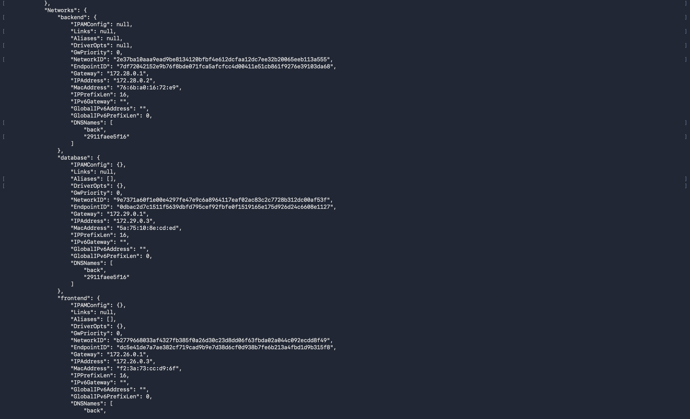
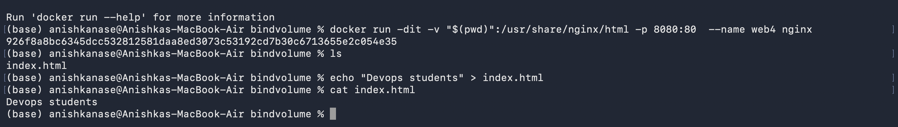

# DevOps & Cloud [SWE] — Class 8 Notes

**Lecture Title:** Docker Networking & Volumes
**Date/Time:** 27 August 2026, 2:00 PM
**Duration:** 120 minutes
**Instructor:** Nensi Ravaliya
**Big idea:** Networks decide **who can talk to whom**. Volumes decide **what survives** when a container dies.
**Sources:** this class's transcript + your screenshots (`Class-08/connectBackend.png`, `bindvolume.png`) + the instructor's repo [Nency-Ravaliya/devops-heros](https://github.com/Nency-Ravaliya/devops-heros) → `session8-docker-networking-volume/`

---

## 0. The 60-Second Version

1. **`EXPOSE` and `-p` are NOT the same thing.** `EXPOSE` is documentation. `-p` is what actually forwards traffic from your laptop into the container.
2. **Four network types:** **bridge** (default, private, needs `-p`) · **host** (shares your laptop's network, no `-p` needed) · **none** (isolated, can't reach anything) · **overlay** (spans multiple Docker hosts).
3. **Default bridge ≠ user-defined bridge.** In a network *you* create, containers can ping each other **by name**. On the default bridge, you must use IP addresses. That's the whole reason to create your own.
4. **Two different networks = two containers that cannot talk.** That's how you keep the frontend away from the database.
5. **One container can join multiple networks** — which is exactly how the backend talks to both the frontend and the DB.
6. **Delete a container and its data is gone.** Unless you used a volume.
7. **Volume = Docker-managed storage** that outlives containers. **Bind mount = a folder on your laptop** wired into the container.
8. **Bind mounts give you live editing.** Change a file on your laptop → it changes inside the running container instantly. No rebuild.

---

## 1. Recap Round

She opened with the usual team relay: *"Just tell me the topic name that we learned in the last two sessions."*

| Team | What they named |
|---|---|
| A | *"Docker lifecycle"* — ⚠️ corrected: **container** lifecycle, not Docker lifecycle |
| B | **Docker architecture** |
| | **Docker commands** |
| | **Multi-stage Dockerfile** |
| | **Docker images**, **registry** |

> 😄 **On Docker Hub accounts:** *"You have a Docker Hub account by the way — hopefully? Now? Okay. **Any genius person who did not install Docker yet? Any genius is there? Then keep your geniusness to yourself, don't tell us.**"* 😄

### The daemon, again

> 🎤 *"Docker daemon — by the way, **no one** told me Docker daemon is also something we learned. What is the main task of Docker daemon?"*
>
> Student: *"Managing the containers."* ✅
>
> *"Docker daemon is the **boss** in Docker. You can say the **heart** of Docker. **If there's no Docker daemon, there's no Docker host, and there's no Docker at all.**"*

**And PID 1, once more:** *"It's the first process when we create a container. If we kill that process, the container will crash. Surely."*

### The four objects — two down, two to go

```
Docker objects:
  ✅ Docker images     ← Class 6, 7
  ✅ Docker containers ← Class 6, 7
  ⬜ Docker volumes    ← TODAY
  ⬜ Docker networks   ← TODAY
```

**Today's map:**

```
NETWORKS — 4 drivers / 4 types      VOLUMES — 2 types
  1. bridge   (default)               1. volume (Docker-managed)
  2. host                             2. bind mount
  3. none
  4. overlay
```

### 🎯 The goal for the whole class, stated up front

> 🧠 **The scenario she wants you to be able to build:**
>
> ```
>  frontend  ←→  backend  ←→  database (MySQL)
>      ✅            ✅
>
>  frontend  ─╳─────────────→  database
>              NOT ALLOWED
> ```
>
> *"My frontend only connects with the backend, and my backend only connects with the database. But my frontend is **not able to connect directly with the database**. That's what we have to implement."*
>
> ✅ **Why that matters:** if your frontend can reach the database directly, then anyone who compromises your frontend can reach your database directly too. Network isolation *is* security.

---

## 2. `EXPOSE` vs `-p` — Clearing Up The Biggest Confusion

> 🎯 **Her question:** *"In a Dockerfile we expose a port, right? `EXPOSE 80`, `EXPOSE 3000`. So do you really think they are **exposing** the port, or are they doing **port mapping**?"*
>
> ⚠️ **They are different things.** *"Port mapping is a different thing. Exposing a port is a different thing. **If you're just writing `EXPOSE 80`, that doesn't mean you're able to see your website on port 8080.**"*

| | **`EXPOSE 80`** (Dockerfile) | **`-p 8080:80`** (docker run) |
|---|---|---|
| What it is | **documentation** — "this app listens on 80" | **actual traffic forwarding** |
| Does it open anything? | ❌ no | ✅ yes |
| Who reads it | humans, and other tooling | the Docker daemon |

### 🧠 Why port mapping is needed at all

> 🧠 **Picture this.** *"My laptop's network is different. And Docker has **its own private, internal network** — a default network. So every time we've created a container in the last two or three sessions, the default driver we've been using is the **bridge network**."*
>
> ```
>  YOUR LAPTOP                        DOCKER'S PRIVATE NETWORK
>  ┌───────────────┐                  ┌──────────────────────┐
>  │  browser      │                  │  container           │
>  │  localhost:8080 ──── -p ────────►│  port 80             │
>  └───────────────┘   the "interface"└──────────────────────┘
> ```
>
> ✅ *"Because of that private network, I have to explicitly say `-p 80:80` — so it does the port mapping from the **container port** to my **host network's port**."*

> ✅ **The one-line test she gave, and it's a good one:**
>
> **If you need `-p`, it's a bridge network. If you don't, it's a host network.**

---

## 3. The Four Network Types

### 1️⃣ Bridge — the default 🌉

| | |
|---|---|
| **What it is** | a **private / internal** network Docker creates for you |
| **Is it the default?** | ✅ yes — every container you've made so far used it |
| **Needs `-p`?** | ✅ yes |
| **Use it for** | microservices, local deployment, testing |

> 🧠 **The key structural fact:** *"In bridge network, between your laptop (your host machine) and your container, we have an **interface**. Because of that private network we're not able to directly see our website on port 80."*

### 2️⃣ Host — share the laptop's network 🏠

| | |
|---|---|
| **What it is** | the container uses **your machine's network directly** |
| **Interface between them?** | ❌ **none** |
| **Needs `-p`?** | ❌ **no** — the ports are already yours |
| **Use it for** | when you want **maximum availability** and don't need extra security layers |

> ✅ *"In host network, whatever port your container is using, it's **shared with your host network**. There is no interface between your container and your host machine."*
>
> 🎤 **Her example of when to use it:** *"A frontend we deploy in a host network. Why? Because we know there's a website, we have to click on it, and I just want to see the website. I don't want an extra layer of security. If I search google.com I just need to see google.com."*

```bash
docker run -dit --network host nginx
# → open localhost:80 directly. No -p anywhere.
```

### 3️⃣ None — total isolation 🚫

> 😄 **Her explanation of the name:** *"Any idea why the name is **none**? **Because someone likes to be alone. That's why.** In containers also, some containers like to be alone."*

| | |
|---|---|
| **What it is** | the container has **no network access at all** |
| **Can it reach google.com?** | ❌ no |
| **Can other containers reach it?** | ❌ *"only you know the IP of the container, that's it"* |
| **Use it for** | a container that must not talk to anything |

> 💡 **Real example she gave:** *"Some containers — like **sidecar containers**, if you know Kubernetes. Some containers we don't want to interact with any other container."*

### 4️⃣ Overlay — networks across multiple Docker hosts 🌐

This is the advanced one, and she built up to it carefully.

> 🎯 **The setup:** *"Right now in my laptop I have **one** Docker host, one Docker daemon. In your laptop, you also have your Docker host and your Docker daemon. What if my frontend container is on **my** Docker host and the backend containers are on **your** laptop's Docker host — and I want to connect them?"*

**Two laptops on a campus is easy enough with private IPs. But scale it up:**

> 🧠 **The Zepto / Amazon question:** *"Do you think their application is on only **one** server? No, right? Millions of lines of code. You can't say 'we have a 50 GB server and our code is inside that server.' **They're using microservices** — maybe the payment code is in this server, the frontend code in another server, notification microservices in another server."*
>
> *"So one application, with all its components on different servers, and still it's working. **Don't tell me we're using an API — I know we're using an API. But how are they connecting?** With the help of Docker, with the help of Kubernetes."*
>
> ✅ *"Their Docker host — which we call a **remote Docker host** — and another server's remote Docker host, they're connecting with each other and sharing information. **Not even just data or code files — they're actually exchanging the images.**"*

| | |
|---|---|
| **What it is** | one network spanning **multiple Docker hosts** |
| **Scope** | **global** (the other three are **local**) |
| **Use it for** | complex, multi-server deployments |

> 🧠 **Her latency/caching aside — the Zepto recommendation story:**
>
> *"If I order milk and curd on Monday, and again Thursday I open Zepto and search — **milk will appear.** Why? It's not just a recommendation system… In the backend it's the **daemon and the Docker host**. Somehow they're managing caching from one server. There's a frontend container running, some code changes are inside that container, and **still we're not getting any latency.**"*
>
> *"The way you're getting the recommendation system from any website — **that is not just AI, it's basically a DevOps concept too.** It's caching, and it's Docker hosts connecting to each other: the cart application, the payment application, the notification application, all talking."*
>
> 🔍 **Worth holding loosely:** the *"recommendations come from Docker hosts"* framing is her intuition rather than a precise mechanism — real recommendation systems run on data pipelines and ML services. But the underlying point is completely sound and is the thing to take away: **a modern app is many services on many machines, and something has to let them find and talk to each other with low latency.** Overlay networking is one of the pieces that makes that possible.

> ⚠️ **Her own difficulty rating:** *"Overlay network is a bit complex — advanced level. The three networks you learned are very very easy once you're okay with the commands. But overlay… it's like a subject of networking in itself. It's a very big subject."*

### 📋 The summary table

| Network | Default? | Needs `-p`? | Scope | Use for |
|---|---|---|---|---|
| **bridge** | ✅ | ✅ yes | local | microservices, local deployment, testing |
| **host** | | ❌ no | local | max availability, no extra security layer |
| **none** | | n/a | local | isolated containers |
| **overlay** | | | **global** | multiple Docker hosts |

---

## 4. Network Commands

```bash
docker network ls                      # list all networks
docker network create <name>           # create one (defaults to bridge driver)
docker network inspect <name>          # what's inside this network?
docker inspect <container>             # which network is this container on?
docker network connect <net> <container>      # add a container to a network
docker network disconnect <net> <container>   # remove it
docker network rm <name>               # delete a network
docker network prune                   # delete all unused networks
```

> 💡 **The pattern she pointed out:** `docker images` → `docker network ls` → `docker volume ls`. *"One keyword is just added."* Same for `create`, `inspect`, `rm`, `prune` across networks and volumes.

### Reading `docker network ls`

| Column | What it is |
|---|---|
| **NETWORK ID** | like a container ID |
| **NAME** | `bridge`, `host`, `none`, and anything you create |
| **DRIVER** | `bridge`, `host`, `null` |
| **SCOPE** | `local` — or **`global`** for overlay |

> 💡 **"Driver" just means "which implementation to use."** Docker's networking is pluggable: the `bridge` driver builds a private virtual switch, the `host` driver skips networking entirely and hands over your machine's, the `overlay` driver adds encryption and cross-machine routing. Same `docker network create` command, completely different machinery underneath — you pick with `--driver`.

> ⚠️ **Her warning about `none`:** *"Don't tell me the **none** network is using a **none driver** — none is not a driver. It's not using any driver, that's why we call it a none network."*
>
> 🔍 **Tiny precision note:** `docker network ls` actually prints **`null`** in the DRIVER column for the `none` network — there *is* a driver, and its name is literally "null" (i.e. "do nothing"). Her point stands completely: no real networking is attached. Just don't be surprised by the word `null` on your screen.

> 💡 **A network you didn't create:** she had one called **`kind`** — *"Kind is a Kubernetes cluster I'm running locally, so it automatically creates a network named `kind`."* Tools create their own networks.

### Creating one

```bash
docker network create my-network
docker network ls        # → my-network   bridge   local
```

> ✅ **No driver specified → bridge is the default.** *"If I don't mention any driver, it will take bridge as the default driver."*
>
> 💡 **You can go further:** `--subnet` and `--gateway` let you pick the IP range explicitly. *"We just created a default network — we didn't mention externally which IP address, which gateway you want to use. You can mention both if you want to change that."*

### Attaching a container to it

```bash
docker run -dit -p 8081:80 --network my-network --name web nginx
#                          └────────┬────────┘
#                     this flag does the joining
```

> 💡 **A small syntax note she made:** `-dit` is just `-d -i -t` mashed together. *"One student asked me, why are you writing `dit`? I'm telling you, `-d -i -t` and `-dit` are equal."*
>
> ⚠️ **But don't add `p` to that cluster** — `-ditp` won't work the way you'd hope, because `-p` takes a value. *"`-p` has the value, port mapping. We cannot add `-ditp`."*

---

## 5. 🔑 Default Bridge vs User-Defined Bridge

This is the single most important distinction in the class.

> 🎤 *"Two concepts are there. One is the **default bridge network**, and one is the **user-defined bridge network**. What we did as `my-network` — that's a user-defined bridge network."*

### The difference that actually matters: DNS

| | **Default bridge** | **User-defined bridge** |
|---|---|---|
| How you get it | automatic | `docker network create` |
| Ping another container **by name**? | ❌ **no** — you must use its **IP** | ✅ **yes** |
| DNS resolution | manual | ⭐ **automatic** |

> ✅ **Her explanation:** *"If you're using a user-defined bridge network, then DNS-to-IP resolution is done **automatically**. But with the default bridge network you **cannot** directly ping `web1` — you have to ping by **IP address**. It will not resolve your IP address from your DNS."*

> 🧠 **And the insight that makes it click:**
>
> *"**`web1` — the name of the container — is actually the DNS. Nothing else.** The name of the container, the `--name` we're giving, that's actually the DNS."*
>
> ```bash
> docker run -dit --name db --network my-net mysql:8.0
> docker run -dit --name backend --network my-net alpine
>
> # from inside backend:
> ping db          # ✅ works — "db" resolves, because it's a user-defined network
> ```
>
> ✅ *"So if I tell my backend container 'ping the database container' — **I'm not going to ping by IP, I'm going to ping by the name of the container.**"* Which means your app config can say `host="database"` instead of a hardcoded IP that changes on every restart.

> 💡 **Look at the real app in her repo** — `demo/backend/app.py` does exactly this:
>
> ```python
> return mysql.connector.connect(
>     host="database",      # ← the container NAME, not an IP
>     user="root",
>     password="root",
>     database="demo"
> )
> ```

---

## 6. Hands-On — Container-to-Container Communication

### ⚠️ First: use Alpine, not nginx

She tried to `ping` from inside an nginx container and it failed:

```
ping: not found
curl: not found
```

> ⚠️ **Why:** the nginx image is deliberately minimal — no `ping`, no `curl`. *"Alpine, we need to use this image."*
>
> ✅ *"**Guys, don't use nginx — nginx doesn't have the ping command by default inside its container. Use the Alpine image.**"*

```bash
docker pull alpine
```

> 💡 **Alpine is also tiny** — a few MB. *"Alpine is like less MB, that's why."*

### The walkthrough

```bash
# 1. create a user-defined network
docker network create my-network

# 2. two containers inside it (no -p needed, they only talk to each other)
docker run -dit --network my-network --name web  alpine
docker run -dit --network my-network --name web1 alpine

# 3. get inside the first one — note: 'sh', not 'bash' (Alpine has no bash)
docker exec -it <web-container-id> sh

# 4. ping the other one BY NAME
ping web1
```

**Result:** *"Can you see containers are talking with each other? **Zero packet loss** means all the requests I'm sending from my `web` to my `web1` container — I'm able to connect."*

**And the reverse works too** — she had the class ping `web` from `web1`.

**And the outside world:**

```bash
ping google.com     # ✅ works from a bridge network
```

> ✅ *"Same practice we'll do with the none network, and you'll get to know: from other networks we're able to connect with Google or Scaler or any website, **but from a none network you are not able to**."*

> 📌 **Two small gotchas from the live demo:** use **`sh`** not `bash` inside Alpine, and if `ping` isn't found you're in the wrong image.

---

## 7. Checking A Container's Network — `docker inspect`

> 🎯 **The question that motivates it:** *"Every time I can't just add `--network` and remember. **How will I get to know which network this container is running on?**"*

```bash
docker inspect <container-id-or-name>
```

**Two places to look in that JSON:**

| Field | Shows |
|---|---|
| **`NetworkMode`** | the network name — `bridge`, `host`, `my-network`, `none` |
| **`Networks`** *(under NetworkSettings)* | full detail: IP, gateway, MAC, DNS names |

### The experiment she ran live

```bash
# container WITHOUT --network
docker run -dit -p 8080:80 nginx
docker inspect <id>          # → "NetworkMode": "bridge"        ← default

# container WITH --network my-network
docker run -dit --network my-network --name web alpine
docker inspect web           # → "NetworkMode": "my-network"    ← yours
```

> ✅ *"When you use a defined bridge network, you're able to see NetworkMode and your **new network name**. If you didn't specify any network, you see the default one — **bridge**."*

She checked understanding: *"How many of you are able to see? 1, 2, 3, 4, 5. Good."*

### To see it from the network's side instead

```bash
docker network inspect my-network     # which containers are IN this network?
```

---

## 8. Isolation — Two Networks, No Conversation

> 🎯 **The problem she posed:** *"In the default bridge network, **every container can talk with each other**, every container can ping each other. So the frontend would also be able to reach the database container. **How can we build a big wall between these two containers so they cannot talk?**"*
>
> ✅ **Answer: user-defined networks.**

```bash
docker network create net1
docker network create net2

docker run -dit --network net1 --name c1 alpine
docker run -dit --network net2 --name c2 alpine

docker exec -it c1 sh
ping c2        # ❌ bad address — they cannot see each other
```

> ✅ **And that failure is the success:** *"If you're **not** able to ping two containers — **that means this is what we want**, right? In two different networks you're not able to ping each other. Each network works as a private, internal network with private IPs, so they're not able to connect."*

> ⚠️ **Naming matters here:** *"Make sure to give a name to your container. If you're not giving the name, then you have to use the ID — **which is not good practice.**"*

---

## 9. One Container, Multiple Networks

> 🎯 **The obvious follow-up:** *"Then why separate the containers, if we're going to put one container in different networks anyway?"*
>
> ✅ **Because the backend genuinely needs both sides:**
>
> ```
>    frontend_net              backend_net
>  ┌──────────────┐         ┌──────────────┐
>  │   frontend   │         │   database   │
>  └──────┬───────┘         └──────┬───────┘
>         │                        │
>         └────────► backend ◄─────┘
>                (in BOTH networks)
>
>  frontend ─╳─► database     ← still blocked ✅
> ```
>
> 🎤 *"What is the work of the backend? Take the query, the API call, from the frontend container. Then get the data from the database container. And then give it back to the frontend user. **That's what happens on a website** — I fill a form (frontend), the data goes to the backend, the query goes to the database, and then my user details are updated in the database."*

### How to do it

**Option 1 — at creation time:**

```bash
docker run -dit --network net1 --name backend alpine
```

**Option 2 — connect an existing container:**

```bash
docker network connect    net2 backend     # ✅ add it to a second network
docker network disconnect net2 backend     # remove it again
```

### The student/teacher demo

She had the class name the networks:

```bash
docker network create students
docker network create teacher          # 😄 "Teacher. Good one."

docker run -dit --name web1 --network students alpine

docker network connect teacher web1

docker inspect web1
# → Networks: { "students": {...}, "teacher": {...} }   ✅ both
```

> ✅ *"See — there are two networks. One container is inside the students network **and** the teacher network. **One container can be inside two networks.**"*

### 📸 Your homework result

This is `Class-08/connectBackend.png` — your `docker inspect` on the backend container:



**What that JSON is telling you:**

| Network | Gateway | The container's IP |
|---|---|---|
| **backend** | `172.28.0.1` | `172.28.0.2` |
| **database** | `172.29.0.1` | `172.29.0.3` |
| **frontend** | `172.26.0.1` | `172.26.0.3` |

> 💡 **How to read those numbers — Class 4's subnetting, showing up for real.**
>
> Every Docker network is a **private subnet** carved out of the `172.16.0.0/12` range (one of the three private ranges from Class 4 §6). Docker hands each new network the next free `/16`:
>
> ```
>  network "frontend"   172.26.0.0/16
>       ├── 172.26.0.1   ← the GATEWAY: Docker's virtual router for this network
>       ├── 172.26.0.2      (whatever joined first)
>       └── 172.26.0.3   ← your backend container
>
>  network "backend"    172.28.0.0/16     ← a completely separate subnet
>  network "database"   172.29.0.0/16     ← and another
> ```
>
> ✅ **And the isolation is now visible as arithmetic.** A container on `172.26.x.x` has no route to `172.29.x.x` — different subnets, and no router between them. That's not a Docker rule bolted on top; **it's ordinary IP networking doing the work.**
>
> 💡 `.0.1` is always the gateway — the address a container sends traffic to when it wants to leave its own network. Same role as your home router's `192.168.1.1`.

> ✅ **This is exactly the homework, and it's correct.** One container (`back`), **three separate networks**, three separate IP addresses, three separate gateways — each network is its own isolated `/16` subnet (`IPPrefixLen: 16`).
>
> 💡 **The detail worth noticing:** the **`DNSNames`** array on each network lists `"back"` and the container ID. *That* is the automatic DNS resolution from §5, visible in the JSON. Any container on any of those three networks can reach this one by typing `back`. And a container on **only** the `frontend` network still can't reach one on **only** the `database` network — which was the entire point.

---

## 10. Hands-On — Host Network (And Why It Broke)

```bash
docker run -dit --network host nginx
# no -p at all
docker ps        # → nginx running on port 80
```

Then open **`localhost:80`**.

### 😄 The live failure

It didn't work on her Mac. It *did* work for some students.

> 😄 *"I'm not able to see. Why? …It's up. It was working in the morning… **My laptop is not working, your laptop is working. What? How? I don't know.** …Maybe Mac issues."*
>
> Then: *"So it's 50-50. If you're able to see the nginx page — good. **If you're not getting it, don't worry, it's not your fault. It's your laptop's fault completely.** …Create a server and then do it, because on a server the IP address will surely work."*

> 🔍 **Simplified, because "it's your laptop's fault" leaves you with the wrong mental model — and this one is worth knowing properly:**
>
> **`--network host` genuinely does not work the normal way on Docker Desktop for Mac or Windows.** Here's why: on Linux, Docker runs containers directly on your machine, so "host network" means *your* network. On **Mac and Windows, Docker Desktop runs a hidden Linux virtual machine**, and containers run inside *that*. So `--network host` gives the container the **VM's** network — not your laptop's. `localhost:80` on your Mac is looking at your Mac, and nothing is listening there.
>
> ✅ **So:** host networking behaves exactly as she taught it **on Linux** (and therefore on every real server, which is where it matters). On a Mac, use bridge + `-p`, or test host networking on an EC2 instance. Her advice — *"create a server and then do it"* — is the right fix; the reason is the VM, not the browser.

**She also had them verify with `curl`:**

```bash
curl localhost
```

**And confirmed the network exists:**

```bash
docker network ls      # → host   host   local
```

> ✅ *"If you're getting `host` in your `network ls`, that means the network was created and your container was added to it."*

---

## 11. Hands-On — None Network

```bash
docker run -dit --network none --name web alpine
docker exec -it <id> sh

pwd          # ✅ works
ls           # ✅ works
ping google.com
# ❌ ping: bad address 'google.com'
```

> ✅ **That error is the feature.** The container has no route to anything. Compare with §6, where the same `ping google.com` worked fine from a bridge network.

### 📝 The task

> 📝 Run a container on the **none** network, `exec` in, try `ping google.com`, screenshot the failure, put it in an `.md` file, push, and ping the repo.

She reviewed submissions live: *"docker run -dit --network none --name web alpine → docker ps → copy the ID → `sh` → `pwd` → ping → done. **Perfect. Good one.**"*

---

## 12. 💎 The Bulk-Stop Command

She shared this as the highlight of her resources file.

```bash
docker stop $(docker ps -q)
```

### How it works, step by step

> 🎤 *"I used to do this when ChatGPT was launched — I was just curious how to stop all containers at once. **I don't want to paste the ID.**"*

```
docker ps          → full table: ID, image, command, uptime, status, ports, names
docker ps -q       → JUST the container IDs, one per line
$( ... )           → run that first, paste its output here     ← command substitution!
docker stop <all those IDs>
```

> ✅ **You've seen `$( )` before** — it's the exact **command substitution** from Class 3's `current_date=$(date)`. Same mechanism, applied to Docker.

### The full family

```bash
docker stop $(docker ps -q)      # stop everything running
docker rm   $(docker ps -aq)     # remove every container
docker rm -f $(docker ps -aq)    # stop AND remove, in one go
docker rmi  $(docker images -q)  # remove every image
```

> 😄 **Her philosophy:** *"I'm lazy, guys, so I will not write all the copy commands again. I'll just do smart work. **Lazy people are smart, by the way — my personal belief. Because they're just finding a way not to do it, or how to do it in a manner where I won't have to.**"*
>
> 📌 She didn't run it herself: *"I will not run it, because my **Kubernetes cluster** will be down."* Fair.

---

## 13. Docker Volumes — Why You Need Them

### First, what's a volume?

> 🎤 *"Volume means **storage**. But what do I want to store in Docker? It's a very lightweight container. What do I want to store?"*
>
> Room: *"Database."* ✅

> 🧠 **Picture this.** *"Your website is there. Someone logs in through the landing page. When you sign up — if you do a **Google sign-up**, your name, email address and photo get updated in their website. If you sign up **manually**, it asks your name, mobile number, email ID, maybe age. **They're putting all of it inside a database, and that database we need to maintain.** At that time we need storage."*

### 🧪 The demo that proves the problem

This was the best sequence of the class. Follow it exactly.

**Step 1 — create a container and put a file in it:**

```bash
docker run -dit --name data1 alpine
docker exec -it <id> sh

echo "hello students" > data.txt
cat data.txt        # → hello students
pwd                 # → /
exit
```

**Step 2 — stop it and restart it. Is the file still there?**

```bash
docker stop <id>
docker start <id>
docker exec -it <id> sh
cat data.txt        # ✅ → hello students   — STILL THERE
```

> ✅ *"That's what I just wanted to confirm."* Stopping and restarting **preserves** data.

**Step 3 — now DELETE the container and make a new one:**

```bash
docker stop <id> && docker rm <id>
docker run -dit --name data2 alpine
docker exec -it <id> sh
ls                  # ❌ no data.txt
cat data.txt        # ❌ nothing
```

> ⚠️ **Gone.** *"Why? The container got deleted. They're totally two different containers. **There is no mechanism to share data between two containers.** We know they can communicate with each other, we can ping each other — but there's nothing that shares the data."*

> ✅ **The precise lesson:**
>
> | Action | Data survives? |
> |---|---|
> | `docker stop` → `docker start` | ✅ yes |
> | `docker rm` → new container | ❌ **no** |
>
> **And this is why volumes exist.**

### The volume commands

```bash
docker volume create my-data      # create
docker volume ls                  # list
docker volume inspect my-data     # detail
docker volume rm my-data          # delete
docker volume prune               # delete unused
```

> 💡 **Same pattern as networks, again:** `create` / `ls` / `inspect` / `rm` / `prune`.

### 🧪 Now the same demo, WITH a volume

```bash
docker volume create my-data

# -v <volume-name>:<path-inside-container>
docker run -dit -v my-data:/data --name c1 alpine
docker exec -it <id> sh

cd /data
echo "hello students" > data.txt
ls                  # → data.txt
exit
```

**Now delete that container entirely and make a fresh one with the same volume:**

```bash
docker stop <id> && docker rm <id>

docker run -dit -v my-data:/data --name web alpine
docker exec -it <id> sh

cd /data
ls                  # ✅ data.txt
cat data.txt        # ✅ hello students
```

> 🎉 *"**This is the magic of Docker volume.** Even after deleting the container, I'm able to see my file inside another container. **That's how frontend, backend and DB are working.**"*

### The `-v` syntax

```
-v  my-data  :  /data
    └──┬───┘    └──┬─┘
    volume name   path INSIDE the container where it gets mounted
```

> 📌 **A small live puzzle:** she saw a `message.txt` inside the volume that she hadn't created. *"It's a default file, we did not create it."* Probably an artifact of the environment — noted, not resolved. Don't be alarmed if you see something similar.

---

## 14. Bind Mounts — The Live-Editing Superpower

### The question that leads there

> 🎯 *"What if I **delete the volume itself** — am I able to recover that data? **No.** So there's another type of volume that we have: **bind mount**."*

### 🧠 What a bind mount is

> 🧠 **In plain terms:** *"You're binding **your laptop's folder** to a container. If the container is deleted, **nothing changes inside your folder** — your folder is still there on your laptop. That means your data is saved."*

| | **Volume** | **Bind mount** |
|---|---|---|
| Where the data lives | **Docker manages it** (somewhere internal) | **a folder on your laptop** you choose |
| Syntax | `-v my-data:/data` | `-v "$(pwd)":/path/in/container` |
| Survives container deletion | ✅ | ✅ |
| Survives *volume* deletion | ❌ | ✅ (it's just your folder) |
| **Live editing** | not really | ⭐ **yes** |

### 🎯 The thing that seems to break the rules

> 🎯 **Her setup — and it's a genuinely good hook:** *"You'll tell me that a Docker image is a **read-only template**, so how can we reflect our latest content into our container, into our website? Don't you have that question? A Docker image is an **immutable** object, right?"*
>
> *"Your container is running, nginx inside, 'Hello World' printed on port 80. And **what if I tell you that without even stopping the container, without even creating a new image, you can still change that Hello World content on your website?**"*
>
> ✅ **That's a bind mount.** The image is still immutable — you're not changing the image at all. You're pointing a path *inside* the container at a folder *outside* it, so the container reads your live files instead of the baked-in ones.

### 🧪 The live demo

```bash
mkdir bindvolume
cd bindvolume
echo "hello students" > index.html

docker run -dit \
  -v "$(pwd)":/usr/share/nginx/html \
  -p 8080:80 \
  --name web4 nginx
```

Open **`localhost:8080`** → **hello students** 🎉

**Then — without touching the container at all:**

```bash
echo "Devops students" > index.html
cat index.html        # → Devops students
```

**Refresh the browser** → **Devops students**

> 🎉 *"**Without even stopping the container, I'm able to reflect whatever I updated in my `index.html`. This is the magic of bind mount.**"*

### Why `$(pwd)` and not just the folder name

> ✅ *"`pwd` will resolve via the `$` symbol to my **current working directory**. Because we need to give a **complete path**. If I give just `bindvolume`, **Docker will not understand where my volume is in my laptop.**"*
>
> ```bash
> -v bindvolume:/usr/share/nginx/html      # ❌ Docker reads this as a VOLUME NAME
> -v "$(pwd)":/usr/share/nginx/html        # ✅ absolute path → bind mount
> ```
>
> ⚠️ **That's not a style preference — it changes the meaning.** A `-v` source with no `/` is treated as a named volume; a source that's an absolute path is treated as a bind mount.

### 📸 Your run of it

This is `bindvolume.png` from the repo root:



```bash
docker run -dit -v "$(pwd)":/usr/share/nginx/html -p 8080:80 --name web4 nginx
# → 926f8a8bc6345dcc532812581daa8ed3073c53192cd7b30c6713655e2c054e35
ls                                    # → index.html
echo "Devops students" > index.html
cat index.html                        # → Devops students
```

> ✅ **That's the exercise done correctly** — quoted `"$(pwd)"`, the right nginx web root, a named container, and then the live edit. Refreshing `localhost:8080` at that point shows the new text with no rebuild, no restart.
>
> 💡 **This is the single most practical thing in the class.** It's how you develop against a container: mount your source folder in, edit in your editor, refresh the browser. No `docker build` loop.

> 😄 **Her reaction to the class getting it:** *"Can you do the same thing I did now? **If you're able to do it, literally I will clap for everyone.** Okay? Then — nice, good. Yeah, I will clap."*
>
> 😄 And on her own typo: *"Forgive me if my spellings are weird. **Student spelling is wrong, I know.**"*

---

## 15. 📝 Homework

| # | Task |
|---|---|
| 1 | 🌉 **The three-tier network exercise.** Create three containers — `frontend` (nginx), `backend` (nginx/alpine), `db` (**MySQL image** from Docker Hub). Create **three networks**. Put the **backend in two networks**. Then **check connectivity** of each one. |
| 2 | 🪶 **Apache on the host network.** Same as the nginx host-network demo, but with the **`httpd`** image — see the Apache page on port 80 with no `-p`. |
| 3 | 🌐 **Read about overlay networks.** *"The operations we performed on three networks — can you do the same with overlay? Right now you can't, because you only have your own laptop. So just read about it."* |
| 4 | 📸 Screenshot the **bind-mount** demo (the terminal **and** the browser) into your README — *"this one is the toughest task of today"* |
| 5 | 📸 Screenshot the **none-network** ping failure |
| 6 | 📸 Screenshot **container-to-container ping** in a user-defined bridge network |

> ⚠️ **The threat:** *"This Saturday–Sunday I'm going to check all of your repositories and your code. **If I find that someone is not doing their homework, then next session I'll take him here and he will do it** — and we will see. I will be seated there and they will do it. **This is a better punishment.**"* 😄

> 📌 **Why overlay has to wait:** *"Two friends could ping via overlay network, but it will be very difficult because you **do have a private IP address**. For that case we'll have a demo when we have a **server** — we'll create two servers, create two Docker hosts, and then connect an overlay network."*

---

## 16. Her Own Recap Quiz

She closed with a rapid-fire round:

| Question | Answer |
|---|---|
| Which networks did we learn? | **bridge · host · none · overlay** |
| Which is the **default**? | **bridge** |
| Can containers ping each other in a bridge network? | ✅ **yes** |
| In a **none** network, can we reach an external website? | ❌ **no** — *"none network we're using to isolate the container"* |
| What is **host** network doing? | sharing your host OS's network — *"run nginx without `-p` and it's on port 80 in your browser"* |
| In **bridge**, what must you specify? | **`-p`** — port forwarding |
| How to check which network a container is on? | **`docker inspect <container>`** |
| Which **two** fields to look at? | **`NetworkMode`** and the **`Networks`** block |
| When do we use **overlay**? | **multiple Docker hosts** |
| How many types of volume? | **two — volume and bind mount** |
| Command to create a volume? | `docker volume create <name>` |
| Command to inspect a volume? | `docker volume inspect <name>` |
| Command to remove a network / volume? | `docker network rm <name>` / `docker volume rm <name>` |
| How to connect a container to a second network? | `docker network connect <net> <container>` |
| Difference between volume and bind mount? | *"Bind mount is a **directory in your local** that you're binding. That's why we call it a bind mount."* |

> ✅ **Her closing thought, and it's the right one for this topic:**
>
> *"In the case of images and containers, if you know the command it will be fine. **But in terms of networking, first you need to know what exactly a network means and how it's working. If you know the theory, the concept, then you're able to do the commands.**"*
>
> 🎤 *"I think this session is a very good one. I thought this is a very important topic and it will be very complex, so I prepared with some good examples."*

> ✅ **And a note on why it matters beyond Docker:** *"Networking, volume — **two things are important for Kubernetes**, or even for Terraform."* Everything here comes back in Class 9 and 10.

---

## 17. Bonus — The Full 3-Tier App In Her Repo

Everything from this class assembled into one working application (`session8-docker-networking-volume/demo/`). Worth reading even before Class 9's Compose lesson, because you can see all today's ideas in one file.

```yaml
services:

  frontend:
    image: nginx:latest
    ports:
      - "8080:80"                                    # ← port mapping (§2)
    volumes:                                          # ← BIND MOUNTS (§14)
      - ./frontend/index.html:/usr/share/nginx/html/index.html
      - ./frontend/nginx.conf:/etc/nginx/conf.d/default.conf
    networks:
      - frontend_net                                  # ← ONE network only

  backend:
    build: ./backend
    networks:
      - frontend_net                                  # ← TWO networks (§9)
      - backend_net
    depends_on:
      - database

  database:
    image: mysql:8.0
    environment:
      MYSQL_ROOT_PASSWORD: root
      MYSQL_DATABASE: demo
    volumes:
      - db_data:/var/lib/mysql                        # ← NAMED VOLUME (§13)
    networks:
      - backend_net                                   # ← ONE network only

networks:
  frontend_net:
  backend_net:

volumes:
  db_data:
```

> ✅ **Read the `networks:` blocks and the isolation is right there in the YAML:**
>
> | Service | Networks | Can reach |
> |---|---|---|
> | `frontend` | `frontend_net` | backend only |
> | `backend` | `frontend_net` **+** `backend_net` | frontend **and** database |
> | `database` | `backend_net` | backend only |
>
> **The frontend cannot reach the database.** That's §1's goal, achieved.

**And nginx does the proxying** (`frontend/nginx.conf`):

```nginx
location /api {
    proxy_pass http://backend:5000/api;    # ← "backend" is the container NAME = DNS (§5)
}
```

**And the backend connects to MySQL by name too** (`backend/app.py`):

```python
mysql.connector.connect(host="database", user="root", password="root", database="demo")
```

> 💡 **Three container names doing DNS duty** — `backend`, `database` — with no IP address written anywhere. That's the user-defined-bridge payoff from §5, in production form.

---

## 18. Cheat-Sheet

### Networks

| Command | Does |
|---|---|
| `docker network ls` | list networks |
| `docker network create <n>` | create (bridge by default) |
| `docker network create --subnet ... --gateway ... <n>` | with a specific IP range |
| `docker network inspect <n>` | what's in this network |
| `docker inspect <container>` | which network is this container on |
| **`docker network connect <net> <c>`** | add a container to a network |
| **`docker network disconnect <net> <c>`** | remove it |
| `docker network rm <n>` | delete a network |
| `docker network prune` | delete unused networks |
| `docker run --network <n> ...` | start a container in a network |

### Volumes

| Command | Does |
|---|---|
| `docker volume create <n>` | create |
| `docker volume ls` | list |
| `docker volume inspect <n>` | detail |
| `docker volume rm <n>` | delete |
| `docker volume prune` | delete unused |
| **`-v <volume>:/path`** | mount a **named volume** |
| **`-v "$(pwd)":/path`** | mount a **bind mount** (absolute path required) |

### Bulk operations

| Command | Does |
|---|---|
| `docker stop $(docker ps -q)` | stop all running |
| `docker rm $(docker ps -aq)` | remove all containers |
| `docker rm -f $(docker ps -aq)` | stop + remove all |
| `docker rmi $(docker images -q)` | remove all images |

### Concepts

| Term | Means |
|---|---|
| **`EXPOSE`** | documentation only — opens nothing |
| **`-p H:C`** | real port mapping; **H = your laptop** |
| **bridge** | default, private, needs `-p` |
| **default bridge** | ping by **IP** only |
| **user-defined bridge** | ⭐ ping by **container name** (automatic DNS) |
| **host** | shares your machine's network, no `-p` — ⚠️ Linux/servers only |
| **none** | fully isolated, no external access |
| **overlay** | spans **multiple Docker hosts**, scope = **global** |
| **Container name = DNS name** | 🔑 the key insight of the class |
| **volume** | Docker-managed storage that outlives containers |
| **bind mount** | a folder on your machine, mounted into the container |
| **Live reload** | bind-mount a folder → edit → refresh. No rebuild. |
| `sh` vs `bash` | Alpine only has **`sh`** |
| `ping` in nginx | ❌ doesn't exist — use **alpine** |

---

## 19. Notes on the Transcript Itself

- **Instructor name:** the header credits *"Ritesh Prajapati"* — the **Scaler++ Chrome extension's developer**, not the teacher. The instructor is **Nensi Ravaliya** ([@Nency-Ravaliya](https://github.com/Nency-Ravaliya)) — confirmed again in this class by a live terminal path reading `/Users/Nensi Ravaliya/...` during the bind-mount demo.
- Transcribed with **Whisper large-v3-turbo**, so quality is good. There's a Portuguese-language opening stretch (*"Oi, pessoal. Bom dia"* — the recap round) and a short Spanish one during the two-network isolation exercise; both are dubbing artifacts and their content is folded in above.
- Garbled terms corrected: **"docker network reboot" → `docker network rm`**, **"Docker UN" → Docker at all**, **"call is not found" → `curl` not found**, **"non-network" → none network**, **"overlays" → overlay**, **"Duriz network" → bridge network**, **"hyphen B" → `-p`**, **"hyphen V" → `-v`**, **"code mapping" → port mapping**, **"my sequel" → MySQL**, **"bind bound / mind mount" → bind mount**, **"docker smart" → her joke about being lazy**, **"jinkil laptop" → a Hindi aside about laptops**, **"Alpine1 / alpi" → the alpine image**.
- 🔍 **Two places where a clarification was added rather than a silent correction:** the **host-network failure on macOS** (§10 — it's Docker Desktop's Linux VM, not the browser) and the **`none` driver name** (§4 — it prints as `null`). Both keep her version first, because that's what's testable in her course.
