Task 1: Helm Commands
Perform hands-on practice with all important Helm commands covered in the session.
For every command:
Execute the command.
Understand what it does.
Capture the output.
Document it in the relevant README.md.

Cover:
helm create
helm install
helm list
helm status
helm get
helm upgrade
helm history
helm rollback
helm uninstall
helm repo
helm search


helm repo add registers a repository, helm repo list lists repositories, helm repo update refreshes chart information, and helm search finds charts.

helm create generates the chart structure, helm lint checks the chart for issues, helm template renders its Kubernetes YAML without deploying anything, and helm install creates the resources in your cluster.
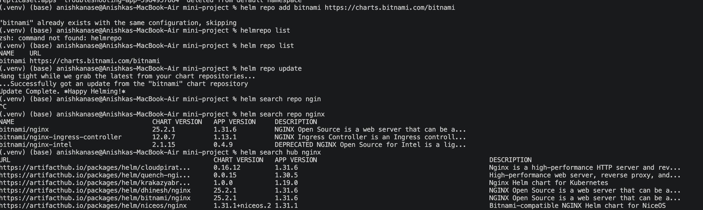
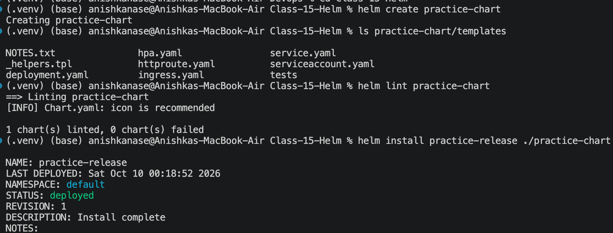
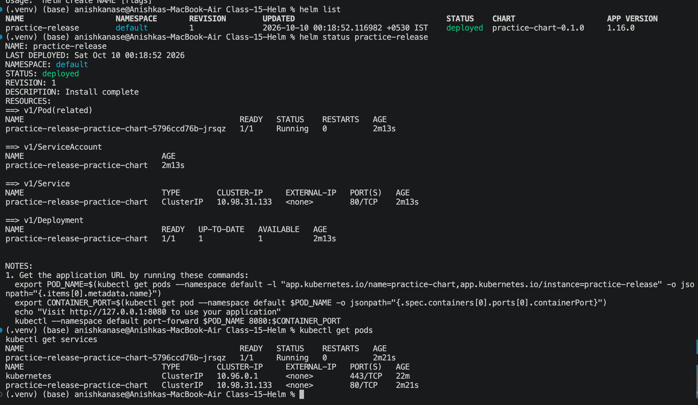


helm get inspects the installed release, helm upgrade applies updated chart configuration, helm history lists release revisions, and helm rollback restores a previous revision. The rollback itself creates a new revision.
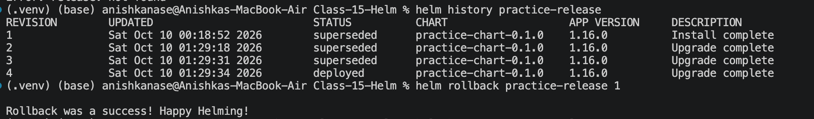
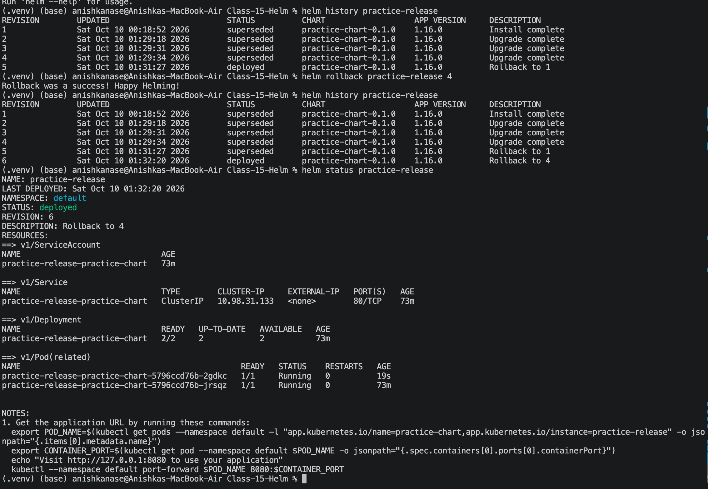


helm uninstall removes the Helm release and its managed Kubernetes resources. helm list should no longer show practice-release.
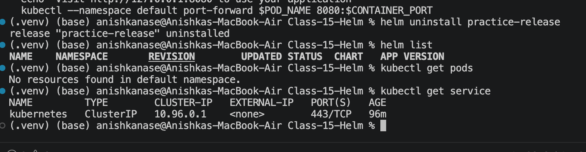


Task-2:
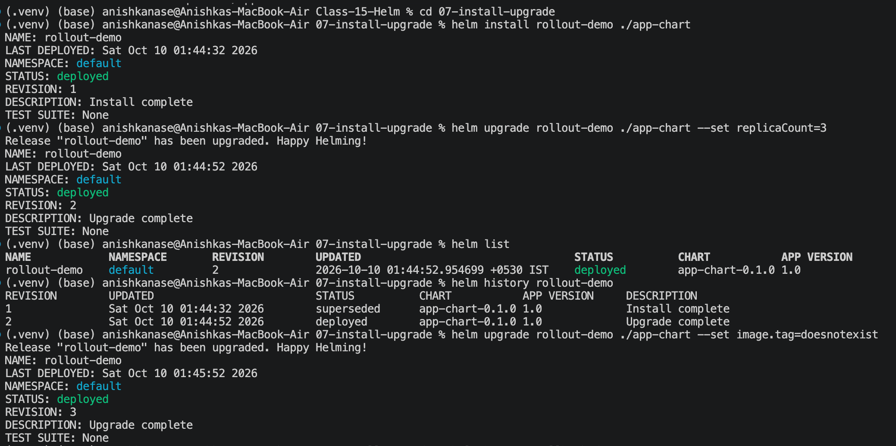
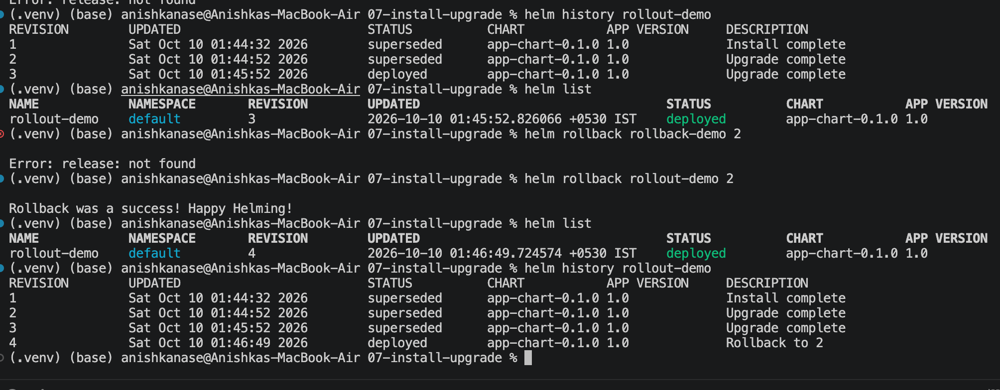


TASK-3: MINI PROJECT
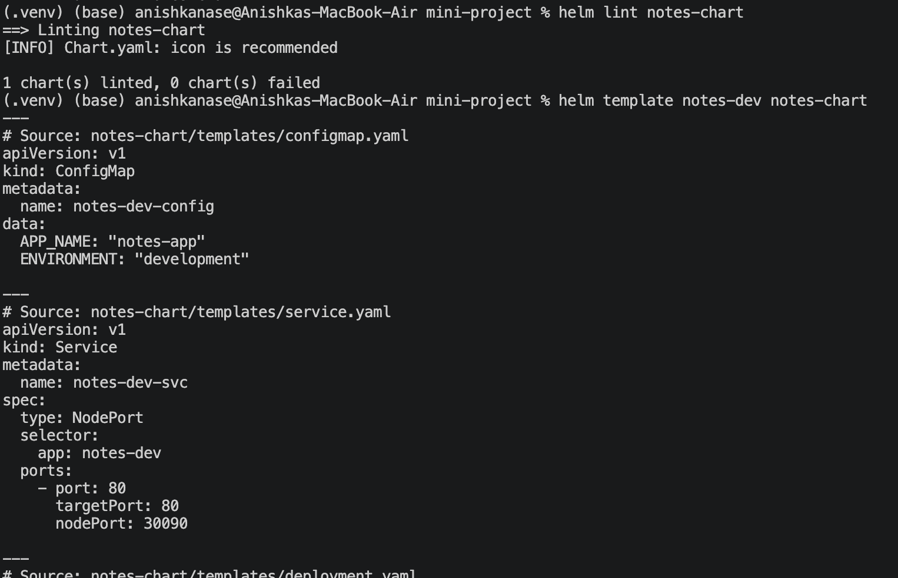
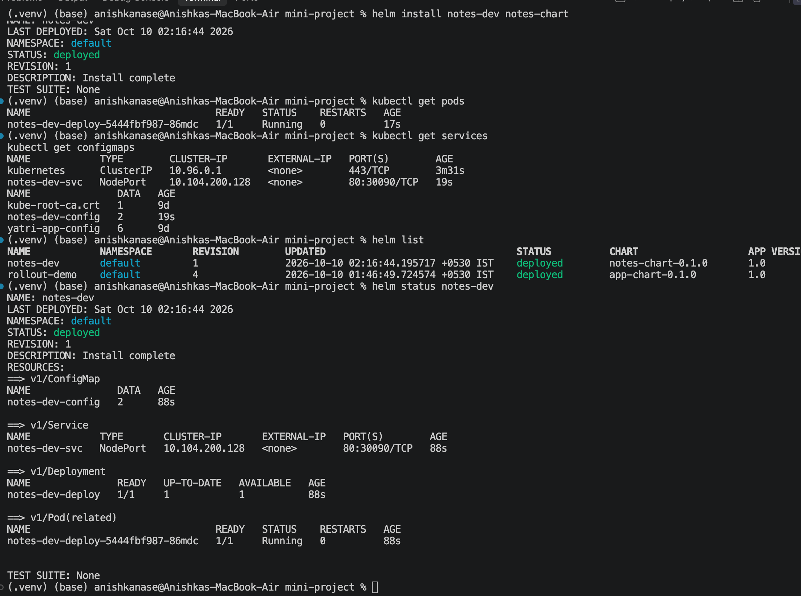
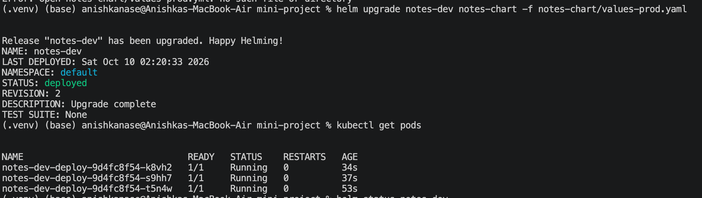
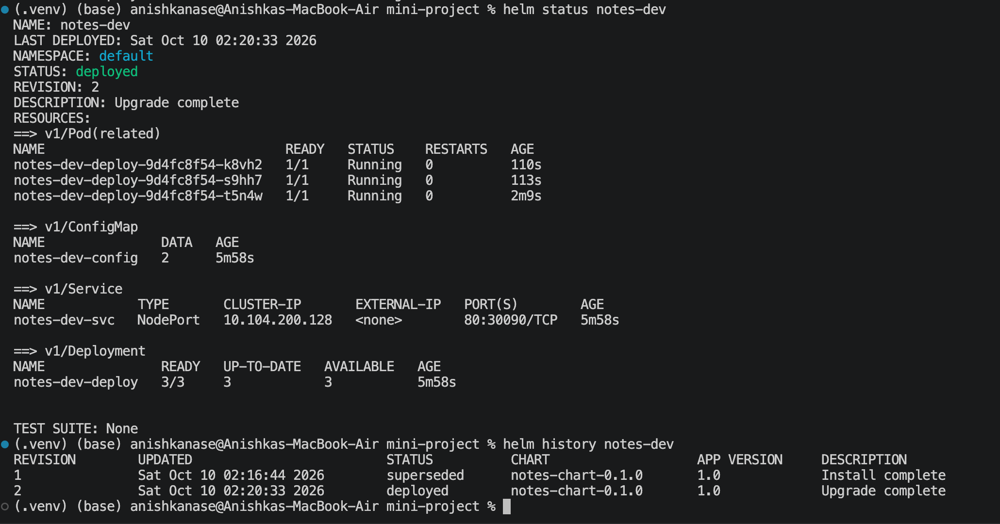
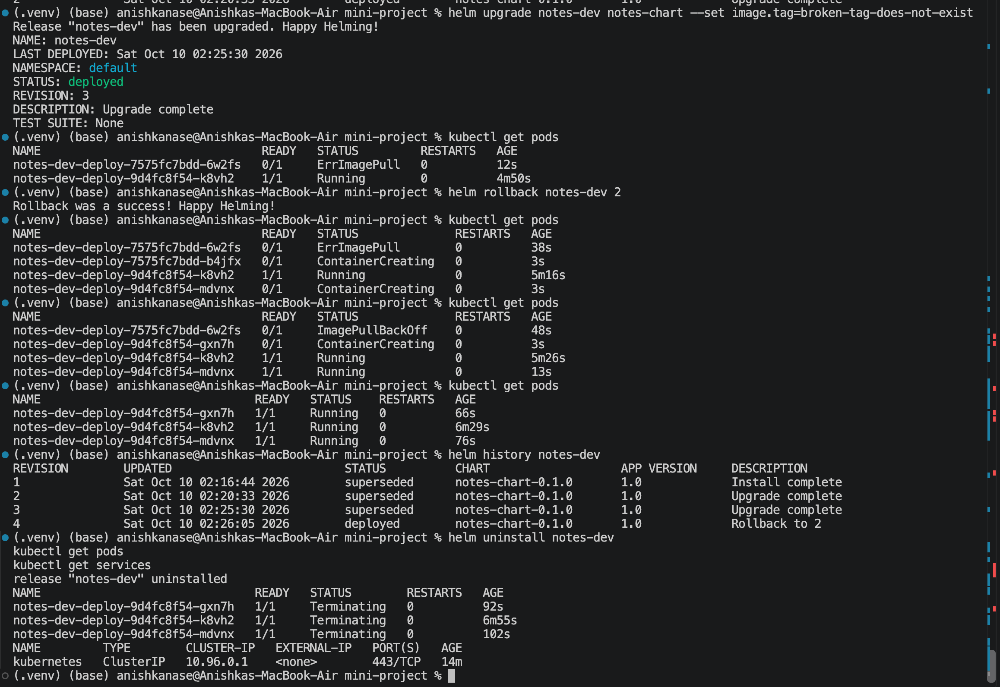


## Task 1 — Helm commands

### 1. Repository and search commands


```
helm version
helm repo add bitnami https://charts.bitnami.com/bitnami
helm repo list
helm repo update
helm search repo nginx
helm search hub nginx
```

### 2. Create, install, inspect, upgrade, rollback and uninstall

```
# Create the chart (skip if practice-chart already exists)
helm create practice-chart

# Validate and preview the chart
helm lint practice-chart
helm template practice-release ./practice-chart

# Install
helm install practice-release ./practice-chart

# Inspect the release
helm list
helm status practice-release
helm get values practice-release
helm get values practice-release --all
helm get manifest practice-release
helm get notes practice-release
helm get all practice-release

# Upgrade to 2 replicas
helm upgrade practice-release ./practice-chart --set replicaCount=2

# Verify the upgrade and history
helm status practice-release
helm history practice-release

# Roll back to revision 1
helm rollback practice-release 1

# Verify rollback
helm status practice-release
helm history practice-release

# Uninstall
helm uninstall practice-release
helm list
```

## Task 2 — Complete Helm rollback workflow


If `rollback-demo` is already installed from an earlier attempt, run `helm uninstall rollback-demo` before starting.

```
# 1. Install — Revision 1
helm install rollback-demo ./app-chart

# 2. Upgrade — Revision 2
helm upgrade rollback-demo ./app-chart --set replicaCount=3

# Verify
helm list
helm history rollback-demo

# 3. Upgrade again with an invalid image tag — Revision 3
helm upgrade rollback-demo ./app-chart --set image.tag=doesnotexist

# Verify the history
helm history rollback-demo

# 4. Roll back to healthy Revision 2 — creates Revision 4
helm rollback rollback-demo 2

# Verify the rollback
helm list
helm status rollback-demo
helm history rollback-demo

# Clean up
helm uninstall rollback-demo
```

Expected progression: revision 1 installs the chart, revision 2 scales to three replicas, revision 3 uses the invalid image tag, and revision 4 rolls back to revision 2.

Document this process and your observed results in `08-rollback/README.md`.

## Task 3 — Notes App mini-project


If `notes-dev` is still installed from your earlier attempt, run `helm uninstall notes-dev` before restarting this workflow.

```
# 1. Validate and preview the chart
helm lint notes-chart
helm template notes-dev notes-chart

# 2. Install with development values — Revision 1
helm install notes-dev notes-chart

# Verify
helm list
helm status notes-dev

# 3. Upgrade to production values — Revision 2
helm upgrade notes-dev notes-chart -f notes-chart/values-prod.yaml

# Verify
helm status notes-dev
helm history notes-dev

# 4. Simulate a failed image upgrade
helm upgrade notes-dev notes-chart --set image.tag=broken-tag-does-not-exist

# Check revision history
helm history notes-dev

# 5. Roll back to healthy production Revision 2
helm rollback notes-dev 2

# Verify
helm status notes-dev
helm history notes-dev
helm get values notes-dev --all

# 6. Clean up
helm uninstall notes-dev
helm list
```

