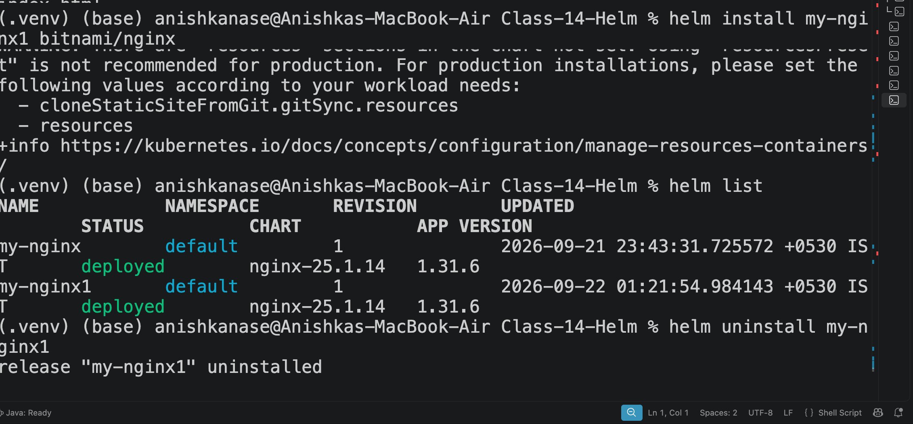

# DevOps & Cloud [SWE] — Class 16 Notes

**Lecture Title:** Helm — the package manager for Kubernetes (install · repos · charts · templates · values · upgrade · rollback)
**Date/Time:** 22 September 2026, 11:15 AM
**Duration:** 120 minutes
**Instructor:** Nensi Ravaliya
**Big idea:** Stop running `kubectl apply` file by file, environment by environment — package the whole app as **one chart**, feed it a different **values file** per environment, and let Helm keep a numbered **revision history** you can roll back to with one command.
**Sources:** class transcript + her repo folder for this session, [`Nency-Ravaliya/devops-heros` → `session-15-helm`](https://github.com/Nency-Ravaliya/devops-heros/tree/main/session-15-helm) (folders `01-what-is-helm` … `09-deploying-application` and `mini-project`, which she screen-shared) + your own working files (`Readme.MD`, `image.png`, `demo-chart/`, `03-chart-structure/simple-chart/`, `mini-project/notes-chart/`, `get_helm.sh`). Every `helm lint` / `helm template` output below was re-run on your files with Helm **v4.3.0**.

---

> 📌 **The title is right this time.** After three classes in a row where the folder name lied (Classes 12, 13 and 14), the header says **"Helm"** and Helm is exactly what was taught. Two things to know before you start:
>
> - **This is Helm, take two.** She opened with *"from last session… what do you understand by Helm?"* and said she'd redo the overview *"because it was an online class."* So Helm was first introduced in the **online** session (Class 15, 21 Sep, whose transcript wasn't captured). That's also why your `image.png` shows Helm releases from **21 Sep, 23:43** — you'd already practised before this class.
> - **Her repo calls this `session-15-helm`.** Your folder is `Class-16`. Don't reconcile the numbers; go by content.

---

## 0. The 60-Second Version

1. **Helm = package manager for Kubernetes.** Like `apt` for Ubuntu or `npm` for Node — but what it installs is a whole app's worth of Kubernetes YAML.
2. **The problem it kills:** `kubectl apply -f deployment.yml`, then `service.yml`, then `configmap.yml`… and then again for **dev, stage and prod**, where only a few numbers (CPU, replicas, image tag) differ.
3. **Three words:** a **chart** is the package (the recipe), a **release** is one installed copy of it (the cooked meal, with a name you choose), **values** are the knobs (the ingredients).
4. **A chart is a folder:** `Chart.yaml` (metadata) + `values.yaml` (defaults) + `templates/` (the YAML with `{{ .Values.something }}` holes in it).
5. **One chart, many environments:** `helm install my-app ./chart -f values-prod.yaml`. Real companies keep `values.yaml`, `values-dev`, `values-stg`, `values-prod` and even `values-dr`.
6. **The safe workflow:** `helm lint` (typos) → `helm template` (dry-run: see the rendered YAML) → `helm install`.
7. **`install` is like `kubectl create`** (fails if the name exists). **`upgrade` is like `kubectl apply`** (updates, but needs the release to exist). **`upgrade --install`** does either.
8. **Every install/upgrade/rollback = a new revision number.** `helm history` shows them; `helm rollback my-app 1` jumps back — and the rollback itself becomes the *next* revision.

---

## 1. 🗓️ Logistics & Warm-up

**The mic didn't work.** The class opened with the recap drill (§2) shouted across the room while someone fixed it — *"I know mic is not working, they are fixing it. Give five minutes."* It stayed flaky for a good half hour: there was a back-and-forth about whether to restart it (*"if there is noise, then we'll hang up"*), a stretch of Hindi about the background noise, and finally a relieved *"Fine, right? Okay. Thank you. **Finally.**"*

**The homework check.** Right after the drill: *"Everyone completed your `readme.md` file in mini project?"* — the Kubernetes mini-project README from the last sessions.

**Set-up asked of everyone:** two terminals — `helm version` in one, `minikube start` in the other. *"Every time we need to run two commands."*

**Proof-of-work rule.** She checked laptops in person rather than trusting "done":

> 😄 *"Don't tell me that I did it but I don't know."* — and later, *"Each and every command I want to see on your laptop."*

**Attendance** was taken partway through (*"I'll take attendance"*), and a stretch of side conversation about extra lectures is too garbled to reconstruct.

**The closing task** (§18) was set with a literal **two-minute countdown**: deploy the mini-project and show her `helm list`, `helm lint` and `helm status` — with a warning that she'd pick people at random and ask them to roll back to a specific revision.

> 😄 **Class moment — muscle memory.** Deploying the guestbook chart, she typed `kubectl get status` instead of `helm status`, laughed, and said (in Hindi): *"Sorry — this is what happens when you study kubectl and then work at a company on Helm."*

---

## 2. 🔁 The Recap Drill — Classes 11 → 15 in Twenty Minutes

Same routine as every Kubernetes class: rapid-fire questions, team by team, before anything new. This one swept everything from workloads to the storage/HPA/probe material of the previous (online) class.

> 📌 **Deliberate repeat.** Services, ConfigMap vs Secret, Ingress routing and DaemonSet have all been drilled before (Classes 11–14). They're written out in full again here because she asked them again — and because this PDF has to stand on its own.

### 2.1 Workloads, config and Ingress

| # | Question | Answer given | Verdict |
|---|---|---|---|
| 1 | Deploying an Nginx pod — Deployment, DaemonSet, both, or StatefulSet? | **Deployment** — *"there is a `deployment.yml`, kind is Deployment, and we use the Nginx image"* | ✅ |
| 2 | Why ConfigMap? | Store **non-sensitive, environment-specific** data | ✅ |
| 3 | Why Secret? | **Sensitive** environment-specific data | ✅ |
| 4 | `ENVIRONMENT=production` — ConfigMap or Secret? | ConfigMap | ✅ |
| 5 | A JWT token, or the Postgres/MongoDB password? | Secret | ✅ |
| 6 | Why use Ingress? | **(1) cost** — one load balancer instead of many; **(2) management** — one place routes to all services, instead of going service by service | ✅ |
| 7 | How many kinds of Ingress routing? | Two — **path-based** (same DNS, different paths) and **host-based** (different DNS names) | ✅ |
| 8 | Can one `ingress.yaml` do both? | Yes — list several hosts, and give each host several paths | ✅ |

> 🧠 **Path vs host routing in one picture.**
>
> ```
> PATH-BASED  (one name, many paths)      HOST-BASED  (many names)
> shop.com/        → frontend-svc         shop.com      → frontend-svc
> shop.com/api     → backend-svc          api.shop.com  → backend-svc
>
> BOTH, in one ingress.yaml:
> shop.com      → /  → frontend-svc
>                 /api → backend-svc
> admin.shop.com → / → admin-svc
> ```

### 2.2 Services

| # | Question | Who | Answer given | Verdict |
|---|---|---|---|---|
| 9 | How many Service types? | — | Five | ✅ |
| 10 | Name them, one per team | Team A → D, then last | **ClusterIP** · **NodePort** · **ExternalName** · **LoadBalancer** · **Headless** | ✅ |
| 11 | Headless vs ClusterIP? | — | Headless has `clusterIP: None` | ✅ |
| 12 | Which is the default? | — | ClusterIP | ✅ |
| 13 | Do we have to specify the cluster IP? | — | First *"I think we need to"*… *"Really? Really? Where?"* … *"OK, we don't need to mention"* | ✅ (after a nudge) |
| 14 | Two things to change in `service.yml` to make it NodePort? | — | `type: NodePort` and the `nodePort:` number | ✅ |
| 15 | Default NodePort range? | — | *"30000…"* (garbled in audio) | ✅ |
| 16 | Which type gets an external IP? | — | *"ExternalName"* | ⚠️ see below |

> 🔍 **Clarified — Q13, Q15 and Q16.**
>
> - **Q13.** You never write the cluster IP *address* — Kubernetes assigns one. You *do* still write the `port:` the Service listens on. (The only time you touch `clusterIP:` is to set it to `None` for a headless Service.)
> - **Q15 (filled in, the audio garbled the number).** NodePorts come from **30000–32767**. Leave `nodePort:` out and Kubernetes picks one from that range.
> - **Q16.** The type that gets a real **external IP** is **LoadBalancer** — the cloud hands it a public IP/hostname. **ExternalName** is a DNS alias *outwards* (`my-db` → `db.example.com`); `kubectl get svc` prints that DNS name in the `EXTERNAL-IP` column, which is why it *looks* like an answer. In her assessment, if asked "which gets an external IP", say **LoadBalancer**.

### 2.3 Storage, HPA and probes

| # | Question | Answer given | Verdict |
|---|---|---|---|
| 17 | What is `emptyDir`? | Storage that lives **within the pod lifecycle** — created with the pod, deleted with the pod (data too) | ✅ |
| 18 | What do you put in a `hostPath`? | The **path to be mounted** | ✅ |
| 19 | `hostPath` lives at which level — cluster, node or pod? | **Node** — so deleting the pod doesn't delete the data | ✅ |
| 20 | The main, third type? | **Persistent Volume (PV)** | ✅ |
| 21 | Command to get PVs? | `kubectl get pv` | ✅ |
| 22 | How do you claim a PV? | With a **PVC** — `kubectl get pvc` | ✅ |
| 23 | *Tricky:* delete the PV — is the PVC deleted? | **No** | ✅ (see 🔍) |
| 24 | Which one field makes the PV get created automatically from the PVC? | **`storageClassName`** | ✅ |
| 25 | HPA? | **Horizontal Pod Autoscaler** | ✅ |
| 26 | Liveness probe? | Is the service up and running? | ✅ |
| 27 | Readiness probe? | Is the app ready to **serve traffic**? | ✅ |
| 28 | Startup probe? | Has the container **booted** enough to start the app? | ✅ |

> 🧠 **Her startup-probe analogy.** *"Let's suppose you're starting your laptop — it will boot, and then you're able to see the screen."* Startup probe = "has it finished booting?". Liveness = "is it still alive?". Readiness = "can it take customers right now?"

> 🔍 **Clarified — probe order.** She said: *"First the startup probe will be executed, second the liveness probe, and the last one is the readiness probe."* The first part is exactly right — **while a startup probe is running, the other two are switched off**. But once startup succeeds, **liveness and readiness run side by side, on their own timers, for the rest of the container's life** — readiness isn't a "last step", it keeps checking forever (that's how a pod gets pulled out of a Service when it's overloaded).
>
> ```
> container starts
>    │
>    ▼
> [startup probe]  ── liveness & readiness paused ──
>    │ succeeds
>    ▼
> [liveness probe]  ⟳ every N s  → fail = restart container
> [readiness probe] ⟳ every N s  → fail = remove from Service endpoints
> ```
>
> For her assessment, "startup → liveness → readiness" is the expected answer.

> 🔍 **Clarified — Q23, deleting a bound PV.** "No, the PVC isn't deleted" is correct. What actually happens is even stricter: Kubernetes puts a protection **finalizer** on a bound PV, so `kubectl delete pv` just leaves it stuck in `Terminating` until the PVC that uses it is gone. The claim never disappears out from under you.

### 2.4 Troubleshooting commands

| # | Question | Answer given | Verdict |
|---|---|---|---|
| 29 | What is "kubectl get described"? | *"It was easy"* — she meant `kubectl describe` | ✅ |
| 30 | How to get events? | `kubectl get events` | ✅ |
| 31 | How to watch them live? | `kubectl get events --watch` (or `-w`) | ✅ |
| 32 | Endpoints of a service? | `kubectl get endpoints <svc-name>` — shows the **pod IPs and ports** behind it | ✅ |
| 33 | How do you disconnect a Service from a Deployment? | Point its **selector at a label that doesn't exist** (endpoints become `<none>`), or **remove the selector** | ✅ |

> 😄 *"Two new commands — I guess you did not try much."* Events and endpoints were the newest material from the online class, and the room was noticeably quieter on them.

---

## 3. ⛵ Why Helm? The Problem It Solves

### 3.1 Life without Helm

Today, deploying the app means:

```bash
kubectl apply -f deployment.yml
kubectl apply -f service.yml
kubectl apply -f configmap.yml
kubectl apply -f secret.yml
# ...change one thing? apply again. Every file. Every time.
```

Now multiply it by environments. Her example: *same application, same code, same image* — only the resources change.

| | Dev | Stage | Prod |
|---|---|---|---|
| CPU | ~100 millicore | **500 millicore** | **900 millicore** |
| Code / image | same | same | same |
| `kubectl apply` runs | all files | all files again | all files again |

> 🎤 *"Because of this reason we can't do `kubectl apply` in dev, `kubectl apply` in stage, `kubectl apply` in production. **We need some package manager where I can apply those changes with just one command.** That is what Helm is doing."*

### 3.2 Life with Helm

```bash
helm install <release-name> <chart-folder> -f values-dev.yaml    # dev
helm install <release-name> <chart-folder> -f values-stage.yaml  # stage
helm install <release-name> <chart-folder> -f values-prod.yaml   # prod
```

> 🎤 *"By just one command, I can directly deploy my complete application in different environments. **I don't need to change my `deployment.yml`. I don't need to change my `service.yml`.**"*

> 🧠 **Package manager = an app store for your terminal.** On Ubuntu, `apt install nginx` grabs a package and puts every file in the right place. `helm install` does the same for Kubernetes: one command, and the Deployment, Service, ConfigMap, ServiceAccount… all land in the cluster together, named consistently.

### 3.3 Helm's three superpowers (as she listed them)

| Power | What it means |
|---|---|
| **1. One command for a whole project** | *"You don't need to run `kubectl apply` — just `helm install` release-name and the folder path. It will apply all the files inside that folder. That's the Helm power."* |
| **2. One chart, any environment** | Swap the values file, not the YAML. |
| **3. Revision-numbered rollback** | Every deploy gets a revision number; roll back to *any* one by number — and see which one you went to. |

### 3.4 Helm rollback ≠ Deployment rollback

A student asked whether Helm's rollback is the same as the rolling-update rollback from Class 12. *"Yes, yes — both things are different."*

| | Deployment rollback (`kubectl rollout undo`) | Helm rollback (`helm rollback`) |
|---|---|---|
| Rolls back | **one** Deployment's pod template | **every** component in the chart — Deployment, Service, ConfigMap, Secret… |
| Where the strategy lives | `strategy:` inside `deployment.yml` (rolling update, recreate…) | Helm doesn't care which strategy — it re-applies the whole old revision |
| Knowing where you're going | *"You need to guess"* which revision number | Every revision is listed with a description |

> 🎤 *"You are rolling back not just a `deployment.yml`. **You are rolling back every component that you added inside your project.**"*

---

## 4. 📦 The Vocabulary — Chart, Release, Repo, Values

### 4.1 Four words

| Word | Her definition | Analogy (from her repo's README) |
|---|---|---|
| **Chart** | *"Just a bunch of code files"* — Chart.yaml, values, templates | The **recipe** |
| **Release** | One installed copy of a chart, with a name you pick (`my-nginx`) | The **cooked meal** |
| **Values** | The variables fed into the templates | The **ingredients** |
| **Repository** | A place to pull charts from (Artifact Hub, Bitnami) | The **cookbook shelf** |

> ✅ **Lock this in — a release name is what you manage.** `helm install my-nginx bitnami/nginx`: `bitnami/nginx` is the **chart**, `my-nginx` is the **release**. Every later command — `upgrade`, `rollback`, `history`, `status`, `uninstall` — takes the **release name**. *"Always release name."*

### 4.2 Anatomy of a chart

```
my-chart/
├── Chart.yaml          ← metadata: "what is this chart?"
├── values.yaml         ← default values
├── values-dev.yaml     ← (optional) dev overrides
├── values-prod.yaml    ← (optional) prod overrides
├── charts/             ← other charts this one depends on
└── templates/          ← the Kubernetes YAML, with {{ holes }}
    ├── deployment.yaml
    ├── service.yaml
    ├── configmap.yaml
    └── ...
```

> 🎤 *"Whenever you're creating a chart, there are three: `Chart.yaml`, `values.yaml`, and the template folder. Inside the template folder all the code files are there — deployment, service, config map, secret, service account…"*

### 4.3 How many values files does a real company keep?

Her organisation uses the same structure, with **five** values files:

| File | Used when |
|---|---|
| `values.yaml` | the **default** — used when you pass no `-f` |
| `values-dev.yaml` | dev environment |
| `values-stg.yaml` | staging |
| `values-prod.yaml` (`prd`) | production |
| `values-dr.yaml` | the **DR** stage — *"if anyone worked on a live project, they know the DR stage."* Sometimes even a separate rollback stage. |

> 🧠 **What "DR" means (she named it, didn't define it).** **Disaster Recovery** — a standby copy of production, usually in another region, that you switch to if the main one goes down (data-centre outage, region failure). Same app, same chart — just its own values (different region, cluster, DB endpoint). That's exactly why it gets its own values file.
>
> ```
>  normal day:    users ──► PROD  (Mumbai)        DR (Hyderabad) idle, in sync
>  bad day:       users ──► DR    (Hyderabad)     PROD down
>                 helm upgrade app ./chart -f values-dr.yaml
> ```

### 4.4 `Chart.yaml` — the chart's ID card

> 🎤 *"`Chart.yaml` means metadata about your chart. What is this chart regarding? Maybe Bitnami chart, your custom chart, the Nginx chart, the Java chart… The same as in `deployment.yml` we are putting a `metadata` field."*

The deep-dive on its fields is in §15.

---

## 5. 🛠️ Installing Helm & the First Commands

### 5.1 Installing — what *you* ran

From your `Readme.MD` and `get_helm.sh`:

```bash
curl -fsSL -o get_helm.sh https://raw.githubusercontent.com/helm/helm/main/scripts/get-helm-4
chmod 700 get_helm.sh      # owner can read, write, execute
./get_helm.sh              # downloads the right binary into /usr/local/bin
helm version
```

On your machine that gives **`v4.3.0`**.

> 💡 **Helm 2 → 3 → 4, in one breath.** Her repo's README explains the big one: **Helm 2** needed a server pod in the cluster called **Tiller** with cluster-admin rights (a security hole). **Helm 3** threw Tiller away — Helm is client-only, uses your own kubeconfig permissions, and stores release history as Kubernetes **Secrets**. Her repo's install line still says `get-helm-3`; you used `get-helm-4`. Everything taught in this class works the same on both — charts still say `apiVersion: v2`.

### 5.2 The two-terminal routine

```bash
# terminal 1                 # terminal 2
helm version                 minikube start
```

> ⚠️ **Helm talks to whatever cluster `kubectl` talks to.** It reads the same kubeconfig. No Minikube running = `helm install` fails with a connection error, even though `helm version` works fine.

---

## 6. 🏪 Artifact Hub & the Bitnami Nginx Chart

### 6.1 Where charts come from

**[Artifact Hub](https://artifacthub.io)** is to Helm charts what Docker Hub is to images — a search site for public charts. She had everyone open it and find the **Bitnami Nginx** chart.

> 🎤 *"Whatever you are searching inside Artifact Hub you can pull, just like Docker pull. In Docker pull: `docker pull` and the image name. Same, you can consider this — **you are pulling the chart, the complete chart.** Inside the chart you have `deployment.yaml`, the templates, `Chart.yaml`, `service.yaml`, everything."*

### 6.2 The repo commands

```bash
helm repo add bitnami https://charts.bitnami.com/bitnami   # register the repo, call it "bitnami"
helm repo update                                           # refresh the index
helm search repo nginx                                     # look before you install
helm repo remove bitnami                                   # (alias: helm repo rm)
```

> 🧠 **`helm repo update` = `sudo apt-get update`.** Her own analogy: *"Just like when we open our Ubuntu and do `sudo apt-get update` — that is the repo update."* It goes back to the URL you gave in `repo add` and fetches the latest list of chart versions. If you already have the newest, it says so and skips.

> 💡 **`helm search repo` = checking Docker Hub before `docker pull`.** *"Let's suppose you don't know the image exists or not… then you will get an error that image doesn't exist. Same thing, you can search your repo."*

### 6.3 Install your first release

```bash
helm install my-nginx bitnami/nginx
```

What the output tells you:

| Field | Meaning |
|---|---|
| `NAME: my-nginx` | the release name you chose |
| `LAST DEPLOYED:` | timestamp of this deployment |
| `NAMESPACE: default` | *"Why default? Because we did not create a dev or stage namespace."* |
| `STATUS: deployed` | the app is up |
| `REVISION: 1` | first version of this release |

```bash
kubectl get pods     # my-nginx-xxxx   1/1   Running
helm list            # my-nginx  default  1  deployed  nginx-25.1.14  1.31.6
```

> 🎤 *"Deployed means your application is up and running. You will see 1/1 pod, maybe 2/2 pods — you will not see 0/1. If it's pending, then you'll see 0/1… similar to the pod life cycle."*

> 🔍 **Clarified — the list of Helm statuses.** She listed *"failed, pending, completed, successful, deployed."* **Filled in from the Helm docs:** a Helm release's real statuses are `deployed`, `failed`, `pending-install`, `pending-upgrade`, `pending-rollback`, `superseded` (an older revision that's been replaced — you'll meet it in §14), `uninstalling` and `uninstalled`. There's no "completed" or "successful" — those are words for pods/jobs. Also: `deployed` means **Helm successfully sent the YAML** to the cluster; it doesn't by itself guarantee the pods are healthy (§16.4 shows a `deployed` release with broken pods).

> 🔍 **Clarified — Helm doesn't pull images.** She said Helm *"will directly pull the image, create the chart, automatically create the `deployment.yml`…"*. Helm pulls the **chart** (YAML templates), fills in the values, and sends the result to the API server. The **kubelet** on the node is still the one that pulls the container image — exactly as with plain `kubectl apply`.

### 6.4 Remove it

```bash
helm uninstall my-nginx
helm list               # my-nginx is gone
kubectl get all         # its Deployment, ReplicaSet, Service, Pod — gone too
```

> 🎤 *"If I do uninstall, it will remove all of my history for that service. It will remove my complete service."*

### 6.5 What your screenshot proves



> 📌 **What this proves.** You installed the **same chart twice** under two release names — `my-nginx` (21 Sep, 23:43) and `my-nginx1` (22 Sep, 01:21) — and `helm list` shows both at **REVISION 1**, status **deployed**, chart **`nginx-25.1.14`**, app version **1.31.6**. Then `helm uninstall my-nginx1` removed only that one. That's the chart-vs-release idea in one picture: **one recipe, two separate meals**.
>
> The wall of warning text at the top is the Bitnami chart warning that `resources` aren't set (*"not recommended for production"*). That's the chart author telling you: in a real values file, set CPU/memory requests and limits — exactly the dev-vs-prod millicore example from §3.1.

> 🏋️ **Lab 1 — your first public chart.**
>
> 1. `minikube start` (second terminal) and `helm version`.
> 2. `helm repo add bitnami https://charts.bitnami.com/bitnami`
> 3. `helm repo update` — run it twice; notice the second run has nothing new.
> 4. `helm search repo nginx` — find `bitnami/nginx`.
> 5. `helm install my-nginx bitnami/nginx` — read every line of the output.
> 6. `helm list` and `kubectl get pods` — confirm `1/1 Running`.
> 7. `helm install my-nginx bitnami/nginx` **again** — read the error (*cannot reuse a name that is still in use*).
> 8. `helm install my-nginx1 bitnami/nginx` — a second release from the same chart.
> 9. `kubectl get all` — count what each release created.
> 10. `helm uninstall my-nginx1`, `helm uninstall my-nginx`, then `helm list` (empty) and `kubectl get all`.

---

## 7. 🧭 Three Ways to Get a Chart

| # | Way | How | When |
|---|---|---|---|
| 1 | **Predefined** | `helm repo add` + `helm install` (§6) | Someone's already packaged it — Nginx, Postgres, Prometheus… |
| 2 | **Fully custom** | `mkdir my-chart`, `touch Chart.yaml values.yaml`, `mkdir templates`, write every file (§11) | You want full control, small and readable |
| 3 | **Partial / hybrid** | `helm create my-chart` — a ready-made skeleton you then edit (§8) | *"You don't need to create the chart requirements… you need a default template of a chart, then you update what you need to update."* |

> 💡 **And you can publish yours too.** *"You can create your own Helm charts and you can publish it to an artifactory — just like we are doing for Docker images."*

---

## 8. 🏗️ `helm create` — The Ready-Made Skeleton

### 8.1 Generate it

```bash
helm create demo-chart
cd demo-chart && ls
# Chart.yaml  charts  templates  values.yaml
ls templates
# NOTES.txt  _helpers.tpl  deployment.yaml  hpa.yaml  httproute.yaml
# ingress.yaml  service.yaml  serviceaccount.yaml  tests/
```

> 🎤 *"…deployment.yaml, HPA, HTTP route, ingress, service.yaml, service account — maybe you don't know, but for service we have service accounts — and then test cases even. **Everything that you need to deploy your application.**"*

What each generated file is for (from your `demo-chart/`):

| File | Job |
|---|---|
| `Chart.yaml` | metadata — `name: demo-chart`, `version: 0.1.0`, `appVersion: "1.16.0"` |
| `values.yaml` | ~150 lines of defaults: `replicaCount: 1`, `image.repository: nginx`, `service.type: ClusterIP`, `ingress.enabled: false`, `autoscaling.enabled: false`… |
| `templates/deployment.yaml` | the Deployment, almost every field pulled from values |
| `templates/service.yaml` | the Service |
| `templates/hpa.yaml`, `ingress.yaml`, `httproute.yaml` | wrapped in `{{- if .Values.X.enabled }}` — **off** by default |
| `templates/serviceaccount.yaml` | a ServiceAccount (identity for the pods) |
| `templates/_helpers.tpl` | reusable snippets — naming and labels (§9.4) |
| `templates/NOTES.txt` | the message printed after `helm install` |
| `templates/tests/test-connection.yaml` | a pod that `wget`s your Service — run with `helm test` |
| `.helmignore` | like `.gitignore` — files not to package |
| `charts/` | empty — dependencies would go here |

> ⚠️ **From your Readme — `cat charts` fails.** `charts/` is a directory, not a file, so `cat` complains. Use `ls charts`. (It's empty in a fresh chart anyway.) You spotted and wrote this up correctly.

### 8.2 `helm template` — see before you deploy

> 🎤 *"There is one more thing inside Helm. Before deploying, you can see by running a dry-run command what will be the output — **this is one of the magic that we have in Helm.** How many components will be created… if there is an error, then you will catch it before even deploying."*

```bash
helm template demo-chart demo-chart
#             └ release  └ chart folder
```

> 🎤 *"`helm template` and the release name — you can put any release name. But the last thing, the `demo-chart` folder you created, must be there."*

Real output on your `demo-chart` (headers only):

```
# Source: demo-chart/templates/serviceaccount.yaml      name: demo-chart
# Source: demo-chart/templates/service.yaml             name: demo-chart
# Source: demo-chart/templates/deployment.yaml          name: demo-chart
# Source: demo-chart/templates/tests/test-connection.yaml   name: "demo-chart-test-connection"
```

Notice: **no HPA, no Ingress, no HTTPRoute** in the output — their `enabled:` flags are `false`, so those templates render to nothing.

> 🎬 **Watch it happen — how one template line becomes real YAML.**
>
> ```
> FRAME 1  template      replicas: {{ .Values.replicaCount }}
> FRAME 2  Helm reads    .Values  →  values.yaml  →  replicaCount: 1
> FRAME 3  -f / --set?   values-prod.yaml says replicaCount: 5  → wins
> FRAME 4  substitute    replicas: 5
> FRAME 5  output        helm template → prints it   (stops here)
>                        helm install  → sends it to the API server
> ```

> 🔍 **Clarified — `helm template` vs `--dry-run`.** She calls `helm template` the dry run, and that's the everyday usage. The precise difference: `helm template` renders **entirely on your laptop** — it doesn't even need a cluster. `helm install <name> <chart> --dry-run` renders *and* asks the cluster to validate, without creating anything. Both are "see it before you ship it"; `template` is the one she used.

---

## 9. 🔤 Reading Templates — The Skill That Matters Most

> 🎤 *"See guys, **what you need to learn today is this thing.**"* — pointing at the `{{ }}` braces in `deployment.yaml`. And later: *"If you understand how to fetch the data, then you are going to know how to write the file. Then you are going to know **where your pipeline is failing**."*

### 9.1 The rule

**Whenever you see `.Values.`, go to the values file and follow the dots.** Each dot is one level of indentation down.

She did this live with Ctrl/Cmd-F:

| In `templates/deployment.yaml` | Search `values.yaml` for | Found |
|---|---|---|
| `.Values.imagePullSecrets` | `imagePullSecrets` | `imagePullSecrets: []` |
| `.Values.nameOverride` | `nameOverride` | `nameOverride: ""` |
| `.Values.serviceAccount.create` | `serviceAccount:` → `create:` | `create: true` |
| `.Values.podLabels` | `podLabels` | `podLabels: {}` |
| `.Values.autoscaling.minReplicas` (in `hpa.yaml`) | `autoscaling:` → `minReplicas:` | `minReplicas: 1` |

```yaml
# values.yaml                     # how a template reaches it
serviceAccount:                   # .Values.serviceAccount
  create: true                    # .Values.serviceAccount.create
  automount: true                 # .Values.serviceAccount.automount
autoscaling:
  enabled: false                  # .Values.autoscaling.enabled
  minReplicas: 1                  # .Values.autoscaling.minReplicas
  maxReplicas: 100                # .Values.autoscaling.maxReplicas
```

> 🧪 **Her live quiz.** *"You want to fetch this variable — what will you add in `deployment.yaml`? `Values` dot `serviceAccount`, then dot or hyphen or what?"* — **Dot**, then `create`. *"If something is inside `create`, again dot and that value."*

### 9.2 Why the HPA template is the perfect example

> 🎤 *"Last time we did min replicas and max replicas in HPA — directly we put min replica 1, max replica 2 or 3. Right now… in dev environment maybe the min replica is 1, in stage it's 5, in production it's 10."*

```yaml
# templates/hpa.yaml (your demo-chart)
{{- if .Values.autoscaling.enabled }}
apiVersion: autoscaling/v2
kind: HorizontalPodAutoscaler
spec:
  minReplicas: {{ .Values.autoscaling.minReplicas }}
  maxReplicas: {{ .Values.autoscaling.maxReplicas }}
{{- end }}
```

| | `values-dev.yaml` | `values-stg.yaml` | `values-prod.yaml` |
|---|---|---|---|
| `autoscaling.minReplicas` | 1 | 5 | 10 |

Same `hpa.yaml`, three behaviours.

> 🧩 **Why it works — the `if not` in `deployment.yaml`.** Your `demo-chart/templates/deployment.yaml` has:
>
> ```yaml
> spec:
>   {{- if not .Values.autoscaling.enabled }}
>   replicas: {{ .Values.replicaCount }}
>   {{- end }}
> ```
>
> When autoscaling is **on**, the template deliberately *leaves `replicas:` out* — otherwise every `helm upgrade` would reset the count the HPA chose. When it's **off**, `replicaCount` is used. One flag, two files that agree with each other.

### 9.3 The other built-in objects

| Object | Comes from | Example |
|---|---|---|
| `.Values.*` | `values.yaml` + `-f` files + `--set` | `{{ .Values.image.tag }}` |
| `.Release.Name` | the name you type in `helm install <name>` | `{{ .Release.Name }}-svc` → `my-app-svc` |
| `.Chart.Name` / `.Chart.Version` / `.Chart.AppVersion` | `Chart.yaml` | `{{ .Chart.Name }}` → `demo-chart` |
| `include "x" .` | a snippet defined in `_helpers.tpl` | `{{ include "demo-chart.fullname" . }}` |

> 🎤 *"Include — it will include nothing else, it will include your `demo-chart.fullname`… we are putting release name, so it will take your release name from the `helm install` command."*

### 9.4 Why everything was named just `demo-chart`

> 🧩 **Why it works — the `fullname` helper.** In your `_helpers.tpl`:
>
> ```
> if fullnameOverride is set        → use it
> else if release name CONTAINS the chart name → use the release name alone
> else                              → "<release>-<chart>"
> ```
>
> She installed with release name **`demo-chart`** and chart **`demo-chart`** → the release name already contains the chart name → every object is called plain **`demo-chart`**. Install it as `demo` and you'd get `demo-demo-chart`; install as `demo-release` (as your Readme did) and you'd get `demo-release-demo-chart`.

### 9.5 The ingress `pathType` question

> 🎤 She asked: *"I want to check my path type — what can I add in my `deployment.yaml`?"* Answer given: *"`Values.ingress.host.host.paths.pathType`"*.

> 🔍 **Clarified — lists need a loop, not dots.** In `values.yaml`, `hosts` and `paths` are **lists** (the `-` dashes):
>
> ```yaml
> ingress:
>   hosts:
>     - host: chart-example.local
>       paths:
>         - path: /
>           pathType: ImplementationSpecific
> ```
>
> Dots only walk through **maps**. To reach `pathType` you step through each list item with `range` — which is exactly what your `templates/ingress.yaml` does:
>
> ```yaml
> {{- range .Values.ingress.hosts }}
> - host: {{ .host | quote }}
>   http:
>     paths:
>       {{- range .paths }}
>       - path: {{ .path }}
>         pathType: {{ .pathType }}
>       {{- end }}
> {{- end }}
> ```
>
> Inside a `range`, the dot `.` becomes "the current item". Her point — *follow the indentation down from `ingress`* — is the right instinct; the exact syntax just needs `range` wherever you hit a `-`.

---

## 10. 🚀 Deploying the `helm create` Chart

```bash
helm install demo-chart demo-chart     # release name, then folder
kubectl get all
```

> 🎤 *"There are many deployments, but we need to see what we have deployed… Replica set for demo chart, deployment for demo chart, service for demo chart, and the pod for demo chart. **That means by Helm automatically we created deployment, service, replica set — everything we were doing manually.**"*

```bash
helm uninstall demo-chart              # ← RELEASE name, always
helm list                              # gone
```

> ⚠️ **Deleting the folder does not delete the app.** *"If you will remove this folder, it will not remove your deployment."* The chart folder is just the recipe on your disk; the release lives in the cluster. Only `helm uninstall <release>` takes it down.

> 🏋️ **Lab 2 — the skeleton chart.**
>
> 1. `helm create demo-chart && ls demo-chart demo-chart/templates`
> 2. `helm template demo-chart demo-chart | less` — find the `# Source:` headers. Which templates produced nothing? Why?
> 3. Open `values.yaml`, set `autoscaling.enabled: true`. Re-run `helm template … | grep -A3 HorizontalPodAutoscaler`. Then check: did `replicas:` disappear from the Deployment?
> 4. Set it back to `false`.
> 5. `helm install demo-chart demo-chart`, then `kubectl get all` — every object is named `demo-chart`.
> 6. `helm uninstall demo-chart`. Then try `helm install demo demo-chart` and note the new names (`demo-demo-chart`). Uninstall again.

---

## 11. ✍️ A Chart From Scratch — `simple-chart`

### 11.1 Build it

> 🎤 *"We call it a local Helm chart — locally you are creating your chart and locally you are deploying your chart."*

```bash
mkdir -p simple-chart/templates
touch simple-chart/Chart.yaml simple-chart/values.yaml
touch simple-chart/templates/deployment.yaml simple-chart/templates/service.yaml
```

Your files (identical to her `03-chart-structure`):

```yaml
# Chart.yaml
apiVersion: v2
name: simple-chart
description: A simple Helm chart for learning
type: application
version: 0.1.0
appVersion: "1.0"
```

```yaml
# values.yaml
replicaCount: 1
image:
  repository: nginx
  tag: latest
service:
  port: 80
```

```yaml
# templates/deployment.yaml
apiVersion: apps/v1
kind: Deployment
metadata:
  name: {{ .Release.Name }}-app
spec:
  replicas: {{ .Values.replicaCount }}
  selector:
    matchLabels:
      app: {{ .Release.Name }}
  template:
    metadata:
      labels:
        app: {{ .Release.Name }}
    spec:
      containers:
        - name: app
          image: "{{ .Values.image.repository }}:{{ .Values.image.tag }}"
          ports:
            - containerPort: {{ .Values.service.port }}
```

```yaml
# templates/service.yaml
apiVersion: v1
kind: Service
metadata:
  name: {{ .Release.Name }}-svc
spec:
  selector:
    app: {{ .Release.Name }}
  ports:
    - port: {{ .Values.service.port }}
      targetPort: {{ .Values.service.port }}
```

> 💡 **Why `{{ .Release.Name }}` is in the labels too.** The Service's selector and the pod labels both come from the release name, so two releases of the same chart (`my-app` and `my-app-2`) never grab each other's pods — the labels-vs-selectors idea from Classes 11–13, done for you automatically.

### 11.2 Step 1 — `helm lint`

> 🎤 *"Linting means — let's suppose I created all of these files and there is some typo. I did an indentation error…"*

```bash
helm lint simple-chart
```

Clean chart (real output, Helm v4.3.0):

```
==> Linting simple-chart
[INFO] Chart.yaml: icon is recommended

1 chart(s) linted, 0 chart(s) failed
```

She then broke the indentation of a field (an `httpGet` line in her version) and re-ran it. The same thing on your chart — `replicas:` pushed one space too far:

```
==> Linting simple-chart
[INFO] Chart.yaml: icon is recommended
[ERROR] templates/deployment.yaml: unable to parse YAML: error converting YAML to JSON: yaml: line 6: did not find expected key

Error: 1 chart(s) linted, 1 chart(s) failed
```

And a typo in `Chart.yaml` (`nme:` instead of `name:`):

```
[ERROR] Chart.yaml: name is required
...
Error: 1 chart(s) linted, 1 chart(s) failed
```

> 😄 **Class moment.** Her first typo didn't make lint fail — *"Why is it not going to happen?"* — until a student pointed out she was editing the file in **`demo-chart`** but linting **`simple-chart`**. *"What a joke."* Fixed the right file: *"Look, it's failed."*

### 11.3 Lint catches "indirect" issues too — her secret example

She described (without a live file) a `secret.yaml` whose password is a variable filled in **by the CI/CD pipeline** from a secret manager — AWS Secrets Manager, GitHub Secrets, or Azure DevOps (ADO). Locally the pipeline hasn't run, so the value is empty:

> 🎤 *"Whenever I do `helm lint`, it will give me error that your password is nil. That means it's not able to fetch the password from ADO."*

> 🔍 **Clarified — when does an empty value fail lint?** Only if the template **demands** it. A plain `{{ .Values.db.password }}` that's empty just renders as blank and lint passes. Charts that want to fail loudly write `{{ required "db.password is required" .Values.db.password }}` — *that* is what produces the "nil/required" error she described. Worth knowing, because the silent blank version is the one that bites you in production.

### 11.4 Step 2 — `helm template`, Step 3 — `helm install`

```bash
helm template my-app simple-chart
```

```yaml
# Source: simple-chart/templates/service.yaml
apiVersion: v1
kind: Service
metadata:
  name: my-app-svc
...
# Source: simple-chart/templates/deployment.yaml
kind: Deployment
metadata:
  name: my-app-app
spec:
  replicas: 1
  ...
          image: "nginx:latest"
          ports:
            - containerPort: 80
```

```bash
helm install my-app simple-chart
kubectl get all     # my-app pod, my-app-svc, my-app-app deployment + replicaset
```

> ✅ **Lock this in — her three-step habit for every custom chart.**
>
> | Step | Command | Catches |
> |---|---|---|
> | 1 | `helm lint <folder>` | typos, bad indentation, missing required fields — *"direct and indirect typos"* |
> | 2 | `helm template <release> <folder>` | wrong values, wrong names — the **dry run** (*"in Terraform also we are doing the same thing"*) |
> | 3 | `helm install <release> <folder>` | the real deployment |

> 🏋️ **Lab 3 — build, break, fix.**
>
> 1. Create `simple-chart/` with the four files above (or `cd` into your `03-chart-structure/`).
> 2. `helm lint simple-chart` → `0 chart(s) failed`.
> 3. Add one space before `replicas:` in `deployment.yaml`. Lint → read the `[ERROR]` line and its line number. Undo.
> 4. Rename `name:` to `nme:` in `Chart.yaml`. Lint → `name is required`. Undo.
> 5. `helm template my-app simple-chart` — find `my-app-svc` and `my-app-app`.
> 6. `helm template my-app simple-chart --set replicaCount=3 | grep replicas` → `replicas: 3`.
> 7. `helm install my-app simple-chart` and `kubectl get all`. **Leave it running for Lab 4.**

---

## 12. 🗑️ Deleting With `kubectl` vs `helm uninstall`

A student asked: *if I delete all the deployments with kubectl, will `helm list` still show the release?*

**Her answer: yes.** `helm list` shows **releases**, and deleting the Kubernetes objects doesn't delete the release. The proper way is `helm uninstall`. She added that there *is* a way without `helm uninstall`: delete all the release's components — *"deployment, replica set, config map and secret"* — **and the history**, and the release disappears too. *"Clean up."*

> 🔍 **Clarified — where "the history" actually lives.** Helm 3+ stores each revision as a **Kubernetes Secret** in the release's namespace, named `sh.helm.release.v1.<release>.v<revision>`. *Those* Secrets are the release. So:
>
> ```bash
> kubectl get secrets -l owner=helm
> # sh.helm.release.v1.my-app.v1   helm.sh/release.v1
> # sh.helm.release.v1.my-app.v2   helm.sh/release.v1
> ```
>
> - Delete the Deployment/Service with `kubectl` → the Secrets remain → `helm list` still shows the release (and the next `helm upgrade` will recreate the objects).
> - Delete those Secrets → Helm forgets the release, even if the pods are still running (now orphaned).
> - `helm uninstall` does **both** cleanly. Use it.
>
> 💡 Her `helm list` vs "repos" moment: a student guessed `helm list` shows repos. No — **`helm list` = releases**, **`helm repo list` = repositories**.

---

## 13. ⬆️ `install` vs `upgrade` vs `upgrade --install`

### 13.1 The live failure chain

She wanted `my-app` to go from 1 replica to 3 — and walked straight into every error on purpose.

> 🎬 **Watch it happen — four tries to scale to 3.**
>
> ```
> TRY 1  helm install my-app --replica-count 3
>        ✗ no such flag, and no chart folder given
>
> TRY 2  helm install my-app simple-chart --set replicaCount=3
>        ✗ "cannot reuse a name that is still in use"
>          (my-app already exists from Lab 3)
>
> TRY 3  "Install will not work. What do you need to do? Upgrade."
>        helm upgrade my-app simple-chart --set replicaCount=3
>        ✓ Release "my-app" has been upgraded.  REVISION: 2
>        kubectl get pods  →  3 pods
>
> TRY 4  helm upgrade --install my-app simple-chart --set replicaCount=5
>        ✓ REVISION: 3        kubectl get pods  →  5 pods
> ```

### 13.2 Map them onto kubectl

| Helm | kubectl twin | If release **exists** | If release **doesn't exist** |
|---|---|---|---|
| `helm install` | `kubectl create` | ❌ error — name in use | ✅ creates it, revision 1 |
| `helm upgrade` | `kubectl apply` | ✅ updates it, revision +1 | ❌ error — *"maybe it will fail"* |
| `helm upgrade --install` | `kubectl apply` (truly) | ✅ updates it | ✅ installs it |
| `helm uninstall` | `kubectl delete` | ✅ removes everything + history | ❌ not found |

> 🎤 *"`kubectl create` will only create, and if it is already there it will give you error. Same way we have the install command… Upgrade is just like the apply command, but in Helm we name it upgrade."*

> 🎯 **Interview alert — "which command does your pipeline run?"** **`helm upgrade --install`**. A CI/CD job runs on the first deploy *and* the hundredth; only `upgrade --install` works on both without an `if`. (Her repo says the same: *"The safest command for CI/CD pipelines."*) She was explicit that you need to know the output of all four commands and the difference between them.

---

## 14. 📜 History, Rollback & Status

### 14.1 `helm history`

```bash
helm history my-app
```

```
REVISION  UPDATED   STATUS      CHART               APP VERSION  DESCRIPTION
1         ...       superseded  simple-chart-0.1.0  1.0          Install complete
2         ...       superseded  simple-chart-0.1.0  1.0          Upgrade complete
3         ...       deployed    simple-chart-0.1.0  1.0          Upgrade complete
```

> 🎤 *"We deployed it three times, so I can see my three deployments. The first ones, I can see the status as **superseded**, and the last one is the current one… First one we did the install command, so I can see install. Second one upgrade, third one upgrade."*

`superseded` = "this revision was replaced by a newer one". Only one revision is ever `deployed`.

### 14.2 `helm rollback`

> 🎤 *"In the rollback, only two things: let me know which revision you want — from 3 to 2, or 3 to 1."*

```bash
helm rollback my-app 1        # release name, revision number
# Rollback was a success! Happy Helming!
helm history my-app
```

```
REVISION  STATUS      DESCRIPTION
1         superseded  Install complete
2         superseded  Upgrade complete
3         superseded  Upgrade complete
4         deployed    Rollback to 1
```

> 🎤 *"This is what we can't get from deployment — when you are performing the rolling update, you are not able to see which revision you are rolling back to. You are just randomly doing from four to one, assuming that this is the one. **Here we can see: we rolled back from three to one.**"*

> ✅ **Lock this in — a rollback moves forward.** Rolling back to 1 doesn't rewind the counter. It creates **revision 4**, which is a *copy of* revision 1's configuration. History is never erased.

### 14.3 The student's trick question: rollback to a rollback

A student asked: revision 4 is itself a rollback of revision 1. If I now roll back to **4**, what does history say — "Rollback to 1" or "Rollback to 4"?

> 🎬 **Watch it happen.**
>
> ```
> rev 1  Install complete      replicas 1      ← the original
> rev 2  Upgrade complete      replicas 3
> rev 3  Upgrade complete      replicas 5
> rev 4  Rollback to 1         replicas 1      ← copy of rev 1
>
> $ helm rollback my-app 4
>
> rev 5  Rollback to 4         replicas 1      ← copy of rev 4 (= rev 1's config)
> ```

> 🎤 *"Rollback to 4 means — if you see revision number 4, that is rollback to 1. That means whatever you deployed in revision number 5 is actually revision number 1 itself."* And the moral: *"It doesn't come automatically — you have to think about it yourself as an engineer."*

### 14.4 `helm status`

```bash
helm status my-app
```

> 🎤 *"I can see the latest — I deployed the fourth revision, it's deployed successfully. For that one, I have one service, my-app service, one deployment, and one pod running."*

> 💡 **From her repo, not demoed live — `--atomic`.** `helm upgrade my-app ./chart --atomic --timeout 60s` waits for the pods to become ready, and **rolls back automatically** if they don't within the timeout. It's the hands-free version of §16.4.

> 🏋️ **Lab 4 — revisions and rollbacks** (continue from Lab 3's `my-app`).
>
> 1. `helm upgrade my-app simple-chart --set replicaCount=3` → revision 2, `kubectl get pods` shows 3.
> 2. `helm upgrade --install my-app simple-chart --set replicaCount=5` → revision 3, 5 pods.
> 3. `helm history my-app` — note which rows say `superseded`.
> 4. `helm rollback my-app 1` → `helm history my-app` → revision 4 says *Rollback to 1*. `kubectl get pods` → back to 1.
> 5. `helm rollback my-app 4` → revision 5 says *Rollback to 4*. Predict the replica count before you check.
> 6. `helm status my-app`.
> 7. Bonus: `kubectl get secrets -l owner=helm` — one Secret per revision.
> 8. `helm uninstall my-app` → `helm history my-app` now errors: the history went with it.

---

## 15. 📄 `Chart.yaml` — Field by Field

> 🎤 *"Chart is also one kind of an API object of Kubernetes. So if it's an API object, that means it has three to four fields we always use — spec, metadata, apiVersion and kind… It's a package manager, so it's not the same, but here we have an API version, the name of the chart, the description, the type…"*

```yaml
apiVersion: v2                  # Helm chart format (v2 = Helm 3+)
name: simple-chart              # the chart's name
description: A simple Helm chart for learning
type: application               # application or library
version: 0.1.0                  # version of the CHART
appVersion: "1.0"               # version of the APP inside it
```

| Field | Meaning | Her words |
|---|---|---|
| `apiVersion` | which chart format | *"This is my API version"* |
| `name` | chart name | |
| `description` | one-liner | |
| `type` | `application` (deploys something) or `library` (shared helpers only, can't be installed) | *"application chart or web application chart or any other type"* |
| `version` | **chart** version — bump it whenever the chart's files change | *"I need to update my chart… it will change to `simple-chart-0.1.1`, so you will get to know you updated your chart"* |
| `appVersion` | the **application** version — usually your image tag | *"If you are updating something, you are able to see it in your app version"* |

That `simple-chart-0.1.0` string is what you see in the `CHART` column of `helm list` and `helm history`.

> 🔍 **Clarified — two things in that explanation.**
>
> 1. **`Chart.yaml` is not a Kubernetes API object.** It never goes to the cluster — no `kind`, no `spec`. Its `apiVersion: v2` is *Helm's* chart-format version. The analogy she means is the right one: it plays the role that `metadata:` plays in a `deployment.yml` — *describing* the thing.
> 2. **Only three fields are truly required:** `apiVersion`, `name`, `version`. Verified on your machine — a `Chart.yaml` with just those three lints clean (`0 chart(s) failed`). She called all six "mandatory"; in her assessment, list all six, and know that `description`, `type` (defaults to `application`) and `appVersion` are strongly recommended rather than enforced.

Your `04-chart-yaml/Chart.yaml` also adds optional `keywords:` and `maintainers:` — both fine. Templates can read these: `{{ .Chart.Name }}`, `{{ .Chart.Version }}`, `{{ .Chart.AppVersion }}` — that's how the generated chart's labels get `helm.sh/chart: demo-chart-0.1.0`.

---

## 16. 🎛️ `values.yaml` & Environment Files

### 16.1 Why values exist

> 🎤 *"We are making a chain — we don't want to copy-paste two files. We have to use one file, reduce the code base, and overwrite it. That's why we create the values file."*

Her `05-values-yaml` folder (the *"5th file"* she opened):

```yaml
# values.yaml                    # values-prod.yaml
replicaCount: 1                  replicaCount: 5
image:                           image:
  repository: nginx                repository: nginx
  tag: latest                      tag: latest      # (in class: a deliberately wrong tag — §16.4)
service:                         service:
  port: 80                         port: 80
app:                             app:
  name: demo-app                   name: demo-app-prod
```

### 16.2 The demo, step by step

```bash
helm uninstall my-app            # clean slate (she also cleared my-app1, my-nginx)
helm list                        # empty
helm install my-app ./my-app -f values.yaml
kubectl get pods                 # 1 replica
```

> 🎤 *"`-f` means I'm overriding all those values."*

### 16.3 The poll: install again with prod values?

> 😄 **Class moment — "Error kitne log bol rahe?"** Before running `helm install my-app … -f values-prod.yaml` she polled the room in Hindi: *"How many of you say error? No error? — Error will come. We already did `helm install` for my-app, didn't we?"* And it did: **`cannot reuse a name that is still in use`**. *"I need to enter another release name, or I need to use the upgrade command. — Good choice."*

```bash
helm upgrade my-app ./my-app -f values-prod.yaml     # revision 2
kubectl get pods
```

> 🔍 **Clarified — `-f` merges, it doesn't replace.** "Overriding all those values" is true only for the keys **present** in the `-f` file. Helm always loads `values.yaml` first and then lays each `-f` file on top, key by key. So a `values-prod.yaml` containing only `replicaCount: 5` still gets `image`, `service` and `app` from `values.yaml`. Verified on your chart: a one-line override file with `replicaCount: 4` rendered `replicas: 4` *and* still `image: "nginx:latest"` from the defaults. That's why real prod files are short — they hold only the differences.
>
> ```
> values.yaml          ← base (always loaded)
>   + -f values-prod.yaml   ← only its keys win
>     + --set key=val       ← wins over everything
> ```
>
> (That precedence order is from her repo's `05-values-yaml` README: *"`--set` always wins."*)

### 16.4 The broken tag — a rollback example handed to her

After the upgrade, some pods showed **`ErrImagePull` / `ImagePullBackOff`**.

> 🎬 **Watch it happen — debugging the bad upgrade.**
>
> ```
> FRAME 1  helm upgrade ... -f values-prod.yaml    → STATUS: deployed (!)
> FRAME 2  kubectl get pods       → new pods: ErrImagePull / ImagePullBackOff
>                                   old pods: still Running (rolling update)
> FRAME 3  "How to check the log for this pod?"  kubectl logs <pod>
>          (kubectl describe pod <pod> → Events shows the pull failure)
> FRAME 4  the cause: values-prod.yaml had an nginx tag that doesn't exist
>          in the repository
> FRAME 5  fix the tag (→ latest), helm upgrade again → pods Running
>          …or simply: helm rollback my-app <last-good-revision>
> ```
>
> 🎤 *"I guess this is a rollback example. **Whenever you are getting this type of error and your containers are not up, then you need to roll back to the previous revision.**"*

> 💡 **Why `kubectl describe` beats `kubectl logs` here.** A container that never pulled its image never started — so it has no logs yet. The reason (`manifest unknown` / `not found`) is in the **Events** at the bottom of `kubectl describe pod`. (The recap drill's `kubectl get events` would show it too.)

### 16.5 `--set` and "drift"

```bash
helm upgrade my-app ./my-app --set replicaCount=3
kubectl get pods       # extra pods Terminating → 3 Running
```

> 🎤 *"After doing `helm install` or `helm upgrade`, if I'm putting `--set replicaCount`, that means I'm overriding my existing deployment. **It will create a drift.** Same concept we are going to learn in Terraform — we call it drift."*

> 🔍 **Clarified — what "drift" means, precisely.** A `--set` change still goes **through Helm** — it's recorded in the release (`helm get values my-app` shows `replicaCount: 3`) and gets its own revision. The problem is that it's **not in Git**: the values files in your repo say one thing, the running release says another. That gap between *"what the code says"* and *"what is actually running"* is the drift she means. True drift in the Terraform sense is even worse: someone runs `kubectl scale` or `kubectl edit` **behind Helm's back**, so not even Helm's history knows. Her repo's rule of thumb: **`--set` for quick experiments, `-f values-<env>.yaml` for anything real.**

---

## 17. 📘 Her Full Demo — The Guestbook Chart

Folder `09-deploying-application` of her repo (heard as *"number 9… Guest book chat"*): a complete app as a chart.

```
guestbook-chart/
├── Chart.yaml
├── values.yaml
└── templates/
    ├── configmap.yaml     ← welcomeMessage, appName from .Values.config
    ├── deployment.yaml    ← envFrom: configMapRef → the ConfigMap above
    └── service.yaml       ← type: NodePort, nodePort: 30080
```

```yaml
# values.yaml (her repo)
replicaCount: 1
image:
  repository: nginx
  tag: "latest"
service:
  port: 80
config:
  welcomeMessage: "Welcome to the Guestbook!"
  appName: "My Guestbook"
```

```yaml
# templates/configmap.yaml
apiVersion: v1
kind: ConfigMap
metadata:
  name: {{ .Release.Name }}-config
data:
  welcome: {{ .Values.config.welcomeMessage | quote }}
  appName: {{ .Values.config.appName | quote }}
```

> 💡 **`| quote` — the pipe.** `{{ .Values.config.appName | quote }}` takes the value and wraps it in quotes → `"My Guestbook"`. ConfigMap values must be strings; quoting stops YAML from turning `true` or `1.0` into a boolean or a number.

What happened live:

1. `helm install <release> guestbook-chart` → deployed.
2. Pods in an image-pull error → she traced it to the template: `values.image.tag` was referenced but **the value wasn't there** in `values.yaml` — so the image rendered as `nginx:` with no tag.
3. Added the tag → *"Which command to run? — **Upgrade.**"*
4. `kubectl get status` 😄 → `helm status <release>`.
5. Showed (in Hindi) that the Service is **NodePort**, not ClusterIP, and that the chart also ships a **ConfigMap** — *"see, I've put a config map in too."*

> 🧩 **Why an empty tag breaks the pull.** `image: "{{ .Values.image.repository }}:{{ .Values.image.tag }}"` with no tag renders `image: "nginx:"` — not a valid reference. Helm's own `helm create` chart guards against this with `{{ .Values.image.tag | default .Chart.AppVersion }}` (look in your `demo-chart/templates/deployment.yaml`): if the tag is empty, fall back to `appVersion`.

> 🏋️ **Lab 5 — guestbook end to end** (from her `09` README).
>
> 1. Build `guestbook-chart/` with the files above.
> 2. `helm lint guestbook-chart` → 0 failed.
> 3. `helm template my-guestbook guestbook-chart` → check no `{{ }}` survive.
> 4. `helm install my-guestbook guestbook-chart`
> 5. `kubectl get pods,svc,configmaps` — find `my-guestbook-config`.
> 6. `kubectl exec <pod> -- env | grep -E "welcome|appName"` — the ConfigMap became env vars.
> 7. `minikube service my-guestbook-svc --url` and open it (NodePort 30080).
> 8. `helm upgrade my-guestbook guestbook-chart --set replicaCount=3` → 3 pods.
> 9. `helm history my-guestbook` → `helm rollback my-guestbook 1` → 1 pod.
> 10. `helm uninstall my-guestbook` — Deployment, Service and ConfigMap all gone.

---

## 18. 🏁 The Mini-Project — Notes App With Helm

### 18.1 The task

> 🎤 *"Deploy your mini project and run the commands `helm status`, `helm lint`, `helm list`. **I want all these commands' output.** When I come, I'll see. First command `helm list`, `helm lint` to check the typos in your file, and the last command `helm status` and release name. So I'll get to know how many revisions you deployed… I will ask someone to roll back — one, two, three, four."*

Two-minute countdown. Then she walked the room, reminding people: *"lint to check your typos"*, *"release name is different — we're using the release name every time"*, and that `lint` and `template` take the **folder**, while `status` and `history` take the **release**.

> ✅ **Lock this in — what each command takes.**
>
> | Takes the **chart folder** | Takes the **release name** |
> |---|---|
> | `helm lint <folder>` | `helm status <release>` |
> | `helm template <release> <folder>` | `helm history <release>` |
> | `helm install <release> <folder>` | `helm rollback <release> <rev>` |
> | `helm upgrade <release> <folder>` | `helm uninstall <release>` |

### 18.2 The chart — your `mini-project/notes-chart/`

```
notes-chart/
├── Chart.yaml          name: notes-chart, version 0.1.0
├── values.yaml         1 replica, nginx:latest, nodePort 30090, environment: development
├── values-prod.yaml    3 replicas, nginx:1.25,  nodePort 30090, environment: production
└── templates/
    ├── configmap.yaml  APP_NAME, ENVIRONMENT  (| quote)
    ├── deployment.yaml envFrom → {{ .Release.Name }}-config
    └── service.yaml    NodePort
```

Rendered with prod values on your machine:

```bash
helm template notes-dev mini-project/notes-chart -f mini-project/notes-chart/values-prod.yaml
#   replicas: 3
#   image: "nginx:1.25"
#   ENVIRONMENT: "production"
```

> 🏋️ **Lab 6 — the mini-project, exactly as she'll check it.**
>
> 1. `cd mini-project`
> 2. `helm lint notes-chart` → screenshot.
> 3. `helm template notes-dev notes-chart` → no `{{ }}` left.
> 4. `helm install notes-dev notes-chart` → revision 1.
> 5. `helm list` → screenshot. `kubectl get pods,svc,cm`.
> 6. `helm upgrade notes-dev notes-chart -f notes-chart/values-prod.yaml` → revision 2, 3 pods, `ENVIRONMENT=production`.
> 7. `helm upgrade notes-dev notes-chart --set image.tag=broken-tag-does-not-exist` → revision 3, `ImagePullBackOff`.
> 8. `helm history notes-dev` → `helm rollback notes-dev 2` → revision 4 *Rollback to 2*, healthy again.
> 9. `helm status notes-dev` → screenshot.
> 10. Be ready for her to say "roll back to N" — and predict the result before you run it.
> 11. `helm uninstall notes-dev`.

---

## 19. 🧐 Review of Your Own Files

**What's good**

- **`Readme.MD` nails the chart-vs-release distinction** (`bitnami/nginx` = chart, `my-nginx` = release) and draws the "one chart, two releases" fork — that's the single most important idea of the class, and your screenshot backs it up.
- **You recorded your own mistake and the reason** — `helm install my-nginx bitnami/nginx nginx` failed because of the extra `nginx` argument. That kind of note is gold at revision time.
- **`cat charts` → use `ls charts`** — correctly diagnosed (directory, not file).
- **`chmod 700` explained correctly** (owner rwx, nobody else).
- `simple-chart`, `04-chart-yaml` and `notes-chart` all **lint clean** on Helm v4.3.0 (only the harmless `[INFO] icon is recommended`).

**Worth fixing (kindly)**

1. **Stale path in `Readme.MD` §19.** It says *"From `Class-14-Helm/demo-chart` back to `Class-14-Helm`"* — the folder is now `Class-16-Helm`. Your terminal screenshot also shows the old name. Harmless, but update the text so it matches the disk.
2. **`01-what-is-helm/README.md` says Helm 3, you run Helm 4.** That README (copied from her repo) installs with `get-helm-3` and expects `v3.15.0`; your `get_helm.sh` is `get-helm-4` and your `Readme.MD` shows `v4.3.0`. Add a one-line note so future-you isn't confused when the output doesn't match.
3. **`notes-chart/values.yaml` changed `tag: "1.24"` → `tag: "latest"`.** Her original pins dev to `1.24` and prod to `1.25`, so the Step-11 upgrade *visibly changes the version* — that's the point of the exercise. With `latest` in dev, "upgrading" to prod's `1.25` is quite possibly a *downgrade*, and `latest` itself means "whatever was newest when the node pulled it", so two nodes can run different code. Prefer pinned tags in every values file.
4. **Both values files use `nodePort: 30090`.** Fine while you only ever have *one* release (`notes-dev` upgraded in place). But if you install dev and prod side by side (`helm install notes-prod notes-chart -f values-prod.yaml`) the second install fails — a NodePort can belong to only one Service per cluster. Give prod its own (e.g. `30091`) or drop `nodePort:` and let Kubernetes choose.
5. **`mini-project/README.md` still says `tag: "1.24"`** in Step 3 while your actual `values.yaml` says `latest` — keep the doc and the file in sync (or just revert point 3).

---

## 20. 🎯 Interview Corner

| Question | Answer |
|---|---|
| What is Helm? | A **package manager for Kubernetes** — packages YAML into parameterised charts you install, upgrade and roll back with one command. |
| Chart vs release? | Chart = the package (recipe). Release = one installed instance with a name (the meal). One chart → many releases. |
| What's inside a chart? | `Chart.yaml`, `values.yaml`, `templates/` (+ `charts/` for dependencies, `_helpers.tpl`, `NOTES.txt`). |
| How do you deploy to dev/stage/prod with one chart? | One values file per environment: `helm upgrade --install app ./chart -f values-prod.yaml`. |
| `values.yaml` vs `-f` vs `--set`? | Defaults → environment file → one-off flag. `--set` wins. Keep real config in `-f` files in Git. |
| `install` vs `upgrade` vs `upgrade --install`? | create-only / update-only / either. Pipelines use `upgrade --install`. |
| How do you preview what will be deployed? | `helm template` (local render) or `--dry-run`. |
| How do you check a chart for errors? | `helm lint <folder>`. |
| What happens to revision numbers on rollback? | Rollback creates a **new** revision that copies the old config; history is never rewritten. |
| Helm rollback vs `kubectl rollout undo`? | Helm reverts **every** object in the release, by a visible revision number; rollout undo reverts one Deployment. |
| Where does Helm store release state? | As Kubernetes Secrets (`sh.helm.release.v1.<name>.v<N>`) in the release's namespace. Helm 2's Tiller is gone. |
| What does `--atomic` do? *(her repo)* | Waits for the upgrade to become healthy and auto-rolls back if it doesn't within `--timeout`. |
| What's `version` vs `appVersion`? | Chart's own version vs the app (image) version inside it. |

---

## 21. 🧾 Cheat-Sheet

### Setup & repos

| Command | Does |
|---|---|
| `curl -fsSL -o get_helm.sh https://raw.githubusercontent.com/helm/helm/main/scripts/get-helm-4 && chmod 700 get_helm.sh && ./get_helm.sh` | install Helm |
| `helm version` | check install |
| `helm repo add bitnami https://charts.bitnami.com/bitnami` | register a chart repo |
| `helm repo update` | refresh repo indexes (like `apt-get update`) |
| `helm repo list` | list repos |
| `helm search repo <keyword>` | find a chart |
| `helm repo remove <name>` | delete a repo (alias `rm`) |

### Building charts

| Command | Does |
|---|---|
| `helm create <name>` | generate a full skeleton chart |
| `mkdir -p <name>/templates` + `touch Chart.yaml values.yaml` | build one by hand |
| `helm lint <folder>` | catch typos, bad YAML, missing fields |
| `helm template <release> <folder>` | render locally — the dry run |
| `helm template <release> <folder> --set k=v | grep …` | preview an override |

### Release lifecycle

| Command | Does |
|---|---|
| `helm install <release> <chart>` | create a release (fails if name exists) |
| `helm install <release> <chart> -f values-prod.yaml` | …with environment values |
| `helm upgrade <release> <chart> [-f file] [--set k=v]` | update an existing release |
| `helm upgrade --install <release> <chart>` | install or upgrade — the pipeline command |
| `helm list` | releases in the current namespace |
| `helm status <release>` | current state + resources |
| `helm history <release>` | every revision |
| `helm rollback <release> <rev>` | go back (creates a new revision) |
| `helm upgrade … --atomic --timeout 60s` | auto-rollback on failure *(her repo)* |
| `helm uninstall <release>` | remove the release, its objects and history |

### Template syntax

| Syntax | Meaning |
|---|---|
| `{{ .Values.a.b }}` | value `b` under `a` in values |
| `{{ .Release.Name }}` | the release name |
| `{{ .Chart.Name }}` / `.Chart.Version` / `.Chart.AppVersion` | from `Chart.yaml` |
| `{{ include "chart.fullname" . }}` | a snippet from `_helpers.tpl` |
| `{{- if .Values.x.enabled }} … {{- end }}` | include a block only if true |
| `{{- range .Values.list }} … {{- end }}` | loop over a list; `.` = current item |
| `{{ .Values.x | quote }}` | wrap in quotes |
| `{{ .Values.x | default "y" }}` | fallback value |
| `{{- … }}` | trim whitespace before the tag |

### `Chart.yaml`

| Field | Required? |
|---|---|
| `apiVersion: v2` | ✅ |
| `name` | ✅ |
| `version` (chart) | ✅ |
| `description`, `type`, `appVersion` | recommended (she treats all six as mandatory) |

### Recap-drill kubectl commands

| Command | Does |
|---|---|
| `kubectl describe <kind> <name>` | full details + Events |
| `kubectl get events [-w]` | cluster events, live with `-w` |
| `kubectl get endpoints <svc>` | pod IPs:ports behind a Service |
| `kubectl get pv` / `kubectl get pvc` | volumes and claims |
| `kubectl get all` | everything a release created |
| `kubectl get secrets -l owner=helm` | Helm's release records |

---

## 22. 📝 Homework

> 📝 **Set in class.**
>
> 1. **Deploy the mini-project** (`mini-project/notes-chart`) with Helm.
> 2. Capture the output of **`helm list`**, **`helm lint`** and **`helm status <release>`** — she checks these on your laptop.
> 3. Be ready to **roll back to any revision she names** and explain which configuration you landed on (§14.3).
> 4. Finish the earlier mini-project `README.md` from the Kubernetes classes, if you haven't.
>
> Labs 1–6 above walk through all of it.

---

## 23. 🗒️ Notes on the Transcript Itself

**The instructor.** The transcript header credits **"Ritesh Prajapati"** — that's the developer of the *Scaler++ Chrome extension* that downloaded the file, **not** the instructor. This class was taught by **Nensi Ravaliya**.

**The title is correct.** Header says *"Helm"*, and Helm is what was taught — the first correctly-labelled class since Class 11. The opening ~20 minutes are a recap drill on earlier material (§2). The drill's storage/HPA/probe/events/endpoints questions, plus her line *"from last session… it was an online class"*, show that **Class 15 (21 Sep, transcript not captured) covered storage, HPA, probes and troubleshooting and first introduced Helm.**

**Transcription quality.** `Model use: groq, whisper-large-v3-turbo`. Clean wherever she speaks English. Damaged stretches:

- **The first ~30 minutes** were recorded with a broken mic — the drill answers from the room are partly inaudible; the answers that came through are in §2.
- **Hindi asides** — about the mic noise, the "*Error kitne log bol rahe?*" poll (§16.3), the `kubectl get status` slip (§1), and the guestbook NodePort/ConfigMap explanation (§17) — are translated and folded in. A line about a *"calculator"* project (*"the calculator one I'd given… as far as I remember"*) is too fragmentary to place.
- **Unrecoverable noise skipped:** repeated *"Thank you"*, Portuguese (*"O que isso / Eu vou usar esse…"*, *"E aí"*), Spanish/Italian (*"Gracias"*, *"Grazie"*), Indonesian (*"Terima kasih, selamat menikmati"*), *"chicken Nem. Nem. Nem."*, and the last ~10 minutes of lab-time room noise while she walked between desks.
- **Release names in the demos are blurred** in the audio (*"Demo… Demo var he was style a than… demo chart"*). §10 uses `demo-chart` because she later says *"Demo-chart — this is my release name"*, and that's the only name consistent with every object being called plain `demo-chart` (§9.4).
- She mentions `myapp-deployment` when rendering `simple-chart`; your file (identical to her repo's) produces **`my-app-app`** — §11 follows the file.

**Cross-referenced against files.** All YAML in §11, §16, §17 and §18 comes from her repo's `session-15-helm` folders and your copies of them, not from the audio. All `helm lint` / `helm template` outputs were re-run on your files with Helm v4.3.0, including the two deliberately broken copies in §11.2 (made in a scratch folder — your files were not modified).

**Garbled-term corrections:**

| Transcript says | Actually |
|---|---|
| *"help"* / *"hem"* / *"helm chat"* | **Helm** / **Helm chart** |
| *"chat"* / *"chat.yaml"* / *"Guest book chat"* | **chart** / **`Chart.yaml`** / **guestbook chart** |
| *"hem artifact tree"* / *"hub artifact"* | **Artifact Hub** |
| *"Bitnami… bit Nami"* | **Bitnami** |
| *"My Enginex"* / *"my engines"* | **`my-nginx`** |
| *"help please command"* | **`helm list`** |
| *"Helm repo rmd hatha delete hatha hai"* | **`helm repo rm`** — "*remove hota hai, delete hota hai*" (it removes/deletes) |
| *"drive-in"* | **dry run** |
| *"help lending"* | **`helm lint`** |
| *"super edit"* | **superseded** |
| *"ruleback"* | **rollback** |
| *"kubectl upgrade"* | **`helm upgrade`** (a slip) |
| *"hyphen hyphen replica count"* | **`--set replicaCount=…`** |
| *"MTDIR"* / *"MTDIL"* | **`emptyDir`** |
| *"props"* / *"prob"* | **probes** |
| *"demon set"* | **DaemonSet** |
| *"noteport"* / *"300A0"* | **NodePort** / **30000** (range 30000–32767) |
| *"Qtl"* / *"QCTO"* / *"Kube CTL"* | **`kubectl`** |
| *"Mike"* | **mic** |
| *"ADO"* | **Azure DevOps** |
| *"dr"* | **DR — disaster recovery** |
| *"valuesprod"* / *"hyphen prod.yamil"* | **`values-prod.yaml`** |
| *"Window F"* | **Cmd-F** (find, on a Mac) |
| *"millicode"* | **millicore** |
