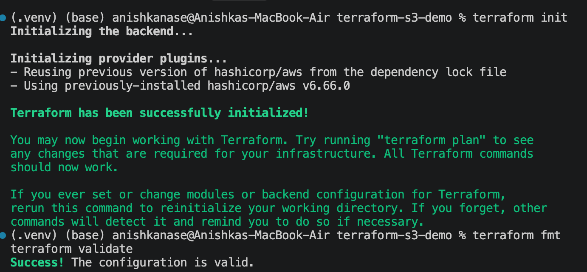
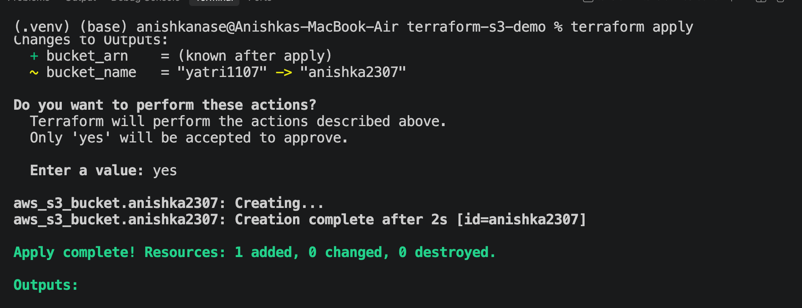
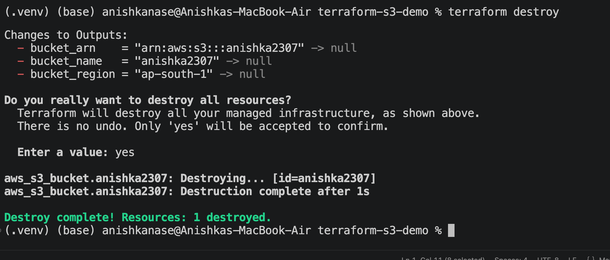

## 01. IAM — Governance

What is IAM? AWS Identity and Access Management (IAM) controls who can access AWS resources and which actions they can perform. It helps secure AWS accounts by managing identities and permissions.

Users: An IAM user is an identity representing a person or application that needs AWS access. It can have credentials and must be granted appropriate permissions.

Groups: An IAM group is a collection of IAM users. Permissions assigned to a group apply to its users, making it easier to manage access for teams.

Roles: An IAM role is an identity that an authorized user, application, or AWS service can assume to obtain temporary credentials. For example, an EC2 instance can assume a role to access an S3 bucket without storing long-term access keys.

Policies: An IAM policy is a JSON document that defines which actions are allowed or denied on specific resources and under which conditions. Policies can be attached to users, groups, roles, or resources.

Permissions: Permissions specify which AWS actions an identity can perform. For example, s3:GetObject allows reading an object when the necessary permissions are in place, while s3:DeleteObject allows deleting an object.

Least privilege: The principle of least privilege means granting only the permissions required to complete a task. For example, a user who only needs to view files should receive read access rather than full administrative access.

IAM best practices: Enable multi-factor authentication (MFA), avoid using the root user for everyday tasks, follow least privilege, prefer roles and temporary credentials where appropriate, protect access keys, review permissions regularly, and monitor account activity.

Common use cases: IAM is used to manage developer access, allow EC2 applications to access S3, control database permissions, separate administrator and read-only access, and manage secure access between AWS accounts.

## 02. EC2 — Compute

What is EC2? Amazon Elastic Compute Cloud (EC2) provides virtual servers in the cloud. You can choose their operating system, CPU, memory, storage, and networking based on your application's needs.

AMI: An Amazon Machine Image (AMI) is a template used to launch an EC2 instance. It contains the information required to configure the instance, including its operating system and potentially preinstalled software.

Instance types: Instance types determine an EC2 instance's computing resources. General-purpose instances provide a balance of CPU and memory, compute-optimized instances suit CPU-intensive workloads, and memory-optimized instances suit applications that require large amounts of RAM.

Key pairs: An EC2 key pair consists of a public key and a private key used for authentication. For example, you can use the private key to connect to a Linux instance through SSH. Keep the private key secure.

Security Groups: A security group acts as a virtual firewall for an EC2 instance. It controls allowed inbound and outbound traffic using rules for ports, protocols, and sources or destinations. Security groups are stateful, so response traffic for an allowed connection is automatically permitted.

EBS: Amazon Elastic Block Store (EBS) provides block storage volumes that can be attached to EC2 instances, similar to hard drives. It stores data persistently and supports snapshots for backups.

Public vs private IP: A public IP address can be used for internet communication when routing and security rules permit it. A private IP address is used for communication within private networks, such as a VPC. An instance generally has a private IP, while a public IP depends on its configuration.

Instance lifecycle: EC2 instances move through states such as pending, running, stopping, stopped, shutting-down, and terminated. A stopped instance can generally be restarted, but a terminated instance cannot. Stopping an instance can stop compute charges, although storage and other resources may continue to incur charges.

Common use cases: EC2 is used to host websites, run backend applications, create development environments, process data, run scheduled jobs, and operate applications that need configurable virtual servers.

## 03. S3 — Storage

What is S3? Amazon Simple Storage Service (S3) is an object storage service used to store and retrieve files such as images, videos, backups, documents, and application data.

Buckets: A bucket is a container for storing S3 objects. Buckets are created in AWS Regions, and general-purpose bucket names must be globally unique within the applicable AWS partition.

Objects: An object is the data stored in S3, along with metadata. Each object has a key that identifies it within the bucket. For example, photos/profile.jpg can be an object key; the slash does not represent a traditional directory.

Storage classes: S3 storage classes balance storage cost, access speed, and availability. S3 Standard is suitable for frequently accessed data, S3 Intelligent-Tiering suits changing access patterns, and Infrequent Access and Glacier classes suit less frequently accessed or archival data.

Versioning: S3 Versioning stores multiple versions of an object. If a file is overwritten or deleted, previous versions may remain recoverable, helping protect against accidental changes and deletions.

Lifecycle policies: S3 Lifecycle policies automatically transition objects to different storage classes or expire objects after a specified period. For example, old backups can be moved to a lower-cost archival class.

Encryption: S3 automatically encrypts new objects at rest using server-side encryption with S3-managed keys by default. You can also use AWS KMS-based encryption for additional key-management controls. Encryption does not replace access permissions.

Bucket policies: A bucket policy is a JSON document attached to an S3 bucket that defines which principals can perform which actions on bucket resources. It can allow or deny access based on identities, resources, and conditions.

Common use cases: S3 is used for backups, media storage, static website files, application logs, data lakes, file sharing, and CI/CD build artifacts.

## 04. VPC — Networking

What is VPC? Amazon Virtual Private Cloud (VPC) provides a logically isolated virtual network for AWS resources. You control its IP address ranges, subnets, routes, and network access.

CIDR: Classless Inter-Domain Routing (CIDR) represents an IP address range using an address and prefix length. For example, 10.0.0.0/16 contains 65,536 IPv4 addresses in total.

Subnets: A subnet is a range of IP addresses within a VPC. Each subnet belongs to one Availability Zone and helps organize resources and control their network connectivity.

Route tables: A route table contains rules that determine where network traffic goes. Routes can direct traffic to targets such as the local VPC network, an Internet Gateway, or a NAT Gateway.

Internet Gateway: An Internet Gateway connects a VPC to the internet. A resource generally also needs appropriate routing, public IP addressing, and security rules to communicate directly with the internet.

NAT Gateway: A NAT Gateway allows resources in a private subnet to initiate connections to external networks, such as the internet, without allowing unsolicited inbound internet connections to those resources. NAT Gateways incur charges for usage.

Security Groups: Security groups control allowed inbound and outbound traffic for resources or network interfaces. They are stateful and allow traffic through defined rules rather than using explicit deny rules.

Network ACLs: Network Access Control Lists (NACLs) control inbound and outbound traffic at the subnet level. They support both allow and deny rules and are stateless, so response traffic must also be permitted by the rules.

Public vs private subnet: A public subnet has a route to an Internet Gateway. A private subnet does not have a direct route to an Internet Gateway. Private resources can use a NAT Gateway for outbound internet access when configured. For example, a load balancer may be public while application servers and databases remain private.

## 05. DynamoDB & RDS — Database Services

### DynamoDB

NoSQL: Amazon DynamoDB is a managed NoSQL database that supports key-value and document data models. It is designed for applications that need scalable, low-latency data access.

Tables: A DynamoDB table is a collection of related data items. For example, an online shopping application may have an Orders table.

Items: An item is an individual record in a table, similar to a row in a relational database. Each item is identified by its primary key.

Attributes: Attributes are pieces of information within an item, similar to fields or columns. For example, an order may have OrderID, CustomerID, Amount, and Status.

Partition key: The partition key is a primary-key attribute whose value DynamoDB uses to distribute data internally. Choosing a well-distributed partition key helps avoid uneven data distribution.

Sort key: A sort key is an optional second primary-key attribute used together with the partition key. Multiple items can share a partition-key value when their sort-key values differ. For example, a customer ID can be the partition key and an order timestamp the sort key.

Use cases: DynamoDB is used for shopping carts, user sessions, gaming data, IoT applications, user profiles, and event-driven applications requiring scalable key-based access.

### RDS

Relational database: Amazon Relational Database Service (RDS) is a managed service for setting up, operating, and scaling relational databases. Relational databases organize data into tables with relationships and support SQL queries.

Supported engines: RDS supports engines such as PostgreSQL, MySQL, MariaDB, Oracle Database, Microsoft SQL Server, and IBM Db2. Amazon Aurora is also available through the broader RDS service.

DB instances: A DB instance is the compute environment running a database engine. You choose its instance class, storage, and configuration according to your application's needs.

Security: RDS security includes configuring security groups, using private subnets, enabling encryption, protecting database credentials, and granting only required permissions. Databases should generally not be exposed directly to the public internet.

Backups: RDS supports automated backups and manual snapshots. These can be used to restore a database after accidental deletion, data loss, or other problems.

Multi-AZ: Multi-AZ deployments use database infrastructure across multiple Availability Zones to improve availability and support failover. In a standard Multi-AZ DB instance deployment, the standby is primarily for failover rather than read traffic.

Read replicas: Read replicas are copies of a source database that can handle read queries. They help distribute read-heavy workloads and reduce pressure on the primary database. Replication is generally asynchronous, so a replica may temporarily lag behind the source.

Use cases: RDS is useful for e-commerce platforms, booking systems, customer-management applications, banking systems, and other applications requiring relational data, SQL queries, transactions, and structured relationships.