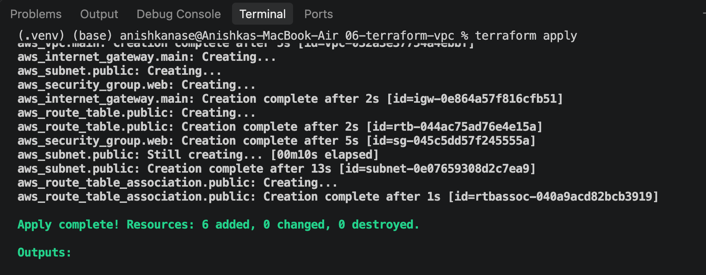
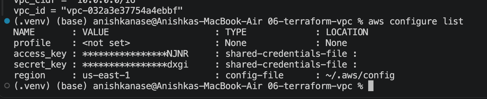
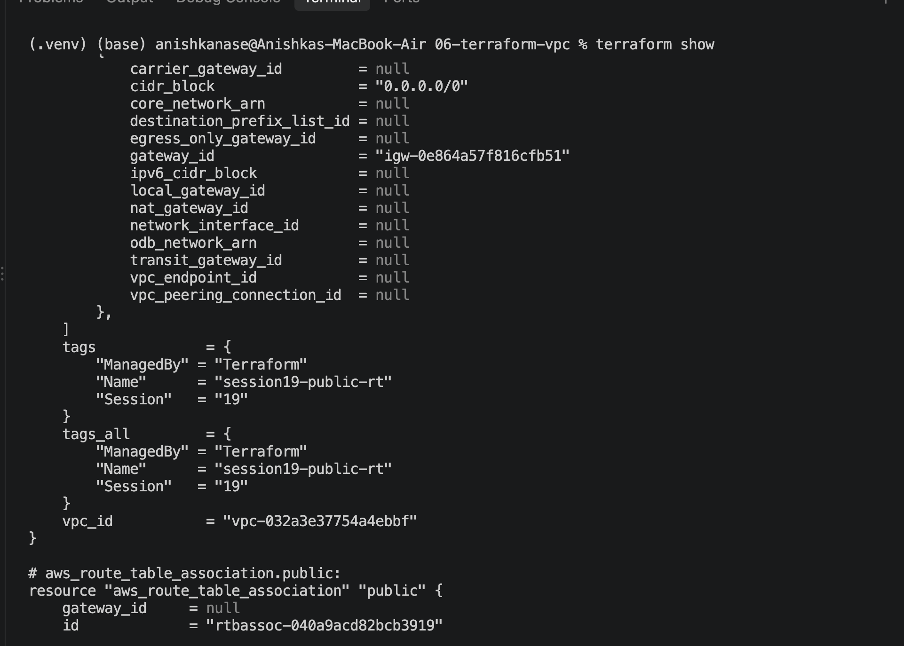
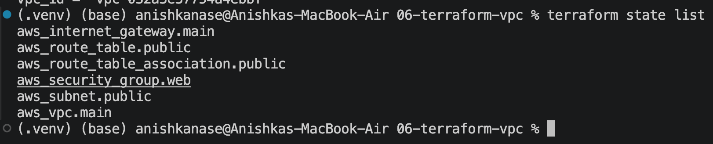

# DevOps & Cloud [SWE] — Class 20 Notes

**Lecture Title:** Cloud & Terraform in Action — Cloud Service Models, Regions & AZs, the AWS VPC, and Building a VPC with Terraform
**Date/Time:** 3 October 2026, 4:15 PM
**Duration:** 120 minutes
**Instructor:** Nensi Ravaliya
**Big idea:** Everything you deploy in the cloud lives inside a **VPC** — a private, walled-off network built from **five components** (Internet Gateway, Subnet, Route Table, Route Table Association, Security Group) — and Terraform can build all six resources with one `terraform apply` and remove them with one `terraform destroy`.
**Sources:** class transcript · her repo folder for this session, [`Nency-Ravaliya/devops-heros` → `session19-cloud-terraform`](https://github.com/Nency-Ravaliya/devops-heros/tree/main/session19-cloud-terraform) (`01-cloud-service-models` … `08-mini-project` READMEs and the `06-terraform-vpc` Terraform code she screen-shared) · the student's own `06-terraform-vpc/` working folder, `Readme.MD` and the seven terminal screenshots in this class folder.

---

> 📌 **Title check — this time the title is right.** After a run of classes whose folder names promised one topic and taught another, *"Cloud & Terraform in Action"* is an honest name for this one. "Cloud" = §3–§4 (IaaS/PaaS/SaaS, regions and availability zones). "Terraform in action" = §6–§11 (building a real VPC on AWS with real credentials). The fuller title above just spells out that **the VPC is the star** — about two-thirds of the class.

> 📌 **Her session numbering vs. your folder numbering.** In her repo this is **`session19-cloud-terraform`**, and every resource the code creates is tagged `Session = "19"` and named `session19-…`. Your folder is `Class-20`. Same class — go by content, not numbers.

---

## 0. The 60-Second Version

1. **Cloud = services running over the internet.** Three big providers: **AWS**, **Microsoft Azure**, **GCP**.
2. **IaaS / PaaS / SaaS** = how much the cloud does for you. **EC2** is IaaS (you get a bare server), **Elastic Beanstalk** is PaaS (server + dependencies ready, you bring code + data), **Gmail** is SaaS (you just use it and pay the subscription).
3. **Region > Availability Zone > physical servers.** A region is a geographic area (`ap-south-1` = Mumbai). Inside it, several **AZs** = separate data centres. Spread across AZs to survive a data-centre failure; spread across **regions** to survive a whole-region failure.
4. **A VPC is your private network in the cloud.** Your EC2s, EKS clusters and databases live *inside* it, behind an extra wall. Traffic path: **user → internet → IGW → VPC → subnet → your resource.**
5. **Five components build a VPC:** **Internet Gateway**, **Subnets** (public/private), **Route Table**, **Route Table Association**, **Security Group**. Plus the VPC itself = **6 resources** in `terraform plan`.
6. **Route table = WHERE does traffic go? Security group = IS this traffic ALLOWED?** Security groups have **inbound (ingress)** and **outbound (egress)** rules, all about ports and CIDR ranges.
7. **Every component carries `vpc_id`** — the VPC is the "empty bucket" and the `vpc_id` drops each component into it.
8. **The CIDR maths matters:** VPC `10.0.0.0/16`, subnets `10.0.1.0/24`, `10.0.2.0/24` … — a subnet must be *smaller* than its VPC. `0.0.0.0/0` = "anyone, anywhere".
9. **The workflow:** `aws configure` → set your region in `variables.tf` → `terraform init` → `fmt` → `validate` → `plan` (*6 to add*) → `apply` (`yes`) → check the console → `terraform show` / `state list` → **`terraform destroy`**.

---

## 1. 🗓️ Housekeeping — Second-Last Lecture, Repo Hunt & Credentials

**Where we are.** *"This is your second last lecture."* Terraform had been started last class (Class 19 — the S3 bucket demo) but wasn't finished, so today completes it with the networking side. Next class is the final project.

**Homework check first, teaching second.** Last class she'd assigned **five AWS services** to read up on and write a `README.md` for in your own repo: **IAM, EC2, S3, VPC, DynamoDB**. Before any new material she asked the class to *"ping me your repo right now"* in chat, then went row by row — *"First row… second row… share your repo"* — and read some of them on screen.

What she found:

- Some READMEs had all the right words (**CIDR blocks, NACL, SGs, NAT, subnet, private subnet, public subnet**) but the student couldn't explain them.

> 🎤 *"You are creating a readme.md file. **You need to understand what you are doing.** Maybe you created the file, then you just understand what you added."*

- Someone had pasted LLM output wholesale (*"take other, use LLM models, but see what you are…"*).
- Some people were committing live while she waited (*"you shared three minutes ago…"*), and one student had it only on local — she gave credit anyway: *"at least you are doing it."*
- She spotted spelling mistakes, and gave a deadline: wait a few more minutes (*"till 5…"*), then start the VPC.

**Credentials.** While everyone re-read the five READMEs (5 minutes, *"readme ko dekh lo"* — have a look at the README), she created an **IAM user per section** in her own AWS account, gave it **VPC full access** plus a tag (*"so if something happens, we can see it"*), generated an **access key + secret key**, and posted them on the notice board.

> ⚠️ **Her instructions, in Hindi:** *"I'm giving VPC full access — don't mess around, do only exactly as much as I tell you, okay?"* And: *"keep it safe."* She **deleted the user after class** (*"after 6:30"*).

**Prometheus / Grafana / ArgoCD.** Section B had already done Prometheus, Grafana and ArgoCD. The class asked whether they could squeeze Prometheus + Grafana in today after the VPC. Her answer: *"Let's try. We won't stretch, don't worry — I'll let you go before 6:30, it won't go till 8."* She sold it as easy: *"`docker compose up`, `docker compose down`… username and password, how to connect it… a colourful dashboard — CPU, load, it will go red and green."* **It didn't fit** — it was pushed to the next lecture (§13).

> 😄 **Class moment.** The tangent on why NVIDIA became a trillion-dollar company — chips in everything (including, she said, the weapons driving current wars), employees who joined five years ago becoming *"billionaires"*, and a friend at NVIDIA Bangalore who told her she'd joined two years too late. Her point underneath it: *"NVIDIA is a hardware company? But no — **the cloud and DevOps scope is very large in NVIDIA**."*

**Attendance** was taken at the very end as a roll call of enrollment-number suffixes, with a check of *which region each person deployed in* (§10).

---

## 2. 🔁 Warm-Up Drill — The Five AWS Services

> 📌 These five services were **homework**, not taught in a previous class. This drill was her checking that you'd actually read about them.

| Question | Who | Answer given | Verdict |
|---|---|---|---|
| How many services did I give you? | Class | **5** — IAM, EC2, S3, VPC, DynamoDB | ✅ |
| Where do we use EC2? | Class | *"As a server"* | ✅ |
| What is DynamoDB? | Class | *"For database"* — then pushed: **key-value pairs**, **non-relational** | ✅ |
| And for a relational database on AWS? | Class | **RDS** | ✅ |
| What is S3? | Class | **Object storage** | ✅ |
| What can you store in S3? | Class | Images, media files, video, audio, text, PDF, Word files | ✅ |
| What are the S3 tiers? | Class | *"Standard tier, premium tier"* — mostly silence | ⚠️ she said *go explore these* |
| What did you learn about VPC? | Class | Thin answers; she listed the vocabulary instead (below) | ❌ → today's topic |

### 2.1 DynamoDB — a table of name → value

> 🎤 *"It's kind of a table where we are storing our variable name and value — that's what DynamoDB is. You are asking for your value — that's why you need to **query your variable name** inside your table."*

> 🧠 **Her Kubernetes link:** *"In Kubernetes we have **etcd** — same kind of structure we have inside DynamoDB."* Both are key-value stores: you ask by key, you get the value back.
>
> ```
> DynamoDB / etcd                 RDS (MySQL, Postgres)
> ┌───────────────┬──────────┐    ┌────┬────────┬───────┬──────┐
> │ key           │ value    │    │ id │ name   │ city  │ age  │
> ├───────────────┼──────────┤    ├────┼────────┼───────┼──────┤
> │ user#42       │ {...}    │    │ 42 │ Anish  │ Pune  │ 21   │
> │ cart#42       │ {...}    │    │ 43 │ Riya   │ Delhi │ 22   │
> └───────────────┴──────────┘    └────┴────────┴───────┴──────┘
>  non-relational, look up by key   relational: fixed columns, JOINs, SQL
> ```

### 2.2 S3 tiers — the bit nobody knew

> 🔍 **Clarified, since "standard tier, premium tier" isn't the real list.** S3 calls them **storage classes**, and the idea is *"pay less to store it if you'll read it less often."* The common ones:
>
> | Storage class | Use it for |
> |---|---|
> | **S3 Standard** | Frequently-read data (the default) |
> | **S3 Intelligent-Tiering** | Unknown access pattern — AWS moves it for you |
> | **S3 Standard-IA** (Infrequent Access) | Read rarely, but needed fast when read |
> | **S3 One Zone-IA** | Same, cheaper, stored in **one AZ** only (see §4) |
> | **S3 Glacier** (Instant / Flexible / Deep Archive) | Archives and backups — cheapest, slower to get back |
>
> *Filled in — not said in class.* There is no "premium" class. She flagged tiers as *"very important concepts"* that you must explore yourself, so expect the question.

### 2.3 The VPC vocabulary she listed

> 🎤 *"These are the things that you need to understand: **CIDR blocks, NACL, SGs, NATs, subnet, private subnet, public subnet**."* Plus: **Internet Gateway (IGW)**, **route table**, **route table association**.

Every one of these except NACL is explained in §5–§7. NACL was only expanded (*"Network Access Control List"*), never defined, so:

> 💡 **NACL vs Security Group — the one-minute version.** Both are firewalls inside a VPC, at different doors.
>
> ```
>           ┌──────────────── SUBNET ────────────────┐
> traffic ─►│ NACL  (the gate of the housing society) │
>           │   ┌──── EC2 ────┐                       │
>           │   │ SG (the flat's own door lock)       │
>           │   └─────────────┘                       │
>           └─────────────────────────────────────────┘
> ```
>
> | | **Security Group** | **NACL** |
> |---|---|---|
> | Attached to | an instance / network interface | a whole **subnet** |
> | Rules | **allow only** | allow **and deny** |
> | Remembers connections? | **Yes — stateful** (reply traffic auto-allowed) | **No — stateless** (must allow the reply too) |
>
> *Filled in — not taught in class.* Today's Terraform only builds a **security group**.

---

## 3. ☁️ What Is the Cloud? IaaS, PaaS, SaaS

> 🎤 *"What do you mean by cloud? **Services running over the internet.** That is what the cloud is."*

**Three major cloud platforms:** **AWS**, **Microsoft Azure**, **GCP** (Google Cloud Platform).

> 🧠 **Her repo's analogy — renting a place to live.**
>
> | Model | You rent… | You still do… |
> |---|---|---|
> | **IaaS** | an **empty house** | furniture, cooking, cleaning — almost everything |
> | **PaaS** | a **furnished apartment** | just move in with your stuff (your code) |
> | **SaaS** | a **hotel room** | nothing — you just use it |

### 3.1 IaaS — Infrastructure as a Service

The cloud gives you raw building blocks — a virtual machine, storage, a network. Everything on top is yours.

- **AWS:** **EC2** instance (also EBS disks, VPC)
- **Azure:** Virtual Machine

> 🎤 *"Give me a virtual server. I will install Java, configure Nginx and deploy my application."* *(from her repo)*

### 3.2 PaaS — Platform as a Service

> 🎤 *"Platform as a service means a kind of a service that is providing you a server infrastructure **with all the predefined dependencies** that you need to run your application."*

Her worked example — a full-stack Java app:

```
 Your app:  React front end  +  Java (Maven) back end  +  MySQL / Postgres

 On IaaS (EC2) you must install yourself:     On PaaS it's already there:
   ☐ Java runtime                               ✅ Java runtime
   ☐ Node / React build tools                   ✅ build tools
   ☐ MySQL / Postgres drivers                   ✅ drivers
   ☐ then copy your code in and run it          → you bring only CODE + DATA
```

- **AWS:** **Elastic Beanstalk** · **Azure:** App Service · **Google:** App Engine

> 🔍 **Clarified — "EBS" in the transcript.** The audio says *"EBS is one of the services in AWS that you are using as a platform as a service."* In AWS, **EBS** is *Elastic Block Store* — a disk, which is **IaaS**. The PaaS she means is **Elastic Beanstalk** (sometimes shortened "EB"), which is exactly what her repo lists. Answer **Elastic Beanstalk** for PaaS.

### 3.3 SaaS — Software as a Service

The whole thing — infrastructure, dependencies, application, data — is already built. **You're the user paying a subscription.**

Her story: say she starts a startup called **Yatri Cloud**. She doesn't build an email server — she buys 50 Google Workspace accounts and every employee gets `firstname.lastname@yatricloud.com`, which is really **Gmail**.

> 🧠 **You already use this.** *"Just like you have your Scaler ID… what about those IDs? Actually **those are Google accounts.** Scaler is using those Google accounts from Google."*

Other SaaS: Google Docs, Microsoft 365, Slack.

### 3.4 Who manages what

| Layer | IaaS | PaaS | SaaS |
|---|---|---|---|
| Application & data | **You** | **You** | Provider |
| Runtime / dependencies | **You** | Provider | Provider |
| OS | **You** | Provider | Provider |
| Servers, storage, network | Provider | Provider | Provider |
| Example | EC2 | Elastic Beanstalk | Gmail |

> ✅ **IaaS → more control, more responsibility. PaaS → less infrastructure work. SaaS → just use the software.**

> 🧪 **Try it yourself — classify these** *(from her repo)*: EC2 · Gmail · Elastic Beanstalk · Google Docs · Virtual Machine.
>
> **Answers:** EC2 → IaaS · Gmail → SaaS · Elastic Beanstalk → PaaS · Google Docs → SaaS · Virtual Machine → IaaS.

---

## 4. 🌍 Regions & Availability Zones

### 4.1 Region — a geographic location

> 🎤 *"Geographical locations where your data center is there. Inside your data center you have servers, nothing else. Those we call regions."*

Last class you created S3 buckets in different regions. Regions named in class:

| Code | Where | Mentioned how |
|---|---|---|
| `ap-south-1` | **Mumbai**, India | *"one of the regions we have inside India"* |
| `ap-south-2` | **Hyderabad**, India | a student said "Hyderabad" — right city, she wanted the code |
| `us-east-1` | N. Virginia | used in class |
| `us-east-2` | **Ohio** | used in class |
| `us-west-1` | N. **California** | used in class (the student's region) |
| `us-west-2` | Oregon | used in class |
| `ap-southeast-1` | **Singapore** | *"long name… AP South-East one"* |
| `ap-southeast-2` | **Sydney** | used in class |
| `ap-northeast-1` | **Tokyo** | her own demo region |
| `ap-northeast-2` | **Seoul** | *"Seoul is a very good city… I remember the drama"* |
| `ap-northeast-3` | Osaka | used in class |

*(Region-to-city mapping filled in from AWS's standard list.)*

### 4.2 Availability Zone — several data centres inside one region

> 🎤 *"Don't you think we have only one data center? … There is one big region and inside that region we have multiple data centers… Those multiple data centers that we have inside our region, that we call **availability zone**."*

> 🧠 **Her nesting picture — like AI ⊃ ML ⊃ DL.**
>
> ```
> ┌──────────────── REGION  (ap-south-1, Mumbai) ────────────────┐
> │  ┌──── AZ  ap-south-1a ────┐   ┌──── AZ  ap-south-1b ────┐   │
> │  │  [srv][srv] servers     │   │  [srv][srv] servers     │   │
> │  └─────────────────────────┘   └─────────────────────────┘   │
> └───────────────────────────────────────────────────────────────┘
>   Region  >  Availability Zone  >  physical server
> ```
>
> Her repo's version: **Region = a city. AZ = separate buildings/campuses in that city.**

> 💡 **AZ names are the region code + a letter** — `us-west-1a`, `ap-south-1b`. That's exactly what the Terraform does in §9: `availability_zone = "${var.aws_region}a"`.

### 4.3 Why bother? Latency and failure

**Latency.** You're in Bangalore searching Google. Your query goes to a nearby DNS, lands on servers in India (`ap-south-1`, zone A or B), and comes back in micro-seconds. Hit the *same* app hosted in the US and the response is noticeably slower — just from the distance.

**Failure.** She walked it through as a story:

> 🎬 **Watch it happen — what survives which disaster.**
>
> ```
> FRAME 1 — normal day
>   India user ──► ap-south-1 / AZ-a  ✅  (fastest)
>
> FRAME 2 — AZ-a goes down
>   India user ──► ap-south-1 / AZ-b  ✅  (still India, still fast — backup was in AZ-b)
>
> FRAME 3 — a storm takes out BOTH Indian AZs
>   only ap-south-1 deployed?  ──►  ❌  "you lost your data and you lost your money"
>
> FRAME 4 — same storm, but a geo-backup exists
>   India user ──► DNS routes to nearest healthy region (e.g. us-east-1 / AZ-a) ✅
>   "My application will not go down for even five seconds."
> ```

> ✅ **The rule:** multiple **AZs** protect you from a *data-centre* failure. Multiple **regions** protect you from a *whole-region* failure. Which you need depends on the client — a giant like Microsoft runs in essentially every region and AZ.

**Scale:** *"Worldwide we have around 27 regions — not sure, 27 was the last count… more than 100 plus availability zones."*

> 🔍 **Clarified — the numbers move.** AWS keeps adding regions; the count is now in the **30s**, with **100+ AZs**. For an exam, "~30 regions, 100+ AZs" is safe; the *hierarchy* is what's actually tested.

> 💡 **Which resources live where** *(from her repo)*: a **VPC is regional** (spans all AZs of its region); a **subnet lives in exactly one AZ**. That's why real architectures put one public + one private subnet in *each* of two AZs (§5).

> 🎯 **Interview alert:** *"What's the difference between AWS regions and availability zones?"* — she said anyone who has cleared **AWS Cloud Practitioner** or **Azure Fundamentals** knows this one cold.

---

## 5. 🏰 The VPC — Your Private Network in the Cloud

> 🎤 *"Whatever applications you are deploying — on an EC2 instance or maybe some EKS cluster — do you know this EC2 instance, EKS cluster are inside one **virtual environment** that we call **VPC**?"*

**VPC = Virtual Private Cloud.** Its job: an **extra layer of security** so that nobody on the internet can hit your EC2 / EKS / website directly — *"even if you have the IP address."*

> 🧠 **Picture a gated campus.** The VPC is the campus wall. The **Internet Gateway** is the main gate. **Subnets** are the buildings — some face the street (public), some are deep inside with no street door (private). **Route tables** are the signboards at every junction. **Security groups** are the guard at each building's door with a guest list.

### 5.1 The request path

```
   user (laptop)
        │   google.com
        ▼
   INTERNET
        │
        ▼
   IGW  (Internet Gateway)          ← the gate between internet and VPC
        │
┌───────┴──────────────── VPC 10.0.0.0/16 ─────────────────────────┐
│       ▼                                                           │
│  ┌── PUBLIC SUBNET ──────┐        ┌── PRIVATE SUBNET ───────────┐ │
│  │  EC2 / EKS / web app  │ ─────► │  database, internal services│ │
│  └───────────────────────┘        └─────────────────────────────┘ │
└───────────────────────────────────────────────────────────────────┘
```

### 5.2 Public vs private subnet

> 🎤 *"Subnet means, by the way, just a **virtual partitioning inside your VPC**."*

| | **Public subnet** | **Private subnet** |
|---|---|---|
| Reachable from IGW? | **Yes** | **No** — *"we cannot even reach out directly from IGW"* |
| What goes in it | EC2 web servers, your cluster, the front door of the app | **databases**, **internal company services** you don't want exposed *"outside the world"* |
| Example | the website | the Postgres your website talks to |

**Q: What can we put in a private subnet?** Class: *"Internal services."* ✅ She added the second big one: **the database**. *"Database you can't add inside your public subnet… Database you are adding inside your private subnet."*

### 5.3 NAT

**Q: Who knows NAT?** A student: *"Network Address Translation"* ✅ … *"to connect your private subnet to the internet"* ✅.

Her description: *"You are not able to access directly your private subnet from internet. You need to go through first IGW, and then IGW will connect with your NAT, and then through NAT you can go to your private subnet."*

> 🔍 **Clarified, since the direction matters.** A **NAT gateway** works **outbound only**. It sits in a *public* subnet and lets machines in the *private* subnet start connections **out** to the internet (to download updates, call an API) — while the internet still **cannot start a connection in**.
>
> ```
> private EC2 ──► NAT gateway (in public subnet) ──► IGW ──► internet   ✅ outbound
> internet    ──► IGW ──► NAT ──► private EC2                           ❌ not possible
> ```
>
> So the honest answer to *"how does the internet reach my private database?"* is **it doesn't — that's the point.** Your public-subnet app (or a load balancer) talks to it *inside* the VPC. For her course, *"NAT connects your private subnet to the internet"* is the answer she accepted — just know it's *outward*.

### 5.4 The standard production layout

> 🎤 *"In VPC, minimum we have **two public subnets and two private subnets** whenever you are creating architecture… Always you have a VPC and four subnets, two public and two private, and always you have an IGW and NAT to add an extra layer of security."* — *anyone into system design or solution architecture knows this.*

```
┌──────────────────────── VPC 10.0.0.0/16 ────────────────────────┐
│        AZ-a                               AZ-b                   │
│  ┌ public  10.0.1.0/24 ┐           ┌ public  10.0.2.0/24 ┐       │
│  │  web / NAT          │           │  web / NAT          │       │
│  └─────────────────────┘           └─────────────────────┘       │
│  ┌ private 10.0.3.0/24 ┐           ┌ private 10.0.4.0/24 ┐       │
│  │  database / internal│           │  database replica   │       │
│  └─────────────────────┘           └─────────────────────┘       │
└──────────────────────────────── IGW ─────────────────────────────┘
```

*(Placing one public + one private per AZ is the standard reason for "two of each" — see §4.)*

### 5.5 Everything you've learned runs in here

> 🎤 *"Whatever we learned so far — **Kubernetes, Terraform, CI/CD**, everything — whatever you are running, it will be always inside your VPC."*

Her picture: the whole **cluster** in the public subnet, reaching **volumes/storage** in an S3 bucket or a **private database** in the private subnet — *"so no one can hack your application directly and you can access your data internally very fast."*

**Layers of security:** *"There is a firewall, there is a load balancer, and there is one VPC… there are seven layers of security — at least we are creating four layers of security in each type of application."* As a beginner you won't add them all, but every production app has them.

---

## 6. 🧩 The Five Components That Build a VPC

> 🎤 *"If you want to create a VPC, you need to create **five components** in Terraform."*

| # | Component | Terraform resource | One-line job |
|---|---|---|---|
| 1 | **Internet Gateway (IGW)** | `aws_internet_gateway` | The door between the internet and the VPC |
| 2 | **Subnets** | `aws_subnet` | Partitions of the VPC's IP range (public / private) |
| 3 | **Route Table** | `aws_route_table` | Rules for **where** traffic goes |
| 4 | **Route Table Association** | `aws_route_table_association` | Ties a route table to a subnet |
| 5 | **Security Group** | `aws_security_group` | Rules for **which** traffic is **allowed** (inbound/outbound) |
| + | **The VPC itself** | `aws_vpc` | The container all five go into |

> ✅ *"When I do `terraform apply`, I will see **6 resources** — 5 components and the 6th is the VPC."*

### 6.1 Route table — the signboards

> 🎤 *"Route table, where we are mentioning **where your traffic will go**… We are putting **routing rules** inside our route table."*

Her example: traffic arrives on port 80 at the front-end service; to get the response from the back end, *"whenever I get some traffic on my 8080 port number, please redirect it to backend-service-1."*

> 🔍 **Clarified, since an AWS route table doesn't look at ports.** A VPC route table matches only the **destination IP range** and says which **target** to send it to. It knows nothing about ports or services.
>
> | Destination | Target | Meaning |
> |---|---|---|
> | `10.0.0.0/16` | `local` | anything inside the VPC — deliver locally (AWS adds this automatically) |
> | `0.0.0.0/0` | `igw-…` | everything else — out through the Internet Gateway |
>
> "Port 8080 → backend-service-1" is the job of a **load balancer listener rule**, a **Kubernetes Service** (`port` → `targetPort`), or an **Ingress** — the things you built in Classes 11–14. Keep her mental model (*"route table = where traffic goes"*), but in an AWS answer say **"destination CIDR → target"**, not "port → service". Her own repo puts it right: *"A route table is like a road map."*

### 6.2 Route table association — who uses which signboard

> 🎤 *"In route table we have hundreds or thousands of rules. Who will manage those rules? For that we have an association table where we are managing all the routes."*

> 🔍 **Clarified — what an association physically is.** It's a single link: **"subnet X uses route table Y."** That's it — two IDs (`subnet_id`, `route_table_id`), exactly what the Terraform in §9 has. A route table on its own affects nothing; it only takes effect on the subnets associated with it.
>
> 🧩 **And this is what makes a subnet "public."** A subnet is public *because* it's associated with a route table that has `0.0.0.0/0 → IGW`. Creating an IGW alone doesn't make anything public *(her repo: "Creating an Internet Gateway does not automatically make every subnet public").*

### 6.3 Security group — the guest list

> 🎤 *"Whenever you get traffic on port number 8080, do you want to allow it or not? Those types of rules we are putting inside our security group."*

Two kinds of rule, *"all about port numbers"*:

| Rule | Terraform block | Means | Her example |
|---|---|---|---|
| **Inbound** | `ingress` | traffic **coming in** | users hitting port 8080 / 80 / 443 — allow it? |
| **Outbound** | `egress` | traffic **going out** | the EC2 sending output back to the user — allow it? |

> 😄 **Class moment — the "Ingress" word again.** She asked if they recognised **Ingress** from Kubernetes. Same English word, different thing: here **ingress/egress just mean inbound/outbound** — *"nothing else."* In Kubernetes (Class 14) an Ingress is a routing rulebook.

> 🔍 **Clarified — you don't need an outbound rule for the reply.** Her outbound example (*"the backend sends output on port 80, so put 80 in the outbound rule"*) suggests replies need an egress rule. They don't: **security groups are stateful** — if an inbound request was allowed, its **response is automatically allowed out**. Egress rules are for connections your server *starts* (calling an API, `apt update`). Her repo says it plainly: *"Security Groups are stateful."* Today's code uses one catch-all egress rule anyway, so nothing breaks.

> ✅ **The memory trick (from her repo):**
>
> ```
> Route Table    = WHERE?    (which way does this packet go)
> Security Group = ALLOWED?  (is this packet let in at all)
> ```

> 🎯 **Interview alert:** *"Route table vs security group?"* She called it *"both confusing"* and promised to make sure it wouldn't confuse you. One answers **direction**, the other answers **permission**.

### 6.4 The class recall

| Question | Answer given | ✅ |
|---|---|---|
| Component 1? | **Internet Gateway (IGW)** | ✅ |
| Component 2? | **Subnets** | ✅ |
| Component 3? | **Route tables / routing** | ✅ |
| Component 4? | **Association table** | ✅ |
| Component 5? | **Security group** | ✅ |
| How many resources will `apply` show? | **6** (5 + the VPC) | ✅ |

---

## 7. 🔢 Networking Recap — CIDR, Masks, Broadcast, Subnet Planning

> 📌 **Deliberate repeat.** This is Class 4 networking (IP classes, subnet masks, CIDR) coming back because a VPC is nothing *but* IP ranges. Written out in full again here, as she re-taught it.

### 7.1 The drill

| Question | Answer | ✅ |
|---|---|---|
| `10.0.0.0` — which class? | **Class A** | ✅ |
| `10.0.0.0/16` — network bits / host bits? | **16 network, 16 host** | ✅ |
| `/8` — how many network bits? | **8** | ✅ |
| What is a subnet? | *"A small network inside your main network"* | ✅ |
| What is a subnet mask? | Separates **network bits** from **host bits** | ✅ |
| Class A mask? | **255.0.0.0** | ✅ |
| Class B mask? | **255.255.0.0** | ✅ |
| Bits in IPv4? | **32** | ✅ |
| Octets? | **4** (8 bits each) | ✅ |
| `11111111` in decimal? | **255** | ✅ |
| 8 ones, 8 ones, then 0, 0 as an address? | **255.255.0.0** | ✅ |
| Broadcast address of `10.0.0.0` (class A)? | **10.255.255.255** — *"opposite to your subnet mask"* | ✅ |

> 🧠 **What `/16` actually says.**
>
> ```
> 10.0.0.0/16
> 00001010.00000000 . 00000000.00000000
> └── 16 network bits ┘ └── 16 host bits ──┘
>   fixed: "10.0"          free: .0.0 → .255.255
>
> mask  = 11111111.11111111.00000000.00000000 = 255.255.0.0
> broadcast = network part + ALL host bits set to 1 = 10.0.255.255
> ```
>
> | CIDR | Host bits | Addresses |
> |---|---|---|
> | `/8` | 24 | 2²⁴ = **16,777,216** |
> | `/16` | 16 | 2¹⁶ = **65,536** |
> | `/24` | 8 | 2⁸ = **256** |
> | `/0` | 32 | **every IPv4 address** |
>
> *(Address counts filled in — she asked "how many IPs with /8?" and the room didn't answer.)*

> 🔍 **A small precision.** *"10.255.255.255"* is the broadcast for the whole **class-A `/8`** network, which is what she asked. For your **`/16` VPC** it would be `10.0.255.255`, and for a `/24` subnet like `10.0.1.0/24` it's `10.0.1.255`. Same rule — *flip all host bits to 1* — applied to however many host bits you have.

### 7.2 Planning the four subnets

The VPC is `10.0.0.0/16`. Four subnets, two public and two private:

| Subnet | CIDR | Addresses |
|---|---|---|
| public-1 | `10.0.1.0/24` | 256 |
| public-2 | `10.0.2.0/24` | 256 |
| private-1 | `10.0.3.0/24` | 256 |
| private-2 | `10.0.4.0/24` | 256 |

**Why `/24`?** *"Here I have a 16. So which CIDR range am I able to create? **24**."* And you **cannot** make a subnet `/8` or `/16` inside a `/16`:

> 🎤 *"You cannot increase your CIDR range network bits, because you are dividing your network into even smaller chunks."*

> 🧠 **Her cake analogy (half-garbled in the audio, rebuilt).** A VPC is a cake of size 10. You can cut it into 5 + 5, or 2.5 + 2.5 + … — **smaller** pieces. You can never cut a piece bigger than the cake. Bigger prefix number (`/24`) = smaller piece.

> 💡 **AWS keeps 5 addresses of every subnet** (network address, VPC router, DNS, one reserved for future use, broadcast). So a `/24` gives you **251** usable IPs, not 256. *Filled in — not said in class, but a classic exam trick.*

### 7.3 `0.0.0.0/0` — "the whole world"

> 🎤 *"Whenever you see 0.0.0.0/0, that means **anyone from any place in this world** can access your public subnet through the IGW… Every web application you see — google.com, scaler.com, yatricloud.com — we have CIDR block 0.0.0.0/0 everywhere."*

It shows up twice in today's code: as the route-table destination (*send everything else to the IGW*) and as the security-group source (*accept ports 80/443 from anyone*).

---

## 8. 📁 The Terraform Project Layout

> 📌 Last class (Class 19) everything lived in one `main.tf`, and she promised: *"later on we will segregate all those blocks into different files."* This is that.

```
06-terraform-vpc/
├── versions.tf               ← Terraform version + provider (AWS)
├── variables.tf              ← variables: name, type, description, default
├── main.tf                   ← the actual resources (the 6 we're building)
├── outputs.tf                ← values to print after apply
├── terraform.tfvars.example  ← sample values to copy
├── terraform.tfvars          ← your values (gitignored)
└── .gitignore                ← keeps state, tfvars, .terraform/ out of git
```

| File | What goes in it (her words) |
|---|---|
| `versions.tf` | *"Provider and Terraform version — two things."* `required_version = ">= 1.6.0"`, the `hashicorp/aws` provider `~> 6.0`, and the `provider "aws" { region = var.aws_region }` block |
| `variables.tf` | *"Only the variable and variable name, and the default value, type and description."* |
| `outputs.tf` | *"Only the variable output."* — `vpc_id`, `vpc_cidr`, `subnet_id`, `security_group_id` |
| `main.tf` | *"Actually the main file — where you build what type of resources you want."* |

**Why no `provider.tf`?** *"There is only one cloud right now, AWS cloud. So we don't need a provider.tf file… If you have **multi-cloud**, then you create a `provider.tf` and mention these three lines two times — one for AWS and one for the other cloud."*

> 🧩 **Why it works — Terraform doesn't care about the file names.** It reads **every `.tf` file in the folder** and merges them into one configuration. `versions.tf`, `provider.tf`, `main.tf` are a *convention for humans*. You could put the provider block in `banana.tf` and it would still work. Splitting files is about readability, not behaviour.

> 💡 **Variable precedence, in one line.** `default` in `variables.tf` is the fallback; a value in **`terraform.tfvars` overrides it**; `-var` on the command line overrides both. *(Filled in — relevant to the student's setup in §11.)*

---

## 9. 🧱 Reading `main.tf` — Resource by Resource

She walked the file top to bottom in the order of the five components. Her repo's actual file orders them VPC → subnet → IGW → route table → association → SG; the code below follows the file.

### 9.1 The shape of every resource

```hcl
resource "aws_internet_gateway" "main" {
#  ▲        ▲                       ▲
#  keyword  resource TYPE           your NAME for it
#           (predefined by AWS      ("main", "public", "web"…
#            provider)               anything you like)
```

> 🎤 *"If you want to create EC2, you will mention `aws_instance`. If you want to create S3 — last time we did `aws_s3_bucket`, right? I want to create IGW, so there is a predefined keyword, `aws_internet_gateway`."*

### 9.2 The VPC — "the empty bucket"

```hcl
resource "aws_vpc" "main" {
  cidr_block           = "10.0.0.0/16"
  enable_dns_support   = true
  enable_dns_hostnames = true

  tags = {
    Name      = "session19-vpc"
    Session   = "19"
    ManagedBy = "Terraform"
  }
}
```

- `cidr_block` — the **only truly necessary** field. *"You will see the same IP address over there"* in the console.
- `enable_dns_support` / `enable_dns_hostnames` — *"not necessary."* (They let instances resolve DNS and get DNS names.)

### 9.3 Why `vpc_id` is everywhere

> 🧠 **Her bucket analogy.** *"You can assume there is a bucket. So the VPC is the bucket. And to create the VPC, you need five resources inside that bucket… How do I connect my bucket with all of these five components? … By VPC ID it will attach my component to the particular VPC."*
>
> ```
>               aws_vpc.main  [bucket] (the empty one)
>                    ▲
>    vpc_id ─────────┼──────────┬──────────────┬──────────────┐
>        aws_subnet   aws_internet_gateway  aws_route_table  aws_security_group
> ```

> 🧩 **Why it works — the reference *is* the dependency.** Writing `vpc_id = aws_vpc.main.id` does two things: it drops the component into the VPC, **and** it tells Terraform *"create the VPC first, I need its ID."* Terraform builds a dependency graph from these references, creates independent things **in parallel**, and dependent things **after**. You never write the order yourself. §10's apply output shows it happening.

### 9.4 The public subnet

```hcl
resource "aws_subnet" "public" {
  vpc_id                  = aws_vpc.main.id
  cidr_block              = "10.0.1.0/24"
  availability_zone       = "${var.aws_region}a"
  map_public_ip_on_launch = true
  tags = { Name = "session19-public-subnet", Session = "19", ManagedBy = "Terraform" }
}
```

- `"${var.aws_region}a"` builds the AZ name from the region: `us-west-1` → `us-west-1a`.
- `map_public_ip_on_launch = true` — any EC2 launched here gets a public IP automatically.

> 📌 **One subnet, not four.** In theory she described the 2-public + 2-private layout (§5.4, §7.2). The demo code builds **only `10.0.1.0/24`, one public subnet** — enough to show all five component *types* without NAT gateway charges. Adding the rest is a good exercise (§12).

### 9.5 The Internet Gateway

```hcl
resource "aws_internet_gateway" "main" {
  vpc_id = aws_vpc.main.id      # mandatory — which VPC this gate belongs to
  tags = { Name = "session19-igw", Session = "19", ManagedBy = "Terraform" }
}
```

> 🎤 *"The best practice says **always put a tag**."*

### 9.6 The route table

```hcl
resource "aws_route_table" "public" {
  vpc_id = aws_vpc.main.id

  route {
    cidr_block = "0.0.0.0/0"                       # destination: anywhere
    gateway_id = aws_internet_gateway.main.id      # target: the IGW
  }
  tags = { Name = "session19-public-rt", Session = "19", ManagedBy = "Terraform" }
}
```

*"Who will connect with your public subnet? Whenever you see `0.0.0.0/0`, anyone from any place in this world can access your public subnet through the IGW."*

### 9.7 The association

```hcl
resource "aws_route_table_association" "public" {
  subnet_id      = aws_subnet.public.id
  route_table_id = aws_route_table.public.id
}
```

> 🎤 *"You just need to add your subnet ID and then route table ID — those two things."* No tags — associations don't take them.

### 9.8 The security group

```hcl
resource "aws_security_group" "web" {
  name        = "session19-web-sg"
  description = "Security group for Session 19 web traffic"
  vpc_id      = aws_vpc.main.id

  ingress {                         # inbound #1
    description = "HTTP"
    from_port   = 80
    to_port     = 80
    protocol    = "tcp"
    cidr_blocks = ["0.0.0.0/0"]
  }
  ingress {                         # inbound #2
    description = "HTTPS"
    from_port   = 443
    to_port     = 443
    protocol    = "tcp"
    cidr_blocks = ["0.0.0.0/0"]
  }
  egress {                          # the only outbound rule
    description = "Allow outbound IPv4"
    from_port   = 0
    to_port     = 0
    protocol    = "-1"              # -1 = all protocols, all ports
    cidr_blocks = ["0.0.0.0/0"]
  }
  tags = { Name = "session19-web-sg", Session = "19", ManagedBy = "Terraform" }
}
```

**Port recall drill:**

| Port | Protocol | ✅ |
|---|---|---|
| 22 | **SSH** | ✅ (*"SSH ke liye kaun sa jaata hai? — 22. Good."*) |
| 80 | **HTTP** | ✅ |
| 443 | **HTTPS** | ✅ |

> 🎤 *"When we are creating an EC2 instance, first one is for SSH, second one is for HTTP and third one is for HTTPS."* This SG has only HTTP and HTTPS — *"majorly we will focus on ingress."*

> ⚠️ **SSH and `0.0.0.0/0`.** Her repo warns: opening port **22** to `0.0.0.0/0` is technically possible but exposes SSH to the entire internet. Restrict it to your own IP. That's why this SG leaves 22 out entirely.

### 9.9 `outputs.tf`

```hcl
output "vpc_id"            { value = aws_vpc.main.id }
output "vpc_cidr"          { value = aws_vpc.main.cidr_block }
output "subnet_id"         { value = aws_subnet.public.id }
output "security_group_id" { value = aws_security_group.web.id }
```

*(Each block also has a `description` in the real file.)* These are printed after `apply` and by `terraform output`.

---

## 10. 🚀 The Live Demo — 50 People, One AWS Account

### 10.1 The VPC limit, and why everyone got a region

> 🎤 *"One more fact: in one region, let's suppose AP South 1, **you can create only 5 VPCs**. So you'll get an error. Don't all of you do it in one region."*

So she split the room into groups of five, one region per group:

| Group | Region |
|---|---|
| 5 people | `us-east-1` (N. Virginia) |
| 5 people | `us-east-2` (Ohio) |
| 5 people | `us-west-1` (N. California) |
| 5 people | `us-west-2` (Oregon) |
| 5 people | `ap-south-1` (Mumbai) |
| 5 people | `ap-southeast-2` (Sydney) |
| overflow | Seoul, Osaka, Singapore, Tokyo |
| Her own demo | `ap-northeast-1` (**Tokyo**) |

> 💡 **Why the 5-VPC limit bites here.** The 5-per-region figure is AWS's **default quota** (it can be raised by request). Every region also already has a **default VPC**, so on a fresh account you really get room for ~4 more. Fifty students sharing one account blow through that instantly — hence the region assignments. *(Quota details filled in.)*

> 😄 **Class moment — "VPC limit exceeded."** It happened anyway: people drifted into Tokyo (*"in Tokyo only two people have deployed here"*), others picked regions that weren't theirs, and some groups had **destroyed before she could check** (*"Destroyed? What happened to you both?"*). Because the region was tied to names, she knew exactly who: *"I made that region with your name… I'm sure I know which person has done this."*

### 10.2 Configure, then the six commands

```bash
aws configure
# AWS Access Key ID:     <paste access key>
# AWS Secret Access Key: <paste secret key>
# Default region name:   <your assigned region>
# Default output format: json          ← "json is my format"
```

Then **change the region in the code** — line 16-ish: `variables.tf` → `variable "aws_region"` → `default`.

> ⚠️ **Her warning mid-demo:** *"You need to add your region inside your file. Make sure — because it will **override**."* Whatever region `aws configure` has, the provider uses `region = var.aws_region`, so the **code** wins. If you already applied in the wrong region: `terraform destroy`, fix `variables.tf`, apply again.

```bash
cd 06-terraform-vpc
terraform init        # downloads the hashicorp/aws provider, sets up the backend
terraform fmt         # tidies formatting
terraform validate    # "Success! The configuration is valid."
terraform plan        # "Plan: 6 to add, 0 to change, 0 to destroy."
terraform apply       # type: yes
```

> 🎤 *"Can you see there are **6 to add, 0 to change and 0 to destroy**. Six resources — one is the main VPC component and then five more components to create that VPC."*

> 🎬 **Watch it happen — the real apply order** (from the student's screenshot, §11):
>
> ```
> t=0s   aws_vpc.main ............................ Creating…
> t≈3s   aws_vpc.main ............................ ✅ complete
>        ├─ aws_internet_gateway.main ............ Creating…   ┐
>        ├─ aws_subnet.public .................... Creating…   ├ in parallel —
>        └─ aws_security_group.web ............... Creating…   ┘ all only need vpc_id
> t≈5s   aws_internet_gateway.main ............... ✅ (2s)
>        └─ aws_route_table.public ............... Creating…   ← needed the IGW's id
>        aws_route_table.public .................. ✅ (2s)
>        aws_security_group.web .................. ✅ (5s)
>        aws_subnet.public ....................... Still creating… [10s]
>        aws_subnet.public ....................... ✅ (13s)
>        └─ aws_route_table_association.public ... Creating…   ← needed subnet AND route table
>        aws_route_table_association.public ...... ✅ (1s)
>
> Apply complete! Resources: 6 added, 0 changed, 0 destroyed.
> ```
>
> Nobody wrote this order. Terraform worked it out from the `.id` references (§9.3).

### 10.3 Seeing it in the console

Switch the console to **your** region → **VPC** → your VPC. The **IPv4 CIDR** shows `10.0.0.0/16` — the same range you wrote. Then the **resource map** ("explore this VPC" → *show all details*): *"My subnet is connected where? Route table. Route table is connected to the network connection… and then IGW. Just click this, click this and click this."*

```
 VPC 10.0.0.0/16 ── Subnet 10.0.1.0/24 ── Route table (0.0.0.0/0 → igw) ── IGW
```

### 10.4 The screenshot homework

> 📝 **Homework — screenshot each of these into your README:**
>
> 1. `aws configure list` — *"to check your profile"*
> 2. `terraform show` — everything in state
> 3. `terraform show` for **one particular resource** → in practice `terraform state show aws_vpc.main`
> 4. `terraform state list` — *"you will see six resources"*
> 5. `terraform apply` — *"the green output: **6 added, 0 changed, 0 destroyed**"*
> 6. `terraform destroy` — **last**, and **only after she has checked your region**: *"Don't destroy it. Once I approve, then destroy."*
>
> *"If you know any other Terraform command you want to explore, you can explore."*

> 🏋️ **Do this yourself — the full VPC lab, start to finish.** (Use your own AWS account / free tier; a VPC, subnet, IGW, route table and SG cost nothing on their own.)
>
> 1. Clone her repo and go to the lab: `git clone https://github.com/Nency-Ravaliya/devops-heros && cd devops-heros/session19-cloud-terraform/06-terraform-vpc`
> 2. `aws configure` with an IAM user's keys. Check with `aws configure list` and `aws sts get-caller-identity`.
> 3. `cp terraform.tfvars.example terraform.tfvars` and set `aws_region = "ap-south-1"` (or edit the `default` in `variables.tf`).
> 4. `terraform init` → expect *"Terraform has been successfully initialized!"*
> 5. `terraform fmt` then `terraform validate` → *"Success! The configuration is valid."*
> 6. `terraform plan` → find the line **`Plan: 6 to add, 0 to change, 0 to destroy.`** Read each `+ resource` block.
> 7. `terraform apply` → type `yes` → watch the order (above) → note the four outputs.
> 8. `terraform output` and `terraform state list` → six addresses.
> 9. `terraform state show aws_route_table.public` → find `cidr_block = "0.0.0.0/0"` and the `igw-…` gateway.
> 10. Console → VPC → your region → open the **resource map**. Match each box to a resource block.
> 11. *(Optional, from her repo)* verify by CLI:
>     `aws ec2 describe-vpcs --filters "Name=tag:Name,Values=session19-vpc" --query 'Vpcs[].{VpcId:VpcId,Cidr:CidrBlock,State:State}'`
> 12. `terraform plan -destroy` → then `terraform destroy` → `yes` → **`Destroy complete! Resources: 6 destroyed.`**

---

## 11. 🔍 The Student's Run — Screenshots & File Review

These are from your own `06-terraform-vpc/` folder, run in **`us-west-1`** (N. California).

### 11.1 Apply

<p></p>

**What this proves:** the dependency order from §10.2 really happened — IGW, subnet and SG started together after the VPC, the route table waited for the IGW, the association waited for both — and the run ended **`Apply complete! Resources: 6 added, 0 changed, 0 destroyed.`** That's homework item 5.

### 11.2 `aws configure list`

<p></p>

**What this proves:** the keys came from the **shared credentials file** (`~/.aws/credentials`, shown masked), and the CLI's default region is **`us-east-1`** (from `~/.aws/config`).

> 🧩 **Why your VPC still landed in `us-west-1`.** The CLI says `us-east-1`, but `terraform show` says `region = "us-west-1"`. That's her *"it will override"* warning in action: the provider block says `region = var.aws_region`, and your code set `us-west-1`. **For Terraform, the code's region wins over `aws configure`.** Good — that's exactly the region you were assigned.

### 11.3 `terraform show`

You captured four pages of `terraform show`. The one worth keeping is the route table:

<p></p>

**What this proves:** the public route table holds one route, `cidr_block = "0.0.0.0/0"` → `gateway_id = "igw-…"` — the line that makes the subnet public — and every other target (`nat_gateway_id`, `transit_gateway_id`, `vpc_peering_connection_id`, …) is `null`. Below it, the association links `rtb-…` to `subnet-…` — just two IDs, as §6.2 said.

The other three pages (`image-2.png`, `image-4.png`, `image-5.png`) show the IGW, the SG's ingress/egress rules (ports 80 and 443 from `0.0.0.0/0`, egress `protocol = "-1"`), and the VPC (`cidr_block`, `enable_dns_*` = `true`, `main_route_table_id`, tags) plus the **Outputs** block. They're left out of the PDF on purpose:

> ⚠️ **Those three screenshots show your 12-digit AWS account ID** (in every `arn` and `owner_id`). It's your instructor's account and the user is gone, but get into the habit: **crop or blur account IDs, ARNs and keys before you push screenshots to a public repo.** `image-1.png` is fine — the CLI masks the keys.

> 💡 **Spot the "main" route table.** The VPC's `main_route_table_id` is a **different** `rtb-…` from `aws_route_table.public`. AWS automatically creates a *main* route table for every VPC (only the `local` route). Any subnet you *don't* associate explicitly falls back to it — which is why the association resource is needed.

### 11.4 `terraform state list`

<p></p>

**What this proves:** exactly the six addresses predicted — `aws_internet_gateway.main`, `aws_route_table.public`, `aws_route_table_association.public`, `aws_security_group.web`, `aws_subnet.public`, `aws_vpc.main`. That's homework item 4. (Note the format: `<type>.<name>` — the two labels from every `resource` block.)

### 11.5 Your files

| File | Verdict |
|---|---|
| `main.tf`, `outputs.tf`, `versions.tf` | ✅ Identical to her repo — no edits needed. |
| `variables.tf` | ✅ `default` changed `ap-south-1` → **`us-west-1`**, your assigned region. |
| `terraform.tfvars` | ✅ `aws_region = "us-west-1"` too. Harmless duplication: **`terraform.tfvars` overrides the `default`**, so this file is what actually decided the region. Pick one place to set it (the tfvars file is the cleaner habit) so they can never disagree. |
| `.gitignore` | ✅ Ignores `.terraform/`, `*.tfstate`, `*.tfstate.*`, `*.tfvars` (but keeps `terraform.tfvars.example`). Confirmed with `git check-ignore`: your state backup and tfvars **are not tracked**. Exactly right — state files contain account IDs and resource details. |
| `terraform.tfstate` | ✅ Now `"resources": []` at serial 14 — **you ran `terraform destroy`** and nothing is left running. The previous state survives in `terraform.tfstate.backup` (gitignored). |
| `Readme.MD` | ✅ Lists `aws configure list`, `terraform show`, `terraform state list`, `terraform destroy` with all seven screenshots. Add the item-3 command too: `terraform state show aws_vpc.main`. |
| `07/` | Empty. In her repo, `07-terraform-workflow` is a single-S3-bucket rerun of the command cycle — see §12. |

> 🔍 **One small error in her repo's README, not your code.** Her `06-terraform-vpc/README.md` says the apply ends with *"Resources: **5** added"*. Your screenshot shows **6 added** — and 6 is right (her own plan line and destroy line say 6). Trust your terminal.

---

## 12. 🏋️ More Practice From Her Repo

> 🏋️ **Exercise A — change the CIDR, read the plan, don't apply** *(her `06` student exercise)*.
>
> 1. In `main.tf` change the VPC to `cidr_block = "10.10.0.0/16"` and the subnet to `"10.10.1.0/24"`.
> 2. `terraform fmt && terraform validate && terraform plan`
> 3. Read the symbols: `+` create · `~` update in place · `-` destroy · **`-/+` replace**. A VPC's CIDR can't be edited in place, so expect **`-/+` (forces replacement)** on the VPC and everything hanging off it.
> 4. *"Do not apply until you understand what Terraform plans to change."*

> 🏋️ **Exercise B — the mini-project** *(her `08-mini-project`)*.
>
> Same six resources, new ranges: **VPC `10.20.0.0/16`**, **public subnet `10.20.1.0/24`**, names `session19-mini-…`. Run `init → fmt → validate → plan → apply`, confirm `terraform output` shows `vpc_cidr = "10.20.0.0/16"`, check `terraform state list`, then `terraform plan -destroy` and `terraform destroy`.
>
> **Optional extension:** add an `aws_instance` in the public subnet using the web SG. Her questions to think about: Which subnet? Which SG? Why does a public subnet need a route to the IGW? What *else* does an EC2 need to be reachable (a public IP — `map_public_ip_on_launch` — and an allowing SG)? Why not open SSH to `0.0.0.0/0`?

> 🏋️ **Exercise C — the bare workflow** *(her `07-terraform-workflow`, the folder your `07/` was meant for)*.
>
> One `aws_s3_bucket` with `bucket_prefix = "session19-workflow-"` (AWS appends a unique suffix, so names never clash) and an `output "bucket_name"`. Run `init → fmt → validate → plan` (*1 to add*) `→ apply → terraform output → terraform state list` (`aws_s3_bucket.workflow_demo`) `→ destroy`.

> 🧪 **Try it yourself — the 4-subnet VPC.** Extend `main.tf` to the layout she described in §5.4: add `public2` (`10.0.2.0/24`, AZ `…b`), `private1` (`10.0.3.0/24`, AZ `…a`), `private2` (`10.0.4.0/24`, AZ `…b`), with `map_public_ip_on_launch = false` on the private ones, and a second association for `public2`. `plan` should show **9 to add**. Leave out the NAT gateway unless you're happy to pay for it — it's billed by the hour.

---

## 13. 📝 What's Next

- **Screenshot homework** (§10.4) into your repo README.
- Account access: *"I'm going to give it 10 minutes… I will delete you after 6:30."* Want to try another service? *"Tell me, I will add the permission."*
- **Next lecture:** Prometheus + Grafana — *"one of the important topics"* — and it comes **with Kubernetes**. Prerequisites she named: *"make sure that you know the **Kubernetes commands** and **Docker**"*, plus **GitOps** — *"Git knowledge is easy; if not, you will learn GitOps."*
- She also mentioned a possible **Sunday merged class** with the other section, unconfirmed.

---

## 14. 🎯 Interview Questions (From Her Repo) — With Short Answers

| # | Question | Short answer |
|---|---|---|
| 1 | IaaS vs PaaS vs SaaS | You manage VM+OS+app (EC2) / only app+data (Elastic Beanstalk) / nothing, just use it (Gmail) |
| 2 | Region vs AZ | Region = geographic area; AZ = isolated data centre(s) inside it. Region > AZ |
| 3 | VPC vs subnet | VPC = your private network (regional, e.g. `/16`); subnet = smaller slice of it (one AZ, e.g. `/24`) |
| 4 | Public vs private subnet | Public = associated route table has `0.0.0.0/0 → IGW`; private = no direct route to the IGW |
| 5 | Route table | Destination-CIDR → target rules: *where* traffic goes |
| 6 | Internet Gateway | Connects a VPC to the internet; alone it doesn't make any subnet public |
| 7 | Security group | Stateful, allow-only firewall on a resource: *is* this traffic allowed (inbound/outbound) |
| 8 | Terraform | IaC tool that translates `.tf` code into cloud API calls |
| 9 | `plan` vs `apply` | `plan` shows what *would* change; `apply` actually does it (after `yes`) |
| 10 | Terraform state | Terraform's record (`terraform.tfstate`) of what it created and their real IDs |
| 11 | `terraform destroy` | Deletes everything the state tracks — read the plan before typing `yes` |

---

## 15. 🧾 Cheat-Sheet

### Cloud concepts

| Term | Meaning |
|---|---|
| Cloud | Services running over the internet (AWS, Azure, GCP) |
| IaaS | Raw VM/storage/network — EC2, Azure VM |
| PaaS | Server + dependencies ready, you bring code — Elastic Beanstalk, Azure App Service, App Engine |
| SaaS | Finished software on subscription — Gmail, Google Docs, M365, Slack |
| Region | Geographic area with data centres — `ap-south-1` Mumbai |
| Availability Zone | Isolated data centre(s) in a region — `ap-south-1a` |
| DynamoDB | Non-relational key-value database (like etcd) |
| RDS | Managed relational database |
| S3 | Object storage; storage classes Standard / IA / Glacier… |

### VPC components

| Component | Terraform type | Key fields |
|---|---|---|
| VPC | `aws_vpc` | `cidr_block`, `enable_dns_support`, `enable_dns_hostnames`, `tags` |
| Subnet | `aws_subnet` | `vpc_id`, `cidr_block`, `availability_zone`, `map_public_ip_on_launch` |
| Internet Gateway | `aws_internet_gateway` | `vpc_id` |
| Route Table | `aws_route_table` | `vpc_id`, `route { cidr_block, gateway_id }` |
| Association | `aws_route_table_association` | `subnet_id`, `route_table_id` |
| Security Group | `aws_security_group` | `name`, `description`, `vpc_id`, `ingress {}`, `egress {}` |
| NAT gateway | *(described, not built)* | outbound internet for private subnets |
| NACL | *(named, not built)* | stateless subnet-level allow/deny firewall |

### Networking numbers

| Item | Value |
|---|---|
| IPv4 | 32 bits, 4 octets of 8 |
| `11111111` | 255 |
| Class A / B mask | `255.0.0.0` / `255.255.0.0` |
| `/16` | 65,536 addresses (16 network + 16 host bits) |
| `/24` | 256 addresses (251 usable in AWS) |
| `10.0.0.0/8` broadcast | `10.255.255.255` |
| `0.0.0.0/0` | anywhere / everyone |
| Ports | SSH 22 · HTTP 80 · HTTPS 443 |
| VPC quota | 5 per region (default, raisable) |

### Commands

| Command | What it does |
|---|---|
| `aws configure` | Save access key, secret key, default region, output format |
| `aws configure list` | Show which profile/keys/region the CLI is using |
| `aws configure get region` | Print the CLI's default region |
| `aws sts get-caller-identity` | Who am I logged in as? |
| `terraform init` | Download providers, prepare the folder |
| `terraform fmt` | Format `.tf` files |
| `terraform validate` | Check the configuration is valid |
| `terraform plan` | Preview — `N to add, N to change, N to destroy` |
| `terraform apply` | Create/update (asks for `yes`) |
| `terraform output` | Print the `output` values |
| `terraform show` | Print everything in state |
| `terraform state list` | List tracked resource addresses |
| `terraform state show <addr>` | Show one resource, e.g. `aws_vpc.main` |
| `terraform plan -destroy` | Preview a destroy |
| `terraform destroy` | Delete everything in state (asks for `yes`) |
| `aws ec2 describe-vpcs / describe-subnets / describe-route-tables / describe-security-groups` | Verify from the CLI (add `--filters` / `--query`) |

### Terraform files

| File | Holds |
|---|---|
| `versions.tf` | `terraform { required_version, required_providers }` + `provider "aws"` |
| `provider.tf` | Only needed (by convention) for multi-cloud |
| `variables.tf` | `variable` blocks: type, description, default |
| `terraform.tfvars` | Your values — overrides defaults; gitignored |
| `main.tf` | `resource` blocks |
| `outputs.tf` | `output` blocks |
| `.gitignore` | `.terraform/`, `*.tfstate*`, `*.tfvars` |

---

## 16. 🗒️ Notes on the Transcript Itself

- **Instructor.** The header's *"Developer: Ritesh prajapati"* is the author of the Scaler++ Chrome extension that downloaded the file, **not** the instructor. The instructor is **Nensi Ravaliya** (she uses *"nancy.ravalia"* and her startup *Yatri Cloud* as examples).
- **Quality.** `groq, whisper-large-v3-turbo` — good for the English teaching (§3–§9). Badly degraded during the hands-on stretch (§10): long runs of *"It's not It's not…"*, *"I'm I'm I'm…"*, *"y y y y"*, *"Thank you. Gracias."* — crowd noise while 50 people typed. **Skipped as noise.**
- **Non-English stretches.**
  - **Hindi (Devanagari)** — folded in: the "you're committing right now / at least you're doing it" repo check (§1), the region-to-group assignments (§10.1: *"you five do California, US West 1… these two AP South 1… write the region down somewhere so it's not wrong… don't use someone else's region"*), and a short block near the end about accounts. Romanised Hindi (*"readme ko dekh lo"*, *"saat baje se pehle chhod dungi"*, *"SSH ke liye kaun sa jaata hai"*, *"uska screenshot le lo"*) folded in throughout.
  - **Portuguese** (*"vamos lá… temos que começar com a sessão… o que você aprendeu em VPC"*) — mis-detected Hindi/English asking what you learned about VPC before starting. Folded into §1–§2.
  - **Spanish** (*"devops section y si muerega badge"*, *"Gracias"*) — mis-transcribed while she created the IAM users ("devops section A batch"). Folded into §1.
  - **Unrecoverable:** the *"Korn a 5-0 Kya bad at the end of the day…"* and *"we got a ticket and then back the door go a video camera a blogger top call"* lines; the enrollment-number roll call (deliberately not reproduced).
- **Partially garbled, rebuilt from context:** the cake/CIDR analogy (*"you can decrease… you have 2.5 and 2.5"*) → §7.2; *"last one is for 10"* → the fourth subnet `10.0.4.0/24`; *"line number 16 there is a variable AWS region"* → `variables.tf`.
- **Garbled-term corrections:**

| Transcript says | Means |
|---|---|
| "IM", "IEM" | IAM |
| "PC2" | EC2 |
| "SV", "ST bucket" | S3, S3 bucket |
| "telephone", "cloud telephone", "dataform", "platform" (as a tool) | Terraform |
| "EBS" (as PaaS) | Elastic Beanstalk |
| "IDW" | IGW (Internet Gateway) |
| "NADs", "net" | NAT |
| "CIDI block", "CID and block" | CIDR block |
| "blogs" (in "CIDR blogs") | blocks |
| "supported route table", "association rule" | route table association |
| "PPC", "VPC create" | VPC |
| "AP South East / EP South East 2" | `ap-southeast-1` / `ap-southeast-2` |
| "Episode North East to Seoul" | `ap-northeast-2` (Seoul) |
| "APS region" | `ap-south-1` default in `variables.tf` |
| "Mevin" | Maven |
| "Infosius / Inforcius" | (a student's guess for SaaS — Infosys; not used) |
| "Advertmycompany.com" | "@your-company.com" |
| "Pramitris", "Argosil" | Prometheus, ArgoCD |
| "ETCD" | etcd |
| "the cube, sorry, Terraform apply" | `terraform apply` (she started to say `kubectl`) |
| "AWS config configure" | `aws configure` |
| "IPB from port 0" | "IPv4 … from port 0" (the egress rule) |

- **Not fabricated:** every Terraform block, file name, tag and command above is taken from her `session19-cloud-terraform` repo and/or the student's identical `06-terraform-vpc/` folder and screenshots. Items marked *filled in* (S3 storage-class list, NACL table, address counts, AWS's 5 reserved IPs, VPC quota detail, region-to-city names, variable precedence) are standard AWS/Terraform facts added where the class left a gap. **Account IDs, ARNs and key fragments from the student's state file and screenshots are deliberately not reproduced.**
