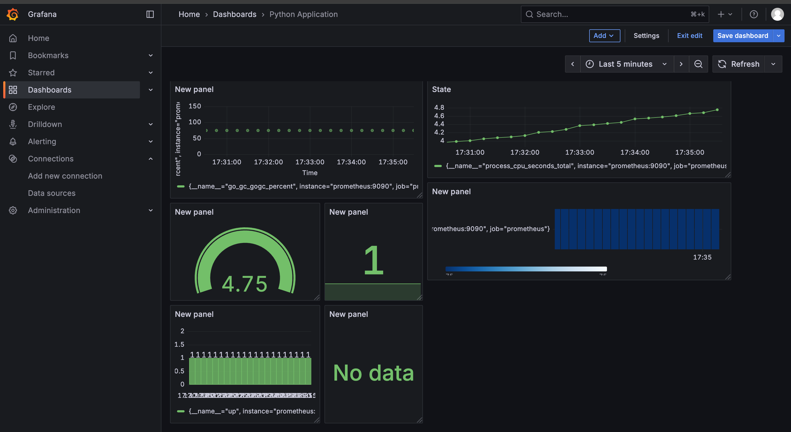
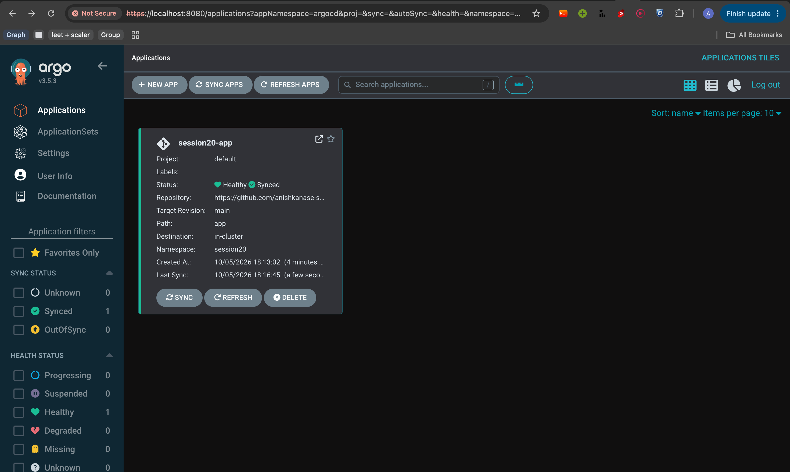
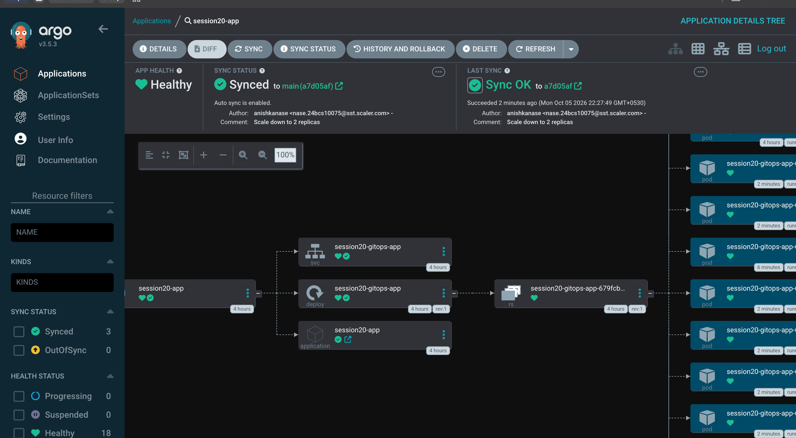
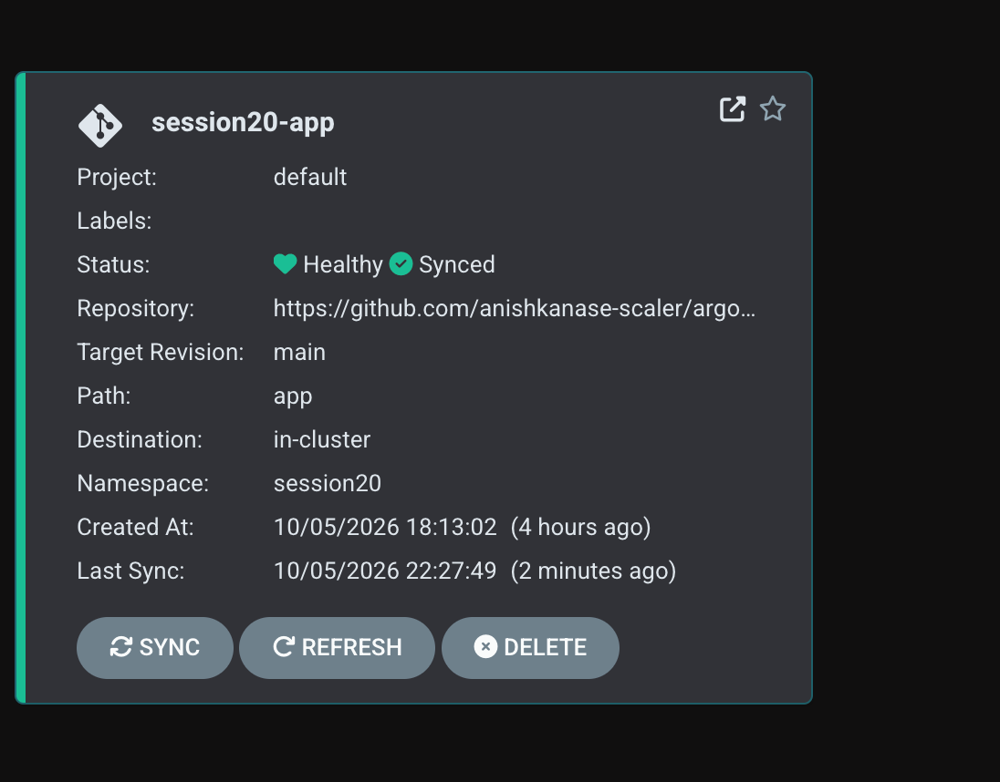
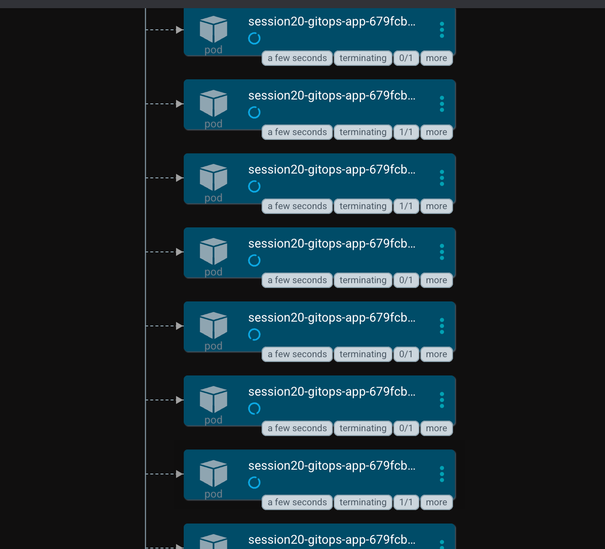
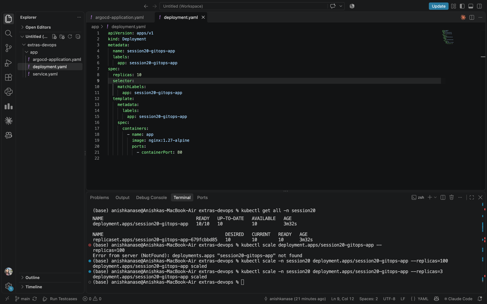

# Activate your Python virtual environment
source /Users/anishkanase/Term-7/Devops/.venv/bin/activate

# List open files and processes
lsof

# Check whether anything is listening on port 8080
lsof -i:8080

# Check Argo CD services
kubectl get svc -n argocd

# Forward local port 8080 to the Argo CD HTTPS service
kubectl port-forward svc/argocd-server -n argocd 8080:443

# Retrieve the initial Argo CD admin password
kubectl -n argocd get secret argocd-initial-admin-secret \
  -o jsonpath="{.data.password}" | base64 -d && echo

  # Add the Prometheus community chart repository
helm repo add prometheus-community https://prometheus-community.github.io/helm-charts

# Refresh repository information
helm repo update

# Install Prometheus and Grafana in a monitoring namespace
helm install prometheus prometheus-community/kube-prometheus-stack \
  --namespace monitoring \
  --create-namespace

# Check monitoring Pods
kubectl get pods -n monitoring

# Check monitoring Services
kubectl get svc -n monitoring

# Forward local port 3000 to Grafana
kubectl port-forward svc/prometheus-grafana 3000:80 -n monitoring

# Forward local port 9090 to Prometheus
kubectl port-forward svc/prometheus-kube-prometheus-prometheus 9090:9090 -n monitoring

# Show Helm releases
helm list -A

# Show monitoring Services
kubectl get svc -A

# Show monitoring Pods
kubectl get pods -A

# Inspect the Prometheus release
helm status prometheus -n monitoring

# Remove the monitoring stack, if the release and namespace match
helm uninstall prometheus -n monitoring

